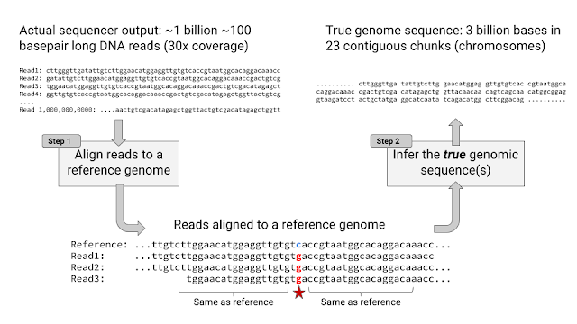
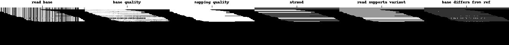
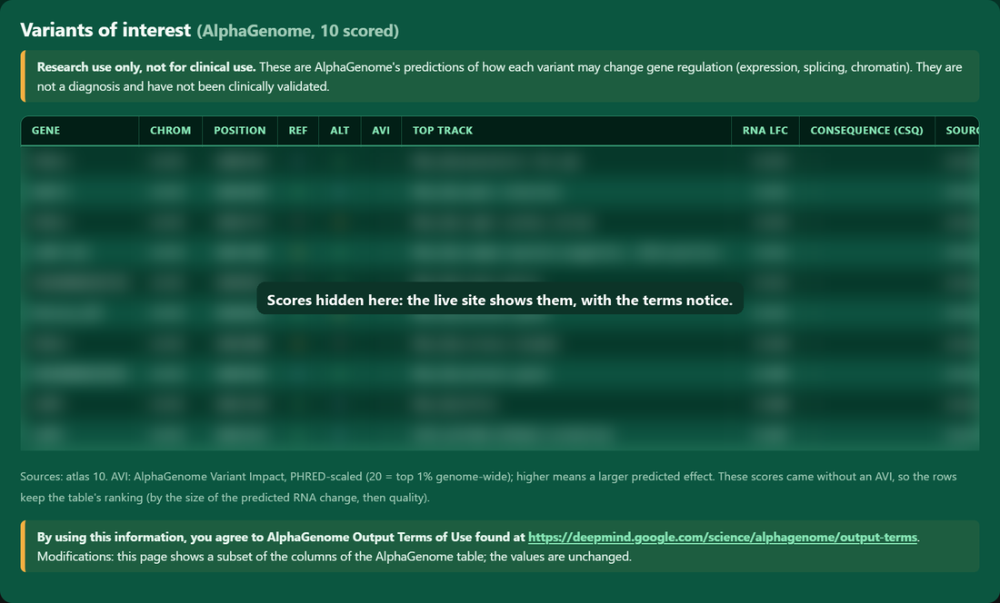

<div align="center">

<picture>
  <source media="(prefers-color-scheme: dark)" srcset="docs/assets/geyser-erupt-dark.gif">
  
</picture>

<h2>Upload a genome. Get your variants. In the cloud, for pennies.</h2>

</div>

For eighteen years I lived with an illness nobody could name. Then my mother, my father and I joined NHS England's **100,000 Genomes Project**, run by **Genomics England**, and gave blood so that all three of our genomes could be sequenced. We were told not to expect an answer. A year later one came: among three billion letters of DNA, a single ultra-rare mutation in the **COA3** gene, causing a mitochondrial defect. An answer like that depends on how well a pipeline reads a genome. So I built my own: Geyser Genomics turns a sequencer's raw reads into a list of variants faster, more accurately and for pennies, and tests pangenome-aware methods that see more of human diversity than a single reference genome can ([the full story](docs/story.md)).

<div align="center">

**Built with**

<p>
  
  
  
  
  <br/>
  
  
  
  
  
  
</p>

<sub>Google DeepVariant (GPU) · Google DeepMind AlphaGenome · GIAB / NIST reference genomes (HG003, HG005) · Human Pangenome Reference Consortium graphs with vg giraffe · AWS (Step Functions, Batch, Fargate Spot, GPU, CloudFront) · Terraform · Rust · Python · Docker · GitHub Actions with OIDC.<br/>These are the tools and data this project uses. It is not affiliated with or endorsed by any of their owners.</sub>

<table>
  <tr>
    <td align="center" width="20%"><h2>~3 h</h2>a whole human genome,<br/>reads to variants</td>
    <td align="center" width="20%"><h2>~$0.07</h2>one chromosome,<br/>in about 22 minutes</td>
    <td align="center" width="20%"><h2>−57% / −90%</h2>SNP / indel errors<br/>with DeepVariant</td>
    <td align="center" width="20%"><h2>2.4×</h2>faster DeepVariant<br/>calling on a GPU</td>
    <td align="center" width="20%"><h2>0</h2>stored AWS keys<br/>(CI signs in with OIDC)</td>
  </tr>
</table>

<sub>Measured on the GIAB reference genomes: HG003 whole genome at 30x in 2 h 59 min; HG003/HG005 chr20 in 21-23 min for $0.071-0.079 at on-demand list prices; DeepVariant against bcftools on the HG003 whole genome, scored with hap.py (SNP F1 0.9959, indel F1 0.9950); DeepVariant's <code>call_variants</code> on the same whole-genome examples, 27.2 min on the GPU against 66.5 min on CPU. <a href="docs/releases/README.md">The release notes</a> have every run.</sub>

<p>
  <a href="https://d1bp7nfasxklsf.cloudfront.net"></a>
  <a href="https://d1bp7nfasxklsf.cloudfront.net/figures/"></a>
  <a href="https://github.com/Harry5haw/Geyser-Genomics/releases"></a>
</p>

<p><a href="https://github.com/Harry5haw/Geyser-Genomics/actions/workflows/web-perf.yml"></a></p>

</div>

## What I built

**Python on AWS, end to end**
- **Python backend and data processing:** about 34,000 lines of Python. A CLI stage dispatcher, storage and metrics layers with S3/CloudWatch and local back ends behind one interface, two Lambdas (the S3 trigger, a web API with multipart presigned uploads), a provenance record per run, a Django app and the ops tooling.
- **Event-driven services on AWS:** an S3 upload fires a Lambda, which starts Step Functions. Each stage then runs as its own container on AWS Batch (Fargate Spot first, on-demand fallback, an EC2 GPU environment for DeepVariant). Five images, one per kind of job; stages talk only through S3 key conventions.
- **Resilience:** infrastructure failures (lost Spot hosts, failed task starts) are retried; tool failures and corrupt uploads fail at once, with a notification. Every stage and run has a time limit, and a pre-flight pass rejects a bad input in minutes, before any alignment. The 30x whole-genome run took 20 Spot interruptions, and every one was retried and recovered.
- **Performance, measured:** a 25-run cost × turnaround grid chose the job sizes. bwa-mem2 made alignment 1.56× faster, a slim image cut job start-up waits by 26%, and DeepVariant on a GPU calls 2.4× faster than on CPU.

**Distributed data processing at scale**
- **A whole human genome in 2 h 59 min:** 718 million reads streamed through a pre-flight check, dealt into 30 chunks aligned 15 at a time, merged in place over presigned HTTPS (no local copy), then called in 244 region shards, 48 at a time. On real chr20, the chunked route scores within 0.00005 F1 of a single alignment job.
- **Scatter-gather orchestration:** Step Functions `Parallel` and `Map` states, a size-based route (under or over 5 GB), and per-run overrides validated before any job starts. Calling shards read only their region of a 16 GB CRAM, with HTTP range reads checked against the ETag.

**Testing, infrastructure as code and delivery**
- **Test automation:** about 1,400 unit tests (about 40% of the code is tests), about 250 tests that run the deployed state machine in Step Functions Local, an offline S3 end-to-end suite on moto, and four Docker end-to-end suites. The pipeline's truth check builds a genome with planted mutations and fails unless exactly those are found.
- **Terraform:** about 3,600 lines over three state files (dev, web, account), with S3 state and locking. Every change is a reviewed plan, with the expected add/change/destroy counts written down before planning.
- **CI/CD and code review:** GitHub Actions with OIDC (no stored AWS keys, read-only CI roles). Every change goes through a pull request (170 merged) behind a protected `main` with 7 required checks and a code review. Work was tracked as issues, milestones and releases on a project board.
- **Cost guardrails:** a budget alert and a project budget whose kill switch attaches a deny-all policy by itself. A real chromosome costs about $0.07; between runs only storage costs anything.
- **Front end and observability:** a static results site on CloudFront (JavaScript: WebGL 3D figures in a Worker, multipart uploads up to 256 GiB). It has four themes including WCAG AAA high contrast and Lighthouse budgets in CI. A CloudWatch dashboard tracks runs, spend, stage durations and quality-gate results.

**The genomics**
- **Accuracy against the GIAB truth sets:** GPU DeepVariant cut SNP errors by 57% and indel errors by 90% against bcftools on the HG003 whole genome. Graph alignment (vg giraffe, Human Pangenome Reference Consortium graphs) halved DeepVariant's errors against BWA on chr20 (−51%).
- **A quality gate in Rust** fails a run that succeeded but isn't good enough, with named reasons, against thresholds calibrated on real genomes. **AlphaGenome annotation** scores the variants of interest, with an evaluation [pre-registered](docs/prereg/rp1-alphagenome.md) before any results.

**How it was built:** the code was written with Claude Code (Anthropic's AI coding agent); I designed the system and directed the work. The decisions and reviews were mine, and infrastructure changes ran under rules I set: Claude's applies needed a reviewed plan or a narrow standing approval, and account-level, compute and CDN changes were mine. The agents worked under a [bounded AWS role with its own kill switch](docs/design/claude-guardrails.md), and an AI-assistance log is kept with the project's write-up.

## What's new

- **v3.1 "Redesign"** (merged, not yet tagged): the web UI and hosted site in a Google-style look: four themes, the erupting logo, one progress helix across the stages, DeepVariant and AlphaGenome motion, rainbow figures with a 2D/3D toggle, and 256 GiB uploads.
- **[v3.0 "Alpha Genome"](docs/releases/v3.0.md)** (9 Nov 2026): AlphaGenome regulatory-effect scores for the variants of interest.
- **[v2.1 "Hosted"](docs/releases/v2.1.md)** (9 Nov 2026): the public results site on CloudFront, the web API and a Publish step after every run.
- **[v2.0 "XLR8"](docs/releases/v2.0.md)** (8 Nov 2026): whole genomes, GPU DeepVariant, and a real chromosome in ~22 minutes for ~$0.07.

In numbers, at the v3.0 tag: about 42,600 lines of code (Python, Terraform, Rust, JavaScript), 170 merged pull requests, 11 GitHub Releases, and 39 recorded cloud runs, from synthetic checkpoints to a 30x whole genome.

## Try it in 2 minutes, no AWS account

```bash
docker build -f Dockerfile -t geyser-app .            # every pipeline tool, pinned
python scripts/make_test_data.py                      # a small genome with 10 planted mutations
python scripts/run_local.py --sample SYNTH001 --reference synthetic_ref.fa --check   # all stages in Docker; finds all 10
```

Needs Docker and Python 3.11. More options (paired-end, sharded calling, DeepVariant on a local GPU, the tests) are in [docs/local-development.md](docs/local-development.md).

## Learn more

| | |
| :--- | :--- |
| [The full story](docs/story.md) | The Odyssey: 18 years to a diagnosis, and the maths of a 1 in 256 million chance |
| [Architecture and features](docs/architecture.md) | How it works, the diagrams, what each technology does, design goals, the repository layout |
| [Results and benchmarks](docs/results.md) | Accuracy (hap.py against GIAB), pangenome and graph alignment, cost and turnaround, GPU timing |
| [Run it locally](docs/local-development.md) | The offline pipeline, tests, the quality gate, DeepVariant on a local GPU |
| [Deployment](docs/deployment.md) · [Operations runbook](docs/operations.md) | Deploying with Terraform, starting and watching runs, monitoring, rollback |
| [Web UI](docs/web-ui.md) | The Django app and the published static site |
| [Release notes](docs/releases/README.md) · [Roadmap](docs/roadmap.md) · [Changelog](changelog.md) | What changed, release by release |
| [Design notes](docs/design/) · [Benchmark history](docs/benchmarks/README.md) · [Figures](docs/figures/README.md) | Why not Nextflow, guardrails, cloud DeepVariant, every hap.py result, how each figure is made |

## 🧬 Built on the shoulders of giants

Geyser is the plumbing: it runs proven open tools at cloud scale, checks their results and shows them. The science comes from these projects.

<table>
  <tr>
    <td width="50%" valign="top">
      <h3>DeepVariant (Google)</h3>
      
      
      <p>A neural network that looks at the reads around each candidate variant as an image and decides the genotype. In Geyser it runs on a cloud GPU and cuts errors against the classic caller by more than half.<br/>
      <sub>Images from the <a href="https://google.github.io/deepvariant/">DeepVariant blog</a>, © Google, BSD-3-Clause (<a href="docs/assets/third-party/deepvariant/NOTICE.md">notice</a>). Not affiliated with or endorsed by Google.</sub></p>
    </td>
    <td width="50%" valign="top">
      <h3>AlphaGenome (Google DeepMind)</h3>
      
      <p>An AI model that predicts how a DNA change may affect gene regulation. Geyser scores a run's variants of interest with it and shows them on the run's page, for research use only.<br/>
      <sub>Our own screenshot (CLOUD026), scores blurred: the live site shows them with the <a href="https://deepmind.google.com/science/alphagenome/output-terms">AlphaGenome output terms</a>. Read DeepMind's post on the <a href="https://deepmind.google/blog/alphagenome-atlas-a-predictive-map-of-every-possible-dna-letter-change-in-the-human-genome/">AlphaGenome Atlas</a>.</sub></p>
    </td>
  </tr>
</table>

Also: [fastp](https://github.com/OpenGene/fastp) (quality control), [bwa-mem2](https://github.com/bwa-mem2/bwa-mem2) (alignment), [samtools and bcftools](https://www.htslib.org/) (files and variant calling), [vg giraffe](https://github.com/vgteam/vg) (pangenome alignment) and the [GIAB](https://www.nist.gov/programs-projects/genome-bottle) truth sets that every number above is scored against.

## 🤝 Contributing, Security and Citing

- [CONTRIBUTING.md](CONTRIBUTING.md): set-up, the checks every change passes, branch/commit/PR conventions, and how infrastructure changes are reviewed.
- [SECURITY.md](SECURITY.md): how to report a vulnerability privately, and what is in scope.
- [CITATION.cff](CITATION.cff): how to cite Geyser and the tools and data it builds on (GitHub's "Cite this repository" uses it).
