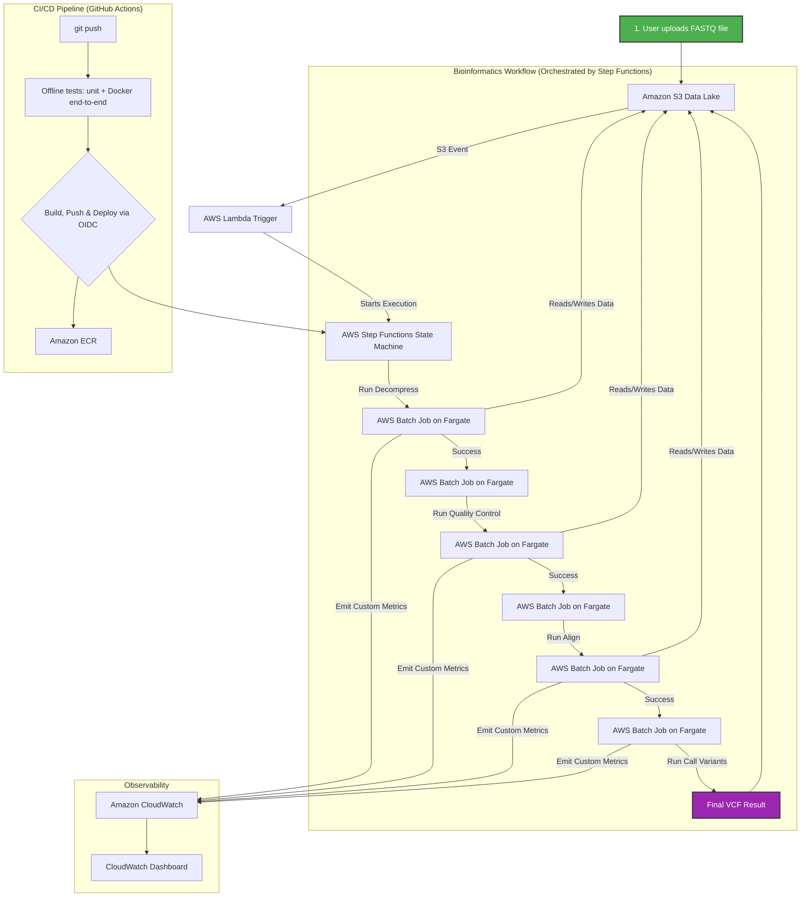

<div align="center">
  <h1>🌋 Geyser Genomics 🌋</h1>
  <p>
    <strong>A fully automated, cloud-native platform on AWS for scalable genomic data analysis.</strong>
  </p>
  
  <p>
    <a href="#️-project-status--features"></a>
    <a href="../../actions/workflows/tests.yml"></a>
  </p>

  <p>
    <a href="https://aws.amazon.com/"></a>
    <a href="https://www.terraform.io/"></a>
    <a href="https://github.com/features/actions"></a>
    <a href="https://aws.amazon.com/step-functions/"></a>
    <a href="https://www.python.org/"></a>
    <a href="https://www.docker.com/"></a>
 
  </p>
</div>

<!-- This is your banner image. It will be centered automatically. -->
<div align="center">
  
</div>

---

### 📋 Table of Contents

1.  [What is Geyser Genomics?](#-what-is-geyser-genomics) 
2.  [The Odyssey: Why This Project Exists](#-the-odyssey-why-this-project-exists)
3.  [The Challenge: From a DNA Sample to an Answer](#-the-challenge-from-a-dna-sample-to-an-answer)
4.  [The Impact: Key Benefits](#-the-impact-key-benefits)
5.  [Project Status & Features](#️-project-status--features)
6.  [How It Works: The Architecture](#️-how-it-works-the-architecture)
7.  [Technical Deep Dive](#-technical-deep-dive)
8.  [Run It Locally in 2 Minutes (No AWS)](#-run-it-locally-in-2-minutes-no-aws)
9.  [Deployment & Usage](#-deployment--usage)
10. [Roadmap](#-roadmap)

---

## 💡 What is Geyser Genomics?

Geyser Genomics is an **automated, serverless data processing platform**. Its purpose is to execute the complex scientific workflow that transforms raw, unreadable DNA data from a sequencing machine into a final, human-readable list of genetic variants.

It functions as a **robotic science lab in the cloud**. A scientist simply uploads their raw data file, and the platform automatically summons the necessary cloud resources, runs a multi-step bioinformatics analysis, and places the final results in a secure data lake, all with zero manual intervention.

**The Transformation: From Raw Data to Actionable Insight**

| Input | The Platform's Process (Automation) | Output |
| :--- | :--- | :--- |
| 🧬 **Raw Data File** <br> *(Millions of jumbled DNA fragments)* | 1. **Quality Control** on the raw data. <br> 2. **Alignment:** Compares data to a reference genome. <br> 3. **Variant Calling:** Identifies all differences. | 📄 **VCF File** <br> *(A clean list of genetic mutations)* |

The platform provides four key advantages:

*   ⚙️ **Fully Automated:** The entire pipeline is event-driven. An upload to S3 triggers the workflow, eliminating manual setup and human error.
*   🚀 **Infinitely Scalable:** Built on serverless AWS services like Step Functions and Fargate, the platform scales from zero to thousands of parallel jobs on demand, then scales back to zero.
*   💰 **Cost-Aware:** Compute is Fargate, which scales to zero, so analysis capacity costs nothing when idle. Supporting network infrastructure is being reworked so the platform's idle cost is close to zero too (see [Roadmap](#-roadmap)).
*   🔬 **Scientifically Rigorous:** Every tool is packaged in a version-controlled Docker container, and every change is tested against synthetic data with known mutations, so results are reproducible and verified.

---

## 🧭 The Odyssey: Why This Project Exists

This project was born from a profound, life-changing journey through the world of genomic medicine. It is a tribute to the pioneering work of NHS England and its **100,000 Genomes Project**.

> The NHS 100,000 Genomes Project is a landmark UK initiative aimed at sequencing the complete genetic codes of patients with rare diseases and their families. By creating this massive dataset, it seeks to uncover new diagnoses and pave the way for personalized medicine.

For eighteen years, my life was an odyssey through a fog of medical uncertainty with no linking diagnosis. As part of the project, my mother, my father, and I all donated our blood. Our entire genomes would be sequenced and explored, becoming three more data points in a vast ocean of information. We were told it was unlikely we would hear anything back.

<table align="center" border="0" cellspacing="0" cellpadding="10">
  <tr>
    <td align="center">
      
    </td>
    <td align="center">
      
    </td>
  </tr>
</table>

A year later, against all odds, I received a result. The project had delivered a link. In the three billion letters of my genetic code, they had found a single, ultra-rare mutation in the **COA3 gene**, causing a mitochondrial defect.

<table align="center" border="0" cellspacing="0" cellpadding="10">
  <tr>
    <td align="center">
      
    </td>
    <td align="center">
      
    </td>
  </tr>
</table>

The statistical probability of this discovery is staggering. The odds of both parents carrying the same rare recessive fault and passing it on is approximately **1 in 64 million**.

### The 1 in 64 Million Chance

This isn't a random number; it's grounded in a core concept of population genetics known as the **Hardy-Weinberg principle**. It's the scientific method for estimating how rare a genetic trait is. The principle is expressed with the equation:

$$ p^2 + 2pq + q^2 = 1 $$

This describes how genetic variations are distributed in a population, where `2pq` represents the probability of being a carrier—like my parents. The calculation itself is a straightforward product of these rare probabilities:

*   **🧑 Carrier Frequency:** The estimated chance of one person being a carrier (`2pq`) is **1 in 8,000**.
*   **🧑‍🤝‍🧑 Two Carriers Meet:** The probability of two such carriers meeting is therefore:

<p align="center">
  <code>(1 / 8,000)   ×   (1 / 8,000)   =   1 / 64,000,000</code>
</p>

My donated genome will now serve as a data point to help others, ensuring that a single-letter fault doesn't define another patient's life. My odyssey of discovery took two decades, but it doesn't need to be that way for others. With technologies like Geyser Genomics, we can accelerate these discoveries and build solutions that may one day repair the very code of life itself.

<table align="center" border="0" cellspacing="0" cellpadding="10">
  <tr>
    <td align="center" width="32%">
      
      <br><em>We can help eachother</em>
    </td>
    <td align="center" width="32%">
      
      <br><em>By looking within ourselves</em>
    </td>
    <td align="center" width="32%">
      
      <br><em>To build a better future</em>
    </td>
  </tr>
</table>

---

## 🤔 The Challenge: From a DNA Sample to an Answer

Analyzing genomes is incredibly difficult. Scientists face three major hurdles:

*    **The Data Deluge:** A single human genome can be over 100 gigabytes. Analyzing hundreds requires a staggering amount of storage and power.
*    **The Complex Recipe:** The analysis involves dozens of specialized scientific tools, each needing to be run in a specific order with precise parameters. One mistake can invalidate the results.
*    **The Hardware Hurdle:** This work traditionally requires buying and maintaining powerful, expensive server clusters that are difficult to manage and often sit idle.

---

## ✨ The Impact: Key Benefits

| Benefit | How Geyser Genomics Delivers |
| :--- | :--- |
| **Blazing Speed** | By using thousands of on-demand cloud CPUs in parallel, analyses that took weeks can now be completed in a matter of hours. |
| **Unwavering Reliability** | The automated workflow and version-controlled containers eliminate human error, producing consistent and trustworthy results every time. |
| **Drastic Cost Reduction** | Compute is serverless and scales to zero, so you pay for processing power only while an analysis is running. |
| **Empowered Scientists** | Researchers can run massive analyses without needing to be cloud experts, freeing them to focus entirely on the science. |

---

## 🗺️ Project Status & Features

The core pipeline (FASTQ → QC → alignment → VCF) is built and verified end to end. The platform is in active development: the cloud deployment is being hardened for cost and security before new features are added.

| Feature | Status | Description |
| :--- | :---: | :--- |
| **Bioinformatics Pipeline** | ✅ Complete | Decompress → FastQC → BWA-MEM alignment (sorted BAM) → bcftools variant calling. |
| **Offline Development & Testing** | ✅ Complete | The full pipeline runs locally in Docker with no AWS account. A pytest suite plus a Docker end-to-end test checks that planted mutations in synthetic data are recovered exactly. Runs on every push. |
| **Infrastructure as Code** | ✅ Complete | The entire AWS environment is defined in Terraform. |
| **Serverless Orchestration** | ✅ Complete | AWS Step Functions runs the four stages in order, with failure notifications via SNS. |
| **Scalable Compute Engine** | ✅ Complete | AWS Batch on Fargate provides containerized, on-demand compute that scales to zero. |
| **Event-Driven Workflow** | ✅ Complete | Uploading a file to the S3 data lake starts the pipeline automatically. |
| **Secure CI/CD (OIDC)** | 🚧 Under Construction | GitHub Actions authenticates to AWS with short-lived OIDC credentials (no stored keys), with separate dev and prod roles. Automatic deploys are paused while this is finalised. |
| **Cost-Safe Networking** | 🚧 Under Construction | Removing the always-on NAT gateway so that an idle platform costs close to nothing. |
| **Custom Monitoring** | 🚧 Under Construction | Each stage emits duration and failure metrics to CloudWatch, shown on dashboards. |
| **Google DeepVariant** | 🚧 Local GPU working, cloud pending | Deep-learning variant calling as an alternative to bcftools. It runs locally on an NVIDIA GPU in Docker, with accuracy and timings measured honestly (see below). The GPU-backed AWS Batch stage is designed but not deployed. |
| **Web UI Front-End** | ✅ Complete | A Django app for uploading samples, generating demo data and browsing results (FastQC, variants, downloads). Works offline. See [Web UI](#-web-ui). |

---

## 🛠️ How It Works: The Architecture

This platform is built on a modern, event-driven, serverless architecture. There are no virtual machines or servers to manage.



---

## 🤖 Technical Deep Dive

The platform's design is guided by modern cloud-native principles:

| Technology | Role & Rationale |
| :--- | :--- |
| **Terraform** | **The Cloud Architect.** Defines all AWS resources (VPC, S3, IAM, ECR, Batch) as code. This ensures a consistent, repeatable, and secure deployment every time. |
| **AWS Step Functions** | **The Serverless Conductor.** Replaces the operational burden of self-hosting an orchestrator like Airflow. It translates the scientific pipeline into a resilient, managed state machine, handling state, error handling, and parallelism. |
| **AWS Batch + Fargate** | **The Serverless Compute Engine.** Manages a fleet of on-demand, containerized compute resources. It handles job queuing, scheduling, and scaling from zero to thousands of CPUs, eliminating the need to manage a cluster. |
| **Docker** | **The Reproducible Toolbox.** Packages all bioinformatics tools (`FastQC`, `BWA`, `Samtools`, etc.) and their specific dependencies into a single, portable container image. This guarantees scientific reproducibility. |
| **GitHub Actions**| **The CI/CD Engine.** Every push runs the offline test suite. The deploy workflow builds the Docker image, pushes it to ECR and applies Terraform, authenticating with short-lived OIDC credentials instead of stored AWS keys. |
| **pytest + synthetic data**| **The Safety Net.** A generator creates a small reference genome and simulated reads with known mutations. The end-to-end test runs every stage in Docker and requires the final VCF to contain exactly those mutations. |
| **Amazon S3**| **The Data Lake.** Provides durable, scalable, and cost-effective storage for massive genomic datasets. It serves as the event source for the pipeline and the single source of truth for all data. |
| **Python**| The primary language for the bioinformatics application logic (`app/tasks.py`) and for interacting with AWS services via the `boto3` SDK. |

---

## 💻 Run It Locally in 2 Minutes (No AWS)

The whole pipeline runs on a laptop. Each stage runs in its own container from the same image the cloud uses, and a local folder (`local_bucket/`) stands in for the S3 data lake with the same layout.

**Prerequisites:** Docker and Python 3.11.

```bash
# 1. Build the pipeline image (FastQC, BWA, samtools, bcftools)
docker build -f Dockerfile -t geyser-app .

# 2. Create a synthetic genome and 30x reads with 10 known mutations planted in them
python scripts/make_test_data.py

# 3. Run all four stages in order, just as Step Functions would, then check the VCF against the truth
python scripts/run_local.py --sample SYNTH001 --reference synthetic_ref.fa --check
```

Expected result: `Truth check (bcftools): 10/10 planted SNPs called, 0 unexpected calls`

**Tests:**

```bash
pip install -r requirements-dev.txt
pytest                                           # unit tests, no Docker needed
GEYSER_E2E=1 pytest tests/test_e2e_docker.py     # full pipeline in Docker
```

The tests also check that the stage list in the Step Functions definition (`infrastructure/step_functions.tf`), the stage code (`app/tasks.py`) and the local runner all agree.

The storage and metrics backends are chosen by environment variables, so the same code runs locally and in AWS:

| Variable | Values | Default |
| :--- | :--- | :--- |
| `STORAGE_BACKEND` | `s3`, `local` | `s3` |
| `LOCAL_STORAGE_DIR` | path to the local data lake | `local_bucket` |
| `METRICS_BACKEND` | `cloudwatch`, `local`, `none` | `cloudwatch` for S3, `local` otherwise |

### DeepVariant on a local NVIDIA GPU

[Google DeepVariant](https://github.com/google/deepvariant) `1.10.0` is available as an alternative variant caller, in its own image (`app-deepvariant/`). It reads the same `alignments/<id>.bam` and writes `variants_deepvariant/<id>.vcf.gz`, so its calls can be compared with the bcftools calls.

```bash
docker run --rm --gpus all nvidia/cuda:12.3.2-base-ubuntu22.04 nvidia-smi   # GPU visible to Docker?
docker build -f app-deepvariant/Dockerfile -t geyser-deepvariant .
python scripts/run_local.py --sample SYNTH001 --reference synthetic_ref.fa --caller both --check

# Real data: NA12878, chr20:10.0-10.1 Mb, with the GIAB truth set (~5 MB download)
python scripts/fetch_dv_testdata.py
python scripts/run_local.py --sample NA12878_S1 --reference ucsc.hg19.chr20.unittest.fasta \
    --caller both --skip-to-variants --check

# Whole chromosome: HG003, NovaSeq 35x, all of chr20 on GRCh38, with GIAB v4.2.1 truth (~1.34 GB download)
python scripts/fetch_dv_testdata.py --dataset hg003-chr20
python scripts/run_local.py --sample HG003_chr20 --reference GRCh38_chr20.fa \
    --caller deepvariant --skip-to-variants --check --dv-memory 12g
```

**Accuracy:**

| Data | bcftools | DeepVariant |
| :--- | :--- | :--- |
| Synthetic | 10/10 planted SNPs, 0 extra calls | 10/10 planted SNPs, 0 extra calls (with or without its small model) |
| NA12878 slice, GIAB confident regions | 45 TP, 4 FN, 4 FP | 49 TP, 0 FN, 0 FP |
| HG003 whole chr20, GIAB v4.2.1 confident regions | 70,773 TP, 10,737 FN, 11,077 FP (recall 0.868, precision 0.865) | 81,172 TP, 338 FN, 108 FP (recall 0.996, precision 0.999) |

The real-data comparisons use exact (position, ref, alt) matching without variant normalisation, so they are indicative only. They are not a hap.py benchmark. This method penalises bcftools' indel representation in particular, so its true gap is probably smaller. DeepVariant's accuracy counts were identical on the GPU and the CPU. With the small model off, they changed by one: 81,173 TP, 337 FN, 107 FP.

**Timing: whole chromosome.** HG003 chr20, 35x, measured on an RTX 3080 (10 GB) under Docker Desktop/WSL2 with 16 CPUs, one run per configuration. These are times for the DeepVariant stage only:

| Device | Small model | Examples sent to the neural network | make_examples (CPU) | call_variants (GPU step) | postprocess (CPU) | Stage total |
| :--- | :--- | ---: | ---: | ---: | ---: | ---: |
| GPU | on (default) | 79,759 | 298.6 s | **128.1 s** | 17.5 s | **466.7 s** (7.8 min) |
| CPU | on (default) | 79,759 | 306.8 s | **426.5 s** | 21.6 s | **776.4 s** (12.9 min) |
| GPU | off | 222,978 | 303.5 s | 266.5 s | 20.5 s | 609.9 s (10.2 min) |
| CPU | off | 222,978 | 336.4 s | 1,200.5 s | 16.9 s | 1,575.4 s (26.3 min) |

**At whole-chromosome scale the GPU pays off.**
- With default settings, `call_variants` is **3.3× faster** on the GPU and the whole stage is **1.7× faster**. With the small model off, `call_variants` is 4.5× faster: about 840 examples/s on the GPU against about 190 on the CPU.
- The stage gains less than `call_variants` does, because `make_examples` (about 300 s) runs on the CPU on either image. It is the largest step on the GPU.
- The small model is itself a CPU speed-up: it makes 64% of the calls before the neural network is involved.
- bcftools took 409 s for the same chromosome.

The CPU runs used a 12 GB container cap (`--dv-memory 12g`) and `--call_variants_extra_args=batch_size=256`. Without a cap, CPU `call_variants` took most of the 16 GB Docker VM and starved Windows. An 8 GB cap was too small for 16 `make_examples` shards.

**Timing: small inputs.** Same machine, median of 3 runs:

| Data | Device | Small model | Examples sent to the neural network | make_examples (CPU) | call_variants (GPU step) | postprocess (CPU) | Stage total |
| :--- | :--- | :--- | ---: | ---: | ---: | ---: | ---: |
| Synthetic 50 kb | GPU | on | 0 | 13.8 s | 4.7 s | 6.1 s | 27.7 s |
| Synthetic 50 kb | CPU | on | 0 | 15.0 s | 4.0 s | 6.0 s | 27.6 s |
| Synthetic 50 kb | GPU | off | 10 | 13.2 s | 18.7 s | 5.9 s | 41.1 s |
| Synthetic 50 kb | CPU | off | 10 | 12.2 s | 12.3 s | 5.7 s | 32.9 s |
| NA12878 100 kb | GPU | on | 90 | 33.6 s | 18.5 s | 5.7 s | 61.2 s |
| NA12878 100 kb | CPU | on | 90 | 34.2 s | 13.4 s | 5.6 s | 56.5 s |
| NA12878 100 kb | GPU | off | 305 | 33.3 s | 20.0 s | 6.6 s | 63.3 s |
| NA12878 100 kb | CPU | off | 305 | 32.9 s | 14.3 s | 5.7 s | 56.2 s |

**On small inputs the GPU is 5–6 s slower than the CPU.** With at most a few hundred examples, `call_variants` time is almost entirely fixed start-up: loading the model and initialising CUDA and cuDNN. The GPU's start-up costs more than TensorFlow's on the CPU. On the synthetic data, the small model makes every call, so the neural network sees nothing. `nvidia-smi` sampling confirmed the GPU was used: utilisation peaked at 98%, and TensorFlow reserved nearly all free VRAM.

**Tests.** `GEYSER_GPU_E2E=1 pytest tests/test_e2e_deepvariant.py` runs the GPU image. `GEYSER_DV_E2E=1` runs the CPU image; CI runs that one on pull requests, because GitHub runners have no GPU. Setting `GEYSER_DV_TESTDATA=<bucket>` also runs the real slice. Cloud deployment (AWS Batch GPU queue) is designed but not built yet; see [`app-deepvariant/README.md`](app-deepvariant/README.md).

---

## 🖥️ Web UI

A small Django front end in `web/`. You can upload a gzipped FASTQ, or click **Generate demo sample** to create synthetic reads with known SNPs. Each stage turns green as it finishes. You then get the FastQC report, a table of called variants (with a "10/10 planted SNPs recovered" check for demo samples) and download links for every intermediate file.

```bash
docker build -f Dockerfile -t geyser-app .          # once: the pipeline image
pip install -r requirements-dev.txt                 # includes web/requirements.txt
python web/dev.py                                   # UI + local worker on http://127.0.0.1:8000
```

**How it fits the architecture.** The UI only reads and writes storage keys, through `app/storage.py`, and never runs the pipeline itself. An upload is stored at `raw_reads/<id>.fastq.gz`, and that key is the trigger:

| | Cloud | Offline |
| :--- | :--- | :--- |
| Storage | S3 (`STORAGE_BACKEND=s3`) | `local_bucket/` folder |
| Trigger | S3 event → Lambda → Step Functions | `manage.py runworker` polls `raw_reads/` → `scripts/run_local.py` |
| Stage status | from the output keys | from the output keys + `metrics/metrics.jsonl` + `runs/<id>.json` |

There is no database. Status is worked out from which outputs exist, the local metrics file and the worker's run records (`runs/<id>.json` and `.log`). The same UI could therefore run against the S3 bucket with no worker.

**Settings** (environment variables): `DJANGO_DEBUG` (default **off**), `DJANGO_SECRET_KEY` (required when DEBUG is off), `DJANGO_ALLOWED_HOSTS`, `DJANGO_HTTPS=1` behind TLS (secure cookies, HSTS, redirect), `GEYSER_MAX_UPLOAD_MB` (default 200), `REFERENCE_NAME` for the worker (default `synthetic_ref.fa`), and `GEYSER_RUNNER=docker|host`. The storage variables are the same as the pipeline's, except that the UI defaults to `local`.

**Safety.** CSRF protection is on. Sample IDs are restricted to `[A-Za-z0-9_-]` because they become storage keys. Uploads must be gzip and within the size limit, and a sample can't be overwritten. Downloads are limited to a fixed list of file types. The FastQC report is shown in a sandboxed iframe.

**Tests:** `pytest` runs the web tests too (`web/tests/`, Django test client, temporary storage folder, no Docker).

---

## 🚀 Deployment & Usage

### 1. The Deployment Process
The infrastructure is deployed by the GitHub Actions workflow `.github/workflows/deploy-platform.yml`, which builds the image, pushes it to ECR and runs Terraform. It authenticates to AWS with GitHub OIDC (short-lived credentials, no stored keys), and separate IAM roles are scoped to the `dev` and `prod` GitHub environments.

> **Note:** automatic deployment is currently paused while the networking is reworked for cost. All development and testing happens offline (see above).

**Prerequisites for CI/CD:**
*   An AWS Account, with the GitHub OIDC identity provider configured.
*   GitHub environments `dev` and `prod`.
*   The following secrets configured in the GitHub repository settings:
    *   `AWS_REGION`: The target AWS region (e.g., `eu-west-2`).
    *   `ECR_IAM_ROLE_ARN`: The ARN of the IAM role for building and pushing to ECR.
    *   `TERRAFORM_IAM_ROLE_ARN`: The ARN of the IAM role for running Terraform.

### 2. How to Use the Platform (Event-Driven)
Once deployed, using the platform is as simple as uploading a file.

1.  **Locate the S3 Data Lake:** Find the S3 bucket created by Terraform. Its name has the format `<project_name>-data-lake-<random-suffix>`.
2.  **Upload Raw Data:** Upload your gzipped FASTQ file to the `raw_reads/` prefix, e.g. `raw_reads/SRR062634.fastq.gz`. The sample ID is the part of the filename before the first dot.
3.  **Monitor the Execution:** The upload automatically starts the Step Functions state machine. You can follow its progress in the AWS Step Functions console.
4.  **Retrieve Results:** When the run succeeds, the outputs are in the same bucket:

| Stage | Output |
| :--- | :--- |
| Decompress | `decompressed/<id>.fastq` |
| Quality control | `qc_reports/<id>_fastqc.html` and `.zip` |
| Alignment | `alignments/<id>.bam` (coordinate-sorted) |
| Variant calling | `variants/<id>.vcf.gz` |

### 3. Dashboard Management
The custom CloudWatch Dashboard provides real-time performance metrics for the pipeline. Due to the complexity of its JSON definition and the unreliability of managing it via Terraform, this resource is managed by a dedicated Python script.

To deploy or update the dashboard, run the following command from the project root:
```bash
python scripts/deploy_dashboard.py
```

---

## 🧭 Roadmap

1. **Cost-safe cloud deployment:** make the NAT gateway optional (off by default), run Fargate jobs in public subnets, set a lifecycle policy on ECR and short log retention, and add an AWS Budget alert.
2. **CI/CD hardening:** finish the OIDC role separation, restrict `prod` to `main` with required review, and make deploys manual rather than automatic on every push.
3. **Monitoring:** finish the CloudWatch dashboards for stage durations and failures.
4. **Google DeepVariant in the cloud:** the stage already runs locally on a GPU and has been measured on a whole chromosome. Still to do: wire it into Step Functions as a parallel branch on the GPU Batch queue.
5. **Web UI:** a Django front end for uploading samples and browsing results.
