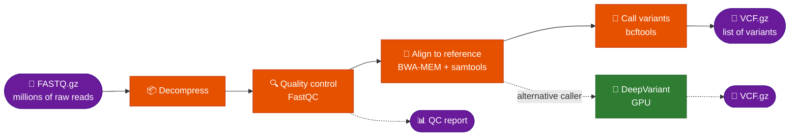
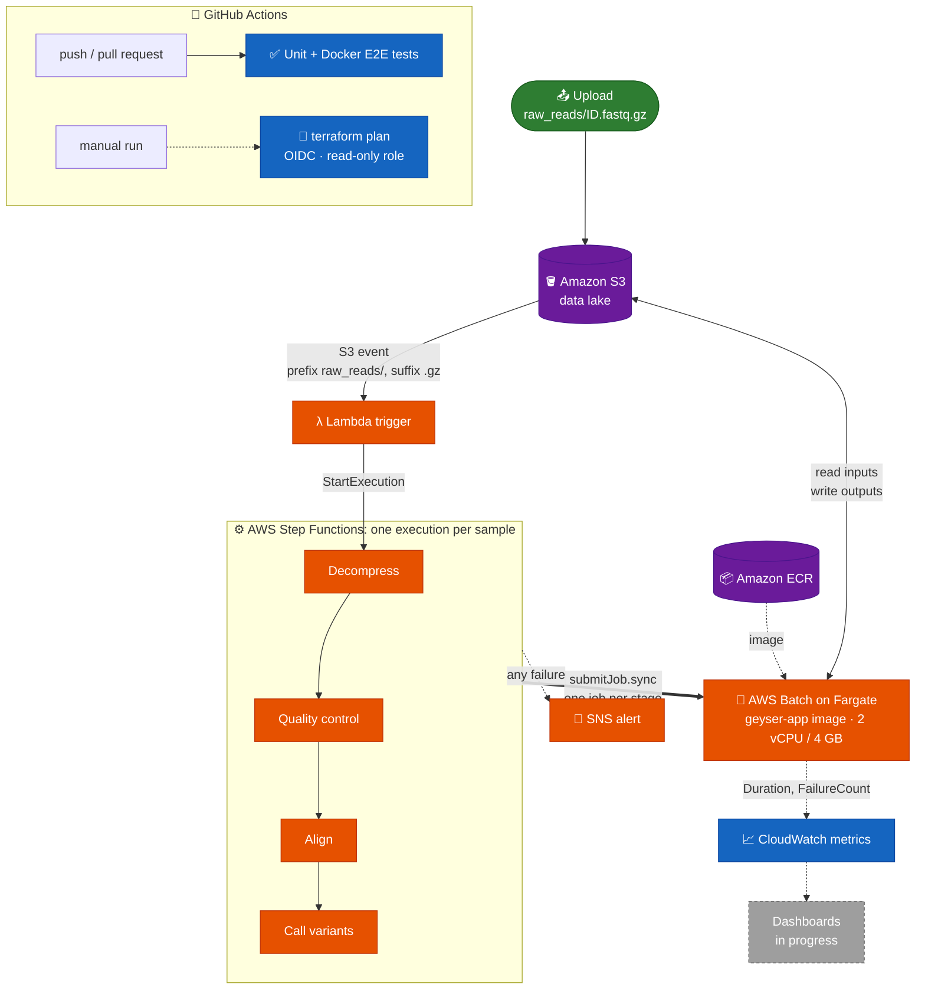
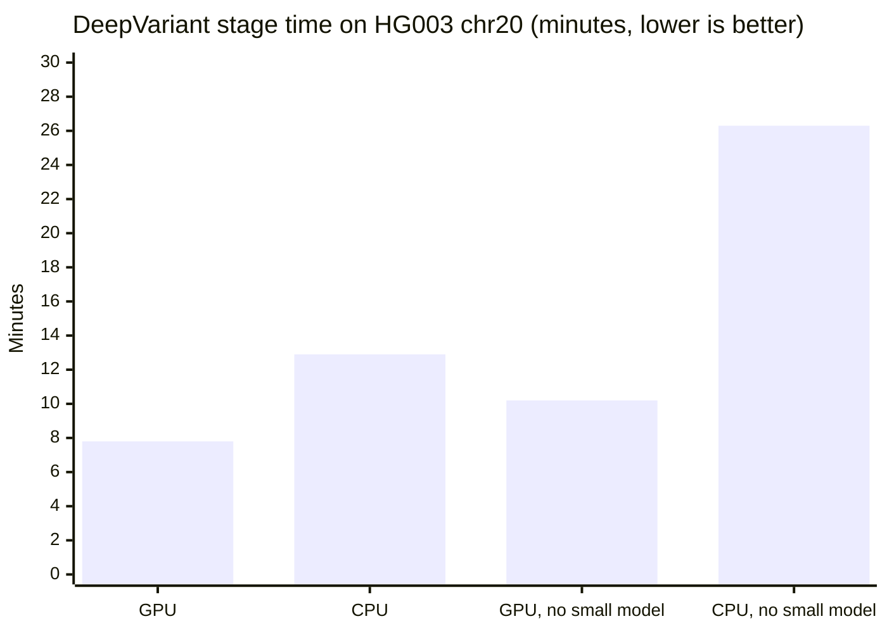

<div align="center">


<h1>🌋 Geyser Genomics</h1>

<p><strong>An event-driven AWS pipeline that turns raw DNA sequencing reads into a list of genetic variants,<br/>built and tested offline first.</strong></p>

<p>
  <a href="#️-project-status--features"></a>
</p>

<p>
  
  
  
  
  <br/>
  
  
  
  
  
</p>

<p>
  <a href="#-run-it-locally-in-2-minutes-no-aws"><b>🚀 Quickstart</b></a> &nbsp;·&nbsp;
  <a href="#️-how-it-works-the-architecture"><b>🏗️ Architecture</b></a> &nbsp;·&nbsp;
  <a href="#️-project-status--features"><b>🗺️ Status</b></a> &nbsp;·&nbsp;
  <a href="#deepvariant-on-a-local-nvidia-gpu"><b>🧠 DeepVariant</b></a> &nbsp;·&nbsp;
  <a href="#️-roadmap"><b>🛣️ Roadmap</b></a>
</p>

<table>
  <tr>
    <td align="center" width="20%"><h3>4</h3>containerised<br/>pipeline stages</td>
    <td align="center" width="20%"><h3>10 / 10</h3>planted SNPs recovered<br/>on every push</td>
    <td align="center" width="20%"><h3>0.996</h3>DeepVariant recall<br/>on HG003 chr20*</td>
    <td align="center" width="20%"><h3>3.3×</h3>faster neural-network step<br/>on an RTX 3080 GPU</td>
    <td align="center" width="20%"><h3>0</h3>stored AWS keys<br/>in CI (OIDC)</td>
  </tr>
</table>

<sub>* Indicative: exact-match comparison against GIAB v4.2.1, not a hap.py benchmark. See <a href="#deepvariant-on-a-local-nvidia-gpu">DeepVariant</a>.</sub>

</div>

---

### 📋 Table of Contents

1.  [What is Geyser Genomics?](#-what-is-geyser-genomics) 
2.  [The Odyssey: Why This Project Exists](#-the-odyssey-why-this-project-exists)
3.  [The Challenge: From a DNA Sample to an Answer](#-the-challenge-from-a-dna-sample-to-an-answer)
4.  [Design Goals and Where They Stand](#-design-goals-and-where-they-stand)
5.  [Project Status & Features](#️-project-status--features)
6.  [How It Works: The Architecture](#️-how-it-works-the-architecture)
7.  [Technical Deep Dive](#-technical-deep-dive)
8.  [Run It Locally in 2 Minutes (No AWS)](#-run-it-locally-in-2-minutes-no-aws)
9.  [Web UI](#️-web-ui)
10. [Deployment & Usage](#-deployment--usage)
11. [Roadmap](#️-roadmap)

---

## 💡 What is Geyser Genomics?

Geyser Genomics is an **event-driven bioinformatics pipeline**. It takes raw DNA data from a sequencing machine (a gzipped FASTQ file) and turns it into a list of genetic variants (a VCF file).

In the cloud design, uploading a file to S3 starts the run. AWS Step Functions then runs each stage as a container on AWS Batch, and the results are written back to the same bucket. The same containers also run on a laptop against a local folder, which is how the project is developed and tested.

**From raw reads to variants**



What it does today:

*   ⚙️ **Event-driven:** an upload to the `raw_reads/` prefix starts the workflow. No one has to launch the stages by hand.
*   📦 **Containerised and on demand:** every stage runs in the same Docker image on AWS Batch (Fargate). Compute only runs while a job is running. The Fargate environment is capped at 16 vCPUs, which is up to 8 jobs at once.
*   💰 **Cost-conscious:** there is no always-on NAT gateway (it is optional and off by default). ECR images and logs are pruned automatically, and an AWS Budget alert fires at $10 a month. Idle cost is mostly storage.
*   🧪 **Tested offline:** every push runs the unit tests and a Docker end-to-end run on synthetic data with known mutations. The run must recover exactly those mutations.

> [!NOTE]
> **Where it stands:** the pipeline is verified locally in Docker. The AWS infrastructure is defined in Terraform and deployed, but the cloud pipeline has not been run end to end since the cost and security changes of November 2026. The next milestone is pangenome-aware variant calling, built and benchmarked locally first.

---

## 🧭 The Odyssey: Why This Project Exists

This project was born from a profound, life-changing journey through the world of genomic medicine. It is a tribute to the pioneering work of NHS England and its **100,000 Genomes Project**.

> The NHS 100,000 Genomes Project is a landmark UK initiative aimed at sequencing the complete genetic codes of patients with rare diseases and their families. By creating this massive dataset, it seeks to uncover new diagnoses and pave the way for personalized medicine.

For eighteen years, my life was an odyssey through a fog of medical uncertainty with no linking diagnosis. As part of the project, my mother, my father, and I all donated our blood. Our entire genomes would be sequenced and explored, becoming three more data points in a vast ocean of information. We were told it was unlikely we would hear anything back.

<table align="center" border="0" cellspacing="0" cellpadding="10">
  <tr>
    <td align="center">
      
    </td>
    <td align="center">
      
    </td>
  </tr>
</table>

A year later, against all odds, I received a result. The project had delivered a link. In the three billion letters of my genetic code, they had found a single, ultra-rare mutation in the **COA3 gene**, causing a mitochondrial defect.

<table align="center" border="0" cellspacing="0" cellpadding="10">
  <tr>
    <td align="center">
      
    </td>
    <td align="center">
      
    </td>
  </tr>
</table>

The statistical probability of this discovery is staggering. The odds of both parents carrying the same rare recessive fault and passing it on is approximately **1 in 64 million**.

### The 1 in 64 Million Chance

This isn't a random number; it's grounded in a core concept of population genetics known as the **Hardy-Weinberg principle**. It's the scientific method for estimating how rare a genetic trait is. The principle is expressed with the equation:

$$ p^2 + 2pq + q^2 = 1 $$

This describes how genetic variations are distributed in a population, where `2pq` represents the probability of being a carrier—like my parents. The calculation itself is a straightforward product of these rare probabilities:

*   **🧑 Carrier Frequency:** The estimated chance of one person being a carrier (`2pq`) is **1 in 8,000**.
*   **🧑‍🤝‍🧑 Two Carriers Meet:** The probability of two such carriers meeting is therefore:

<p align="center">
  <code>(1 / 8,000)   ×   (1 / 8,000)   =   1 / 64,000,000</code>
</p>

My donated genome will now serve as a data point to help others, ensuring that a single-letter fault doesn't define another patient's life. My odyssey of discovery took two decades, but it doesn't need to be that way for others. With technologies like Geyser Genomics, we can accelerate these discoveries and build solutions that may one day repair the very code of life itself.

<table align="center" border="0" cellspacing="0" cellpadding="10">
  <tr>
    <td align="center" width="32%">
      
      <br><em>We can help eachother</em>
    </td>
    <td align="center" width="32%">
      
      <br><em>By looking within ourselves</em>
    </td>
    <td align="center" width="32%">
      
      <br><em>To build a better future</em>
    </td>
  </tr>
</table>

---

## 🤔 The Challenge: From a DNA Sample to an Answer

Analyzing genomes is incredibly difficult. Scientists face three major hurdles:

*    **The Data Deluge:** A single human genome can be over 100 gigabytes. Analyzing hundreds requires a staggering amount of storage and power.
*    **The Complex Recipe:** The analysis involves dozens of specialized scientific tools, each needing to be run in a specific order with precise parameters. One mistake can invalidate the results.
*    **The Hardware Hurdle:** This work traditionally requires buying and maintaining powerful, expensive server clusters that are difficult to manage and often sit idle.

---

## ✨ Design Goals and Where They Stand

| Goal | Approach | Where it is today |
| :--- | :--- | :--- |
| **Reproducible results** | All tools pinned in one Docker image; synthetic data with planted mutations as a truth check | Done. The end-to-end test runs on every push. |
| **No manual steps** | An S3 upload triggers Lambda, which starts Step Functions | Built in Terraform. Not yet re-tested in the cloud. |
| **Pay only while running** | Batch on Fargate, no NAT gateway, budget alert | Applied. Storage is the remaining idle cost. |
| **Scale out across samples** | Each upload is its own Step Functions execution | Limited by design: one sample per run, stages in sequence, up to 8 Fargate jobs at once. |
| **Accessible to non-cloud users** | A web UI for uploading samples and browsing results | Works offline against the local folder. Not yet connected to S3 or deployed. |

---

## 🗺️ Project Status & Features

The core pipeline (FASTQ → QC → alignment → VCF) is built and verified end to end **locally in Docker**. The AWS side is defined and deployed, and has just been hardened for cost and security. It has not been run end to end since then.

| Feature | Status | Description |
| :--- | :---: | :--- |
| **Bioinformatics Pipeline** | ✅ Verified locally | Decompress → FastQC → BWA-MEM alignment (sorted BAM) → bcftools variant calling. |
| **Offline Development & Testing** | ✅ Complete | The full pipeline runs locally in Docker with no AWS account. A pytest suite plus a Docker end-to-end test checks that planted mutations in synthetic data are recovered exactly. Runs on every push. |
| **Infrastructure as Code** | ✅ Complete | The project's AWS resources are defined in Terraform. Changes are planned and applied by hand after review. |
| **Orchestration & Trigger** | 🟡 Built, cloud re-test pending | S3 upload → Lambda → Step Functions runs the four stages in order on AWS Batch (Fargate), with failure notifications via SNS. |
| **CI Authentication (OIDC)** | ✅ Complete | GitHub Actions gets short-lived AWS credentials through OIDC, with no stored keys. Separate dev and prod roles; the Terraform roles are read-only, and prod only trusts the `main` branch. |
| **Automated Deployment** | ⏸️ Not yet | CI runs tests only. The Terraform workflow can only plan, is manual, and is currently disabled. Deploys are done locally. |
| **Cost Safety** | ✅ Applied | NAT gateway optional and off, Fargate jobs in a public subnet, ECR and log retention limits, $10 monthly budget alert. |
| **Custom Monitoring** | 🚧 In progress | Each stage emits duration and failure metrics (CloudWatch, or a local file offline). The dashboard and alarm are scripted and tested offline, not yet deployed (see [Monitoring](#3-monitoring)). |
| **Google DeepVariant** | 🚧 Local GPU working, cloud pending | Deep-learning variant calling as an alternative to bcftools. It runs locally on an NVIDIA GPU in Docker, with accuracy and timings measured (see below). A GPU Batch environment exists in AWS, but the stage is not wired into Step Functions and needs larger instances. |
| **Web UI Front-End** | ✅ Works offline | A Django app for uploading samples, generating demo data and browsing results (FastQC, variants, downloads). Runs locally; not deployed. See [Web UI](#️-web-ui). |

---

## 🛠️ How It Works: The Architecture

The design is event-driven and uses managed AWS services, so there are no servers to look after for the main pipeline. (The planned DeepVariant stage uses GPU instances that AWS Batch starts and stops.)



---

## 🤖 Technical Deep Dive

The platform's design is guided by modern cloud-native principles:

| Technology | Role & Rationale |
| :--- | :--- |
| **Terraform** | **The Cloud Architect.** Defines the AWS resources (VPC, S3, IAM, ECR, Batch, Step Functions, Lambda) as code, so the environment can be reviewed in a plan before anything changes. |
| **AWS Step Functions** | **The Conductor.** Replaced a self-hosted Airflow setup from earlier in the project. A managed state machine runs the stages in order and routes any failure to an SNS notification. |
| **AWS Batch + Fargate** | **The Compute Engine.** Runs each stage as a container job (2 vCPU / 4 GB) with queuing and scheduling handled by AWS. The compute environment is capped at 16 vCPUs, which keeps costs bounded. |
| **Docker** | **The Reproducible Toolbox.** Packages all bioinformatics tools (`FastQC`, `BWA`, `Samtools`, etc.) and their specific dependencies into a single, portable container image. This guarantees scientific reproducibility. |
| **GitHub Actions**| **The CI Engine.** Every push and pull request runs the offline test suite. A manual workflow can run `terraform plan` with short-lived OIDC credentials and a read-only role. It cannot apply changes. |
| **pytest + synthetic data**| **The Safety Net.** A generator creates a small reference genome and simulated reads with known mutations. The end-to-end test runs every stage in Docker and requires the final VCF to contain exactly those mutations. |
| **Amazon S3**| **The Data Lake.** Holds the inputs, every intermediate file and the results, under fixed key prefixes. An upload to `raw_reads/` is the event that starts the pipeline. |
| **Python**| The primary language for the bioinformatics application logic (`app/tasks.py`) and for interacting with AWS services via the `boto3` SDK. |

---

## 💻 Run It Locally in 2 Minutes (No AWS)

The whole pipeline runs on a laptop. Each stage runs in its own container from the same image the cloud uses, and a local folder (`local_bucket/`) stands in for the S3 data lake with the same layout.

**Prerequisites:** Docker and Python 3.11.

```bash
# 1. Build the pipeline image (FastQC, BWA, samtools, bcftools)
docker build -f Dockerfile -t geyser-app .

# 2. Create a synthetic genome and 30x reads with 10 known mutations planted in them
python scripts/make_test_data.py

# 3. Run all four stages in order, just as Step Functions would, then check the VCF against the truth
python scripts/run_local.py --sample SYNTH001 --reference synthetic_ref.fa --check
```

> [!TIP]
> Expected result: `Truth check (bcftools): 10/10 planted SNPs called, 0 unexpected calls`

**Tests:**

```bash
pip install -r requirements-dev.txt
pytest                                           # unit tests, no Docker needed
GEYSER_E2E=1 pytest tests/test_e2e_docker.py     # full pipeline in Docker
```

The tests also check that the stage list in the Step Functions definition (`infrastructure/step_functions.tf`), the stage code (`app/tasks.py`) and the local runner all agree.

The storage and metrics backends are chosen by environment variables, so the same code runs locally and in AWS:

| Variable | Values | Default |
| :--- | :--- | :--- |
| `STORAGE_BACKEND` | `s3`, `local` | `s3` |
| `LOCAL_STORAGE_DIR` | path to the local data lake | `local_bucket` |
| `METRICS_BACKEND` | `cloudwatch`, `local`, `none` | `cloudwatch` for S3, `local` otherwise |

### DeepVariant on a local NVIDIA GPU

[Google DeepVariant](https://github.com/google/deepvariant) `1.10.0` is available as an alternative variant caller, in its own image (`app-deepvariant/`). It reads the same `alignments/<id>.bam` and writes `variants_deepvariant/<id>.vcf.gz`, so its calls can be compared with the bcftools calls.

#### Why the reference genome matters: pangenomes

<div align="center">
  
  <br/>
  <sub>Animation: Google Research, from <a href="https://research.google/blog/building-better-pangenomes-to-improve-the-equity-of-genomics/"><i>Building better pangenomes to improve the equity of genomics</i></a> (Andrew Carroll and Kishwar Shafin, May 2023).</sub>
</div>

<br/>

Variant callers like DeepVariant find variants by comparing reads with a **reference genome**. The standard reference is a single linear sequence, so variation it doesn't contain is easy to miss or to call wrongly. A study of 910 African individuals found about 300 million base pairs, roughly 10% of the reference, that were present in at least one person but absent from the linear reference.

A **pangenome** reference is a graph that combines many people's genomes. The Human Pangenome Reference Consortium's first draft (*Nature*, 2023) combines 47 genomes chosen to better reflect global diversity. Google and UC Santa Cruz built a graph-based variant-calling workflow around DeepVariant and reported improved accuracy across several thousand samples.

> [!NOTE]
> This project currently aligns reads to the linear reference (BWA-MEM against chromosome 20), and DeepVariant runs in its standard mode. Pangenome-aware calling is the project's top priority on the [Roadmap](#️-roadmap). It is not built yet.

#### Running it

```bash
docker run --rm --gpus all nvidia/cuda:12.3.2-base-ubuntu22.04 nvidia-smi   # GPU visible to Docker?
docker build -f app-deepvariant/Dockerfile -t geyser-deepvariant .
python scripts/run_local.py --sample SYNTH001 --reference synthetic_ref.fa --caller both --check

# Real data: NA12878, chr20:10.0-10.1 Mb, with the GIAB truth set (~5 MB download)
python scripts/fetch_dv_testdata.py
python scripts/run_local.py --sample NA12878_S1 --reference ucsc.hg19.chr20.unittest.fasta \
    --caller both --skip-to-variants --check

# Whole chromosome: HG003, NovaSeq 35x, all of chr20 on GRCh38, with GIAB v4.2.1 truth (~1.34 GB download)
python scripts/fetch_dv_testdata.py --dataset hg003-chr20
python scripts/run_local.py --sample HG003_chr20 --reference GRCh38_chr20.fa \
    --caller deepvariant --skip-to-variants --check --dv-memory 12g
```

**Accuracy:**

| Data | bcftools | DeepVariant |
| :--- | :--- | :--- |
| Synthetic | 10/10 planted SNPs, 0 extra calls | 10/10 planted SNPs, 0 extra calls (with or without its small model) |
| NA12878 slice, GIAB confident regions | 45 TP, 4 FN, 4 FP | 49 TP, 0 FN, 0 FP |
| HG003 whole chr20, GIAB v4.2.1 confident regions | 70,773 TP, 10,737 FN, 11,077 FP (recall 0.868, precision 0.865) | 81,172 TP, 338 FN, 108 FP (recall 0.996, precision 0.999) |

The real-data comparisons use exact (position, ref, alt) matching without variant normalisation, so they are indicative only. They are not a hap.py benchmark. This method penalises bcftools' indel representation in particular, so its true gap is probably smaller. DeepVariant's accuracy counts were identical on the GPU and the CPU. With the small model off, they changed by one: 81,173 TP, 337 FN, 107 FP.

**Timing: whole chromosome.** HG003 chr20, 35x, measured on an RTX 3080 (10 GB) under Docker Desktop/WSL2 with 16 CPUs, one run per configuration. These are times for the DeepVariant stage only:

| Device | Small model | Examples sent to the neural network | make_examples (CPU) | call_variants (GPU step) | postprocess (CPU) | Stage total |
| :--- | :--- | ---: | ---: | ---: | ---: | ---: |
| GPU | on (default) | 79,759 | 298.6 s | **128.1 s** | 17.5 s | **466.7 s** (7.8 min) |
| CPU | on (default) | 79,759 | 306.8 s | **426.5 s** | 21.6 s | **776.4 s** (12.9 min) |
| GPU | off | 222,978 | 303.5 s | 266.5 s | 20.5 s | 609.9 s (10.2 min) |
| CPU | off | 222,978 | 336.4 s | 1,200.5 s | 16.9 s | 1,575.4 s (26.3 min) |



**At whole-chromosome scale the GPU pays off.**
- With default settings, `call_variants` is **3.3× faster** on the GPU and the whole stage is **1.7× faster**. With the small model off, `call_variants` is 4.5× faster: about 840 examples/s on the GPU against about 190 on the CPU.
- The stage gains less than `call_variants` does, because `make_examples` (about 300 s) runs on the CPU on either image. It is the largest step on the GPU.
- The small model is itself a CPU speed-up: it makes 64% of the calls before the neural network is involved.
- bcftools took 409 s for the same chromosome.

The CPU runs used a 12 GB container cap (`--dv-memory 12g`) and `--call_variants_extra_args=batch_size=256`. Without a cap, CPU `call_variants` took most of the 16 GB Docker VM and starved Windows. An 8 GB cap was too small for 16 `make_examples` shards.

<details>
<summary><b>Timing on small inputs (where the GPU is slower)</b></summary>

<br/>

Same machine, median of 3 runs:

| Data | Device | Small model | Examples sent to the neural network | make_examples (CPU) | call_variants (GPU step) | postprocess (CPU) | Stage total |
| :--- | :--- | :--- | ---: | ---: | ---: | ---: | ---: |
| Synthetic 50 kb | GPU | on | 0 | 13.8 s | 4.7 s | 6.1 s | 27.7 s |
| Synthetic 50 kb | CPU | on | 0 | 15.0 s | 4.0 s | 6.0 s | 27.6 s |
| Synthetic 50 kb | GPU | off | 10 | 13.2 s | 18.7 s | 5.9 s | 41.1 s |
| Synthetic 50 kb | CPU | off | 10 | 12.2 s | 12.3 s | 5.7 s | 32.9 s |
| NA12878 100 kb | GPU | on | 90 | 33.6 s | 18.5 s | 5.7 s | 61.2 s |
| NA12878 100 kb | CPU | on | 90 | 34.2 s | 13.4 s | 5.6 s | 56.5 s |
| NA12878 100 kb | GPU | off | 305 | 33.3 s | 20.0 s | 6.6 s | 63.3 s |
| NA12878 100 kb | CPU | off | 305 | 32.9 s | 14.3 s | 5.7 s | 56.2 s |

**On small inputs the GPU is 5–6 s slower than the CPU.** With at most a few hundred examples, `call_variants` time is almost entirely fixed start-up: loading the model and initialising CUDA and cuDNN. The GPU's start-up costs more than TensorFlow's on the CPU. On the synthetic data, the small model makes every call, so the neural network sees nothing. `nvidia-smi` sampling confirmed the GPU was used: utilisation peaked at 98%, and TensorFlow reserved nearly all free VRAM.

</details>

**Tests.** `GEYSER_GPU_E2E=1 pytest tests/test_e2e_deepvariant.py` runs the GPU image. `GEYSER_DV_E2E=1` runs the CPU image; CI runs that one on pull requests, because GitHub runners have no GPU. Setting `GEYSER_DV_TESTDATA=<bucket>` also runs the real slice. In the cloud, a GPU Batch environment exists, but the stage is not wired into Step Functions yet, and its instances are too small for a whole chromosome. See the sizing notes in [`app-deepvariant/README.md`](app-deepvariant/README.md).

---

## 🖥️ Web UI

A small Django front end in `web/`. You can upload a gzipped FASTQ, or click **Generate demo sample** to create synthetic reads with known SNPs. Each stage turns green as it finishes. You then get the FastQC report, a table of called variants (with a "10/10 planted SNPs recovered" check for demo samples) and download links for every intermediate file.

```bash
docker build -f Dockerfile -t geyser-app .          # once: the pipeline image
pip install -r requirements-dev.txt                 # includes web/requirements.txt
python web/dev.py                                   # UI + local worker on http://127.0.0.1:8000
```

**How it fits the architecture.** The UI only reads and writes storage keys, through `app/storage.py`, and never runs the pipeline itself. An upload is stored at `raw_reads/<id>.fastq.gz`, and that key is the trigger:

| | Cloud | Offline |
| :--- | :--- | :--- |
| Storage | S3 (`STORAGE_BACKEND=s3`) | `local_bucket/` folder |
| Trigger | S3 event → Lambda → Step Functions | `manage.py runworker` polls `raw_reads/` → `scripts/run_local.py` |
| Stage status | from the output keys | from the output keys + `metrics/metrics.jsonl` + `runs/<id>.json` |

There is no database. Status is worked out from which outputs exist, the local metrics file and the worker's run records (`runs/<id>.json` and `.log`). The same UI could therefore run against the S3 bucket with no worker.

<details>
<summary><b>Settings, safety and tests</b></summary>

<br/>

**Settings** (environment variables): `DJANGO_DEBUG` (default **off**), `DJANGO_SECRET_KEY` (required when DEBUG is off), `DJANGO_ALLOWED_HOSTS`, `DJANGO_HTTPS=1` behind TLS (secure cookies, HSTS, redirect), `GEYSER_MAX_UPLOAD_MB` (default 200), `REFERENCE_NAME` for the worker (default `synthetic_ref.fa`), and `GEYSER_RUNNER=docker|host`. The storage variables are the same as the pipeline's, except that the UI defaults to `local`.

**Safety.** CSRF protection is on. Sample IDs are restricted to `[A-Za-z0-9_-]` because they become storage keys. Uploads must be gzip and within the size limit, and a sample can't be overwritten. Downloads are limited to a fixed list of file types. The FastQC report is shown in a sandboxed iframe.

**Tests:** `pytest` runs the web tests too (`web/tests/`, Django test client, temporary storage folder, no Docker).

</details>

---

## 🚀 Deployment & Usage

### 1. The Deployment Process
Deployment is manual. Terraform is run locally from `infrastructure/`: run `terraform plan`, review it, then `terraform apply`. The container image is built locally and pushed to ECR. There is no automatic deploy.

The GitHub Actions workflow `.github/workflows/deploy-platform.yml` ("Terraform Plan") can run a plan for the `dev` or `prod` environment. It authenticates with GitHub OIDC (short-lived credentials, no stored keys) using a read-only role, so it cannot change anything. It is manual and currently disabled.

<details>
<summary><b>Prerequisites for the CI plan workflow</b></summary>

<br/>

*   An AWS Account, with the GitHub OIDC identity provider configured.
*   GitHub environments `dev` and `prod`.
*   The following secrets configured in the GitHub repository settings:
    *   `AWS_REGION`: The target AWS region (e.g., `eu-west-2`).
    *   `ECR_IAM_ROLE_ARN`: The ARN of the IAM role for pushing to ECR.
    *   `TERRAFORM_IAM_ROLE_ARN`: The ARN of the read-only IAM role for `terraform plan`.

</details>

### 2. How to Use the Platform (Event-Driven)
Once deployed, a run is started by uploading a file.

> [!IMPORTANT]
> This cloud flow has not been re-tested since the November 2026 cost and security changes. The first cloud run is on the [Roadmap](#️-roadmap).

1.  **Locate the S3 Data Lake:** Find the S3 bucket created by Terraform. Its name has the format `<project_name>-data-lake-<random-suffix>`.
2.  **Upload Raw Data:** Upload your gzipped FASTQ file to the `raw_reads/` prefix, e.g. `raw_reads/SRR062634.fastq.gz`. The sample ID is the part of the filename before the first dot.
3.  **Monitor the Execution:** The upload automatically starts the Step Functions state machine. You can follow its progress in the AWS Step Functions console.
4.  **Retrieve Results:** When the run succeeds, the outputs are in the same bucket:

| Stage | Output |
| :--- | :--- |
| Decompress | `decompressed/<id>.fastq` |
| Quality control | `qc_reports/<id>_fastqc.html` and `.zip` |
| Alignment | `alignments/<id>.bam` (coordinate-sorted) |
| Variant calling | `variants/<id>.vcf.gz` |

### 3. Monitoring

> [!NOTE]
> The dashboard and alarm below are written and unit-tested but **not yet deployed**. They will be deployed and checked against real data after the first cloud run.

Each stage records `Duration` (and `FailureCount` when it fails) in the CloudWatch namespace `GeyserGenomics`. The dashboard and alarm definitions are built in `scripts/monitoring.py` and deployed by small Python scripts rather than Terraform, because the dashboard JSON was hard to manage there.

| Script | What it creates |
| :--- | :--- |
| `scripts/deploy_dashboard.py` | Dashboard `geyser-dashboard-dev`: alarm status, pipeline runs per day, end-to-end time (p50/p95), failures by stage, and stage durations for the core pipeline, DeepVariant and pangenome DeepVariant |
| `scripts/deploy_alarms.py` | Alarm `geyser-dev-trigger-lambda-errors`: the trigger Lambda failing, the one failure that leaves no trace in the pipeline's own metrics because no run starts. Its state shows on the dashboard |
| `scripts/runtime_deploy_pipeline_dashboard.py` | Optional dashboard with only the Step Functions widgets |
| `scripts/query_pipeline_duration.py` | Prints a table of recent Step Functions run times (read-only) |

**Preview without AWS:** `--dry-run` prints the JSON and makes no AWS calls. No ARNs are needed.
```bash
python scripts/deploy_dashboard.py --dry-run
python scripts/deploy_alarms.py --dry-run
```

**Deploy** (uses your AWS credentials; region defaults to `eu-west-2`). The state machine ARN is passed in, and the account ID for the alarm widget is looked up at deploy time, so neither is stored in the repo:
```bash
export SFN_ARN=$(terraform -chdir=infrastructure output -raw geyser_pipeline_state_machine_arn)
python scripts/deploy_alarms.py
python scripts/deploy_dashboard.py
```

Stage durations show the mean and max across samples. CloudWatch can't calculate percentiles across samples because each `SampleId` is a separate metric. If the metrics stop using the `SampleId` dimension, run with `--schema aggregated` to get real p50/p95. To add a stage or a new variant caller, add it to `STAGE_GROUPS` in `scripts/monitoring.py`.

Email is optional and off by default: `deploy_alarms.py --sns-topic-arn <arn>` also sends the alarm to an SNS topic. Failed runs already publish to the pipeline's SNS topic from the state machine's `Notify_Failure` step.

---

## 🛣️ Roadmap

| | Milestone | |
| :---: | :--- | :--- |
| ✅ | **Offline pipeline** | End-to-end truth check on every push |
| ✅ | **Cost-safe networking** | NAT gateway optional and off, ECR and log retention limits, budget alert |
| ✅ | **CI hardening** | OIDC with separate dev and prod roles, read-only Terraform roles, prod restricted to `main` |
| ✅ | **DeepVariant on a local GPU** | Measured on a whole chromosome |
| ✅ | **Web UI** | Works offline |
| 🎯 | **Pangenome-aware DeepVariant** | Use the HPRC pangenome graph in addition to the linear reference when calling variants, and benchmark it on HG003 chr20 against linear DeepVariant and bcftools. Local first. **Top priority** ([#51](../../issues/51)) |
| 🔜 | **First cloud run since the hardening** | One small sample through S3 → Step Functions → Batch, confirming the VCF |
| 🔜 | **Monitoring** | Dashboard and alarm are scripted and tested offline; deploy them after the first cloud run |
| 🔜 | **DeepVariant in the cloud** | GPU environment in the public subnet, larger instances, stage added to Step Functions |
| 🔜 | **Web UI on S3** | Point the UI at the cloud bucket |
| 🔜 | **Branch protection** | Required review for `prod`, once the repository is public |
