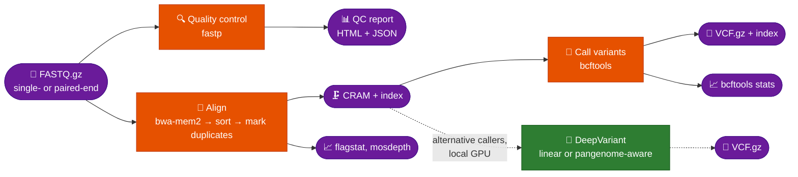
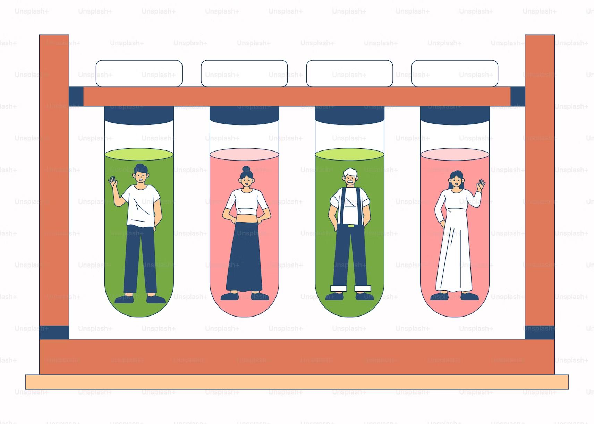
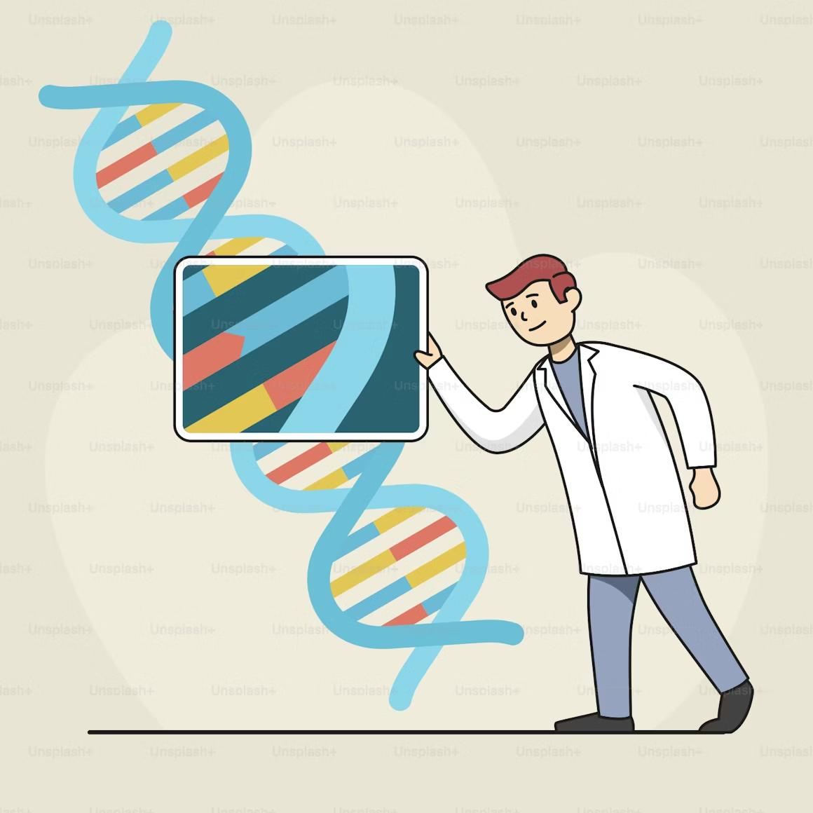
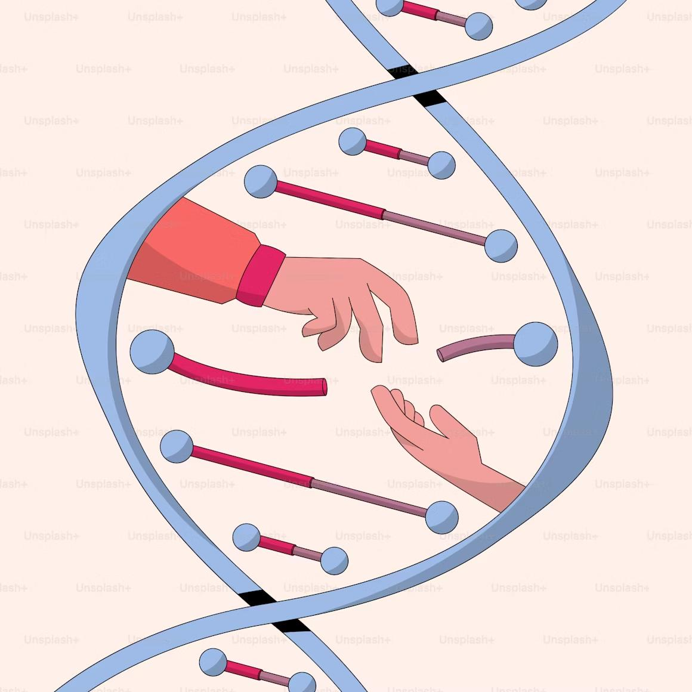
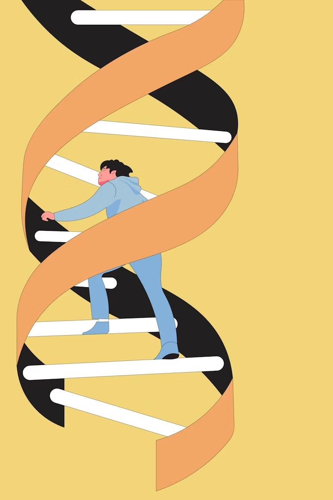
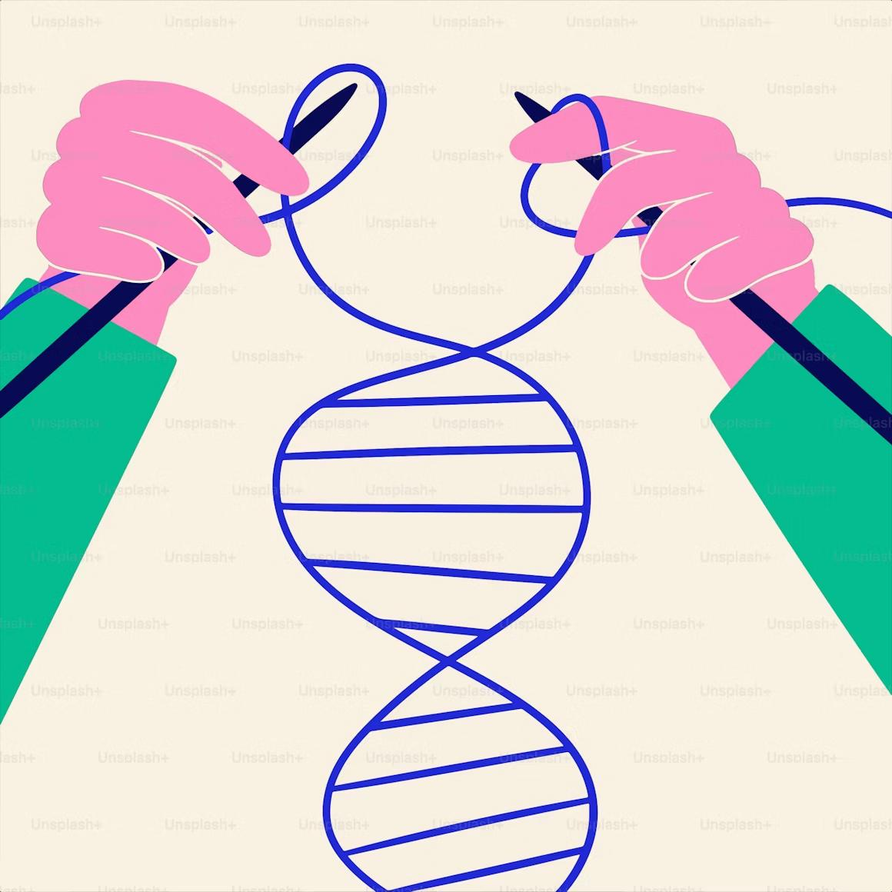
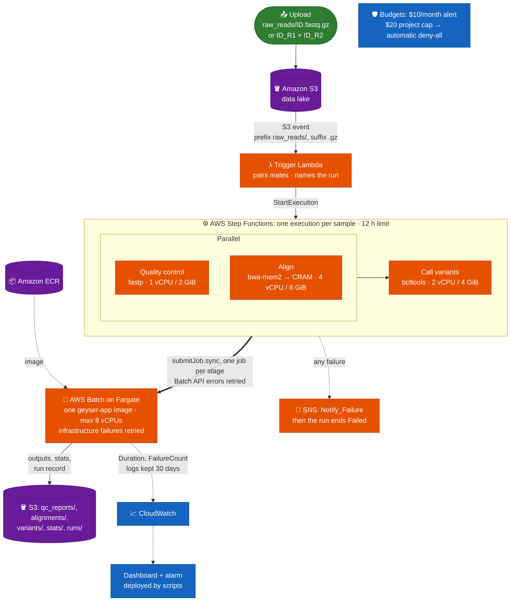
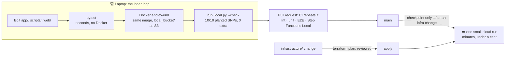
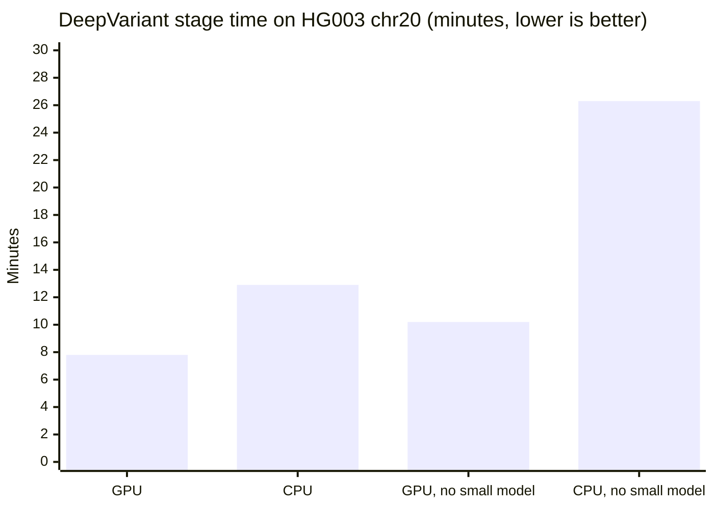

<div align="center">


<h1>🌋 Geyser Genomics</h1>

<p><strong>An event-driven AWS pipeline that turns raw DNA sequencing reads into a list of genetic variants,<br/>built and tested offline first.</strong></p>

<p>
  <a href="#️-project-status--features"></a>
</p>

<p>
  
  
  
  
  <br/>
  
  
  
  
  
</p>

<p>
  <a href="#-run-it-locally-in-2-minutes-no-aws"><b>🚀 Quickstart</b></a> &nbsp;·&nbsp;
  <a href="#️-how-it-works-the-architecture"><b>🏗️ Architecture</b></a> &nbsp;·&nbsp;
  <a href="#️-project-status--features"><b>🗺️ Status</b></a> &nbsp;·&nbsp;
  <a href="#deepvariant-on-a-local-nvidia-gpu"><b>🧠 DeepVariant</b></a> &nbsp;·&nbsp;
  <a href="#️-roadmap"><b>🛣️ Roadmap</b></a>
</p>

<table>
  <tr>
    <td align="center" width="20%"><h3>3</h3>stages, QC and alignment<br/>in parallel</td>
    <td align="center" width="20%"><h3>10 / 10</h3>planted SNPs recovered<br/>on every push</td>
    <td align="center" width="20%"><h3>1 min 52 s</h3>cloud run, small sample,<br/>under 1 cent</td>
    <td align="center" width="20%"><h3>0.9977</h3>DeepVariant SNP F1<br/>on HG003 chr20*</td>
    <td align="center" width="20%"><h3>0</h3>stored AWS keys<br/>in CI (OIDC)</td>
  </tr>
</table>

<sub>* hap.py (vcfeval, PASS only) against GIAB v4.2.1 confident regions, the same method as Google's case studies. Linear and pangenome-aware DeepVariant score the same here. See <a href="#deepvariant-on-a-local-nvidia-gpu">DeepVariant</a>.</sub>

</div>

---

### 📋 Table of Contents

1.  [What is Geyser Genomics?](#-what-is-geyser-genomics) 
2.  [The Odyssey: Why This Project Exists](#-the-odyssey-why-this-project-exists)
3.  [The Challenge: From a DNA Sample to an Answer](#-the-challenge-from-a-dna-sample-to-an-answer)
4.  [Design Goals and Where They Stand](#-design-goals-and-where-they-stand)
5.  [Project Status & Features](#️-project-status--features)
6.  [How It Works: The Architecture](#️-how-it-works-the-architecture)
7.  [Technical Deep Dive](#-technical-deep-dive)
8.  [Run It Locally in 2 Minutes (No AWS)](#-run-it-locally-in-2-minutes-no-aws)
9.  [Web UI](#️-web-ui)
10. [Deployment & Usage](#-deployment--usage)
11. [Roadmap](#️-roadmap)
12. [Contributing, Security and Citing](#-contributing-security-and-citing)

---

## 💡 What is Geyser Genomics?

Geyser Genomics is an **event-driven bioinformatics pipeline**. It takes raw DNA data from a sequencing machine (a gzipped FASTQ file) and turns it into a list of genetic variants (a VCF file).

Uploading a file to S3 starts a run. AWS Step Functions runs quality control and alignment side by side as containers on AWS Batch, then variant calling, and writes every result back to the same bucket. The same containers also run on a laptop against a local folder: that is how the project is developed and tested, and the cloud is a checkpoint rather than the development loop.

**From raw reads to variants**



Every run also writes a **run record** (`runs/<id>.provenance.json`): the inputs, the reference's MD5, the tool versions, the image, and each stage's timing and outcome.

What it does today:

*   ⚙️ **Event-driven:** an upload to `raw_reads/` starts the run (both mates, for paired-end). No one launches the stages by hand.
*   ⚡ **Parallel where it can be:** QC and alignment both read the gzipped upload directly, so they run at the same time, then variant calling reads the CRAM. There is no decompressed copy in between.
*   📦 **Sized per stage, scales to zero:** QC gets 1 vCPU / 2 GiB, alignment 4 / 8 GiB, variant calling 2 / 4 GiB, on AWS Batch (Fargate), all from one Docker image. Nothing runs between samples.
*   🛟 **Resilient without hiding bugs:** infrastructure failures (a lost host, a task that failed to start) are retried; a failing tool or a corrupt upload fails at once and notifies through SNS. Each stage and each run has a time limit.
*   💰 **Cost-bounded:** no NAT gateway, Fargate capped at 8 vCPUs, ECR images and logs pruned, a $10 monthly budget alert, and a $20 project cap with an automatic kill switch for the automation role. A small test run costs well under a cent; idle cost is storage.
*   🧪 **Tested offline:** every push runs the linters, the unit tests, a Docker end-to-end run on synthetic data with planted mutations (which must all be recovered, and nothing else), and the state machine itself in Step Functions Local.

> [!NOTE]
> **Where it stands (2 November 2026):**
> - **In the cloud:** the three-stage pipeline, with its retries, time limits and per-stage sizes, is applied in AWS and verified by real runs ([Deployment](#-deployment--usage)).
> - **Locally and in CI only, for now:** the image those runs used predates the move to bwa-mem2, fastp, CRAM, the QC statistics and the run record. All of these are verified locally and in CI, and they reach the cloud with the next image push.
> - **Locally on a GPU:** pangenome-aware DeepVariant is benchmarked on two samples.

---

## 🧭 The Odyssey: Why This Project Exists

This project was born from a profound, life-changing journey through the world of genomic medicine. It is a tribute to the pioneering work of NHS England and its **100,000 Genomes Project**.

> The NHS 100,000 Genomes Project is a landmark UK initiative aimed at sequencing the complete genetic codes of patients with rare diseases and their families. By creating this massive dataset, it seeks to uncover new diagnoses and pave the way for personalized medicine.

For eighteen years, my life was an odyssey through a fog of medical uncertainty with no linking diagnosis. As part of the project, my mother, my father, and I all donated our blood. Our entire genomes would be sequenced and explored, becoming three more data points in a vast ocean of information. We were told it was unlikely we would hear anything back.

<table align="center" border="0" cellspacing="0" cellpadding="10">
  <tr>
    <td align="center">
      
    </td>
    <td align="center">
      
    </td>
  </tr>
</table>

A year later, against all odds, I received a result. The project had delivered a link. In the three billion letters of my genetic code, they had found a single, ultra-rare mutation in the **COA3 gene**, causing a mitochondrial defect.

<table align="center" border="0" cellspacing="0" cellpadding="10">
  <tr>
    <td align="center">
      
    </td>
    <td align="center">
      
    </td>
  </tr>
</table>

The statistical probability of this discovery is staggering. The odds of both parents carrying the same rare recessive fault and passing it on is approximately **1 in 64 million**.

### The 1 in 64 Million Chance

This isn't a random number; it's grounded in a core concept of population genetics known as the **Hardy-Weinberg principle**. It's the scientific method for estimating how rare a genetic trait is. The principle is expressed with the equation:

$$ p^2 + 2pq + q^2 = 1 $$

This describes how genetic variations are distributed in a population, where `2pq` represents the probability of being a carrier—like my parents. The calculation itself is a straightforward product of these rare probabilities:

*   **🧑 Carrier Frequency:** The estimated chance of one person being a carrier (`2pq`) is **1 in 8,000**.
*   **🧑‍🤝‍🧑 Two Carriers Meet:** The probability of two such carriers meeting is therefore:

<p align="center">
  <code>(1 / 8,000)   ×   (1 / 8,000)   =   1 / 64,000,000</code>
</p>

My donated genome will now serve as a data point to help others, ensuring that a single-letter fault doesn't define another patient's life. My odyssey of discovery took two decades, but it doesn't need to be that way for others. With technologies like Geyser Genomics, we can accelerate these discoveries and build solutions that may one day repair the very code of life itself.

<table align="center" border="0" cellspacing="0" cellpadding="10">
  <tr>
    <td align="center" width="32%">
      
      <br><em>We can help eachother</em>
    </td>
    <td align="center" width="32%">
      
      <br><em>By looking within ourselves</em>
    </td>
    <td align="center" width="32%">
      
      <br><em>To build a better future</em>
    </td>
  </tr>
</table>

---

## 🤔 The Challenge: From a DNA Sample to an Answer

Analyzing genomes is incredibly difficult. Scientists face three major hurdles:

*    **The Data Deluge:** A single human genome can be over 100 gigabytes. Analyzing hundreds requires a staggering amount of storage and power.
*    **The Complex Recipe:** The analysis involves dozens of specialized scientific tools, each needing to be run in a specific order with precise parameters. One mistake can invalidate the results.
*    **The Hardware Hurdle:** This work traditionally requires buying and maintaining powerful, expensive server clusters that are difficult to manage and often sit idle.

---

## ✨ Design Goals and Where They Stand

| Goal | Approach | Where it is today |
| :--- | :--- | :--- |
| **Reproducible results** | Tools and Python packages pinned exactly, base image pinned by digest; synthetic data with planted mutations as a truth check; a run record per sample | Done. The end-to-end truth check runs on every push. |
| **No manual steps** | An S3 upload triggers a Lambda, which starts Step Functions | Verified in the cloud (single-end). Paired-end triggering is tested offline. |
| **Pay only while running** | Batch on Fargate scales to zero, no NAT gateway, budgets | Applied. Cost per sample, measured on the cloud runs CLOUD005-010 (10k single-end reads or 5k pairs from chr20; three stages): **$0.0066-0.0070**, at Fargate on-demand list prices for eu-west-2 (`query_pipeline_duration.py --stages`, defaults in `scripts/stage_breakdown.py`). Almost all of it is fixed per-job overhead (Fargate bills at least a minute per job). Storage is the remaining idle cost. |
| **Fail loudly, recover from flaky infrastructure** | Infrastructure-only retries, per-stage and per-run time limits, failures published to SNS | Applied and tested in the cloud: a truncated upload fails once, notifies and ends Failed. |
| **Scale out** | One execution per sample, QC and alignment in parallel, up to 8 Fargate vCPUs at once | Applied. Splitting one sample's variant calling across jobs is planned (2.0). |
| **Accessible to non-cloud users** | A web UI for uploading samples and browsing results | Works offline against the local folder. Not deployed. |

---

## 🗺️ Project Status & Features

Three levels of "done", kept separate: **☁️ verified in the cloud** (applied in AWS and proven by a real run), **✅ verified locally and in CI** (Docker end-to-end on every push, not yet run in AWS), and **🔜 planned**.

| Feature | Status | Description |
| :--- | :---: | :--- |
| **Orchestration and trigger** | ☁️ Cloud | S3 upload → Lambda → Step Functions: QC and alignment in a `Parallel` state, then variant calling, each a Batch job on Fargate. Runs are named after the sample (`<id>-<UTC time>-<hash>`); a duplicate S3 event starts nothing. Tested offline in Step Functions Local. |
| **Resilience and sizing** | ☁️ Cloud | Infrastructure-only retries (3 attempts), Batch API retries with back-off, per-stage timeouts and a 12-hour run limit, per-stage vCPU/memory, 30-day log retention. A failed stage publishes to SNS and the run ends Failed; a run that hits the time limit ends TimedOut (no SNS message, but it counts in the Step Functions metrics). |
| **Bioinformatics tools** | ☁️ Cloud | fastp QC (one report per sample), bwa-mem2 alignment (with an automatic fallback to bwa for references that would trigger a bwa-mem2 bug), duplicates marked, CRAM + index, tabix-indexed VCF from bcftools. Verified in the cloud on 2 Nov 2026 (image `main-c6f490b`): single-end and paired-end chr20 runs, 10/10 planted SNPs each. The cloud reference stores both aligners' indexes, so no job builds one. |
| **QC statistics** | ☁️ Cloud | `samtools flagstat`, `mosdepth` coverage and `bcftools stats` per sample, under `stats/<id>/`. |
| **Run record (provenance)** | ☁️ Cloud | `runs/<id>.provenance.json` per sample, assembled from one part per stage so parallel stages never overwrite each other. Every job gets the Step Functions execution name as `RUN_NAME`, so each part records which run wrote it. |
| **Paired-end input** | ☁️ Cloud | `<id>_R1.fastq.gz` + `<id>_R2.fastq.gz`: the trigger waits for both mates and starts one run; the stages detect the layout themselves. Verified with a paired-end chr20 run on 2 Nov 2026. |
| **Offline development and testing** | ✅ Complete | The whole pipeline runs locally in Docker with no AWS account. CI: ruff lint and format, `terraform fmt`/`validate`, unit tests, Docker end-to-end truth check, Step Functions Local, and DeepVariant on the CPU image for pull requests. |
| **Infrastructure as code** | ✅ Complete | Every AWS resource is in Terraform, with state per environment (`dev` is live; `prod` is intentionally not deployed). Changes are planned, reviewed, then applied. |
| **CI authentication (OIDC)** | ✅ Complete | GitHub Actions gets short-lived AWS credentials through OIDC, with no stored keys. Separate dev and prod roles; the Terraform roles are read-only, and prod only trusts the `main` branch. |
| **Cost safety and guardrails** | ☁️ Applied | No NAT gateway, Fargate in a public subnet, capped Batch capacity, ECR and log retention, a $10 monthly budget alert. The role automation uses has a permissions boundary and a $20 project budget that attaches a deny-all policy by itself ([guardrails](docs/design/claude-guardrails.md)). |
| **Automated deployment** | ⏸️ Manual by design | CI runs tests and checks only. The "Terraform Plan" workflow can only plan, is manual, and is disabled. Applies happen from a reviewed plan. |
| **Monitoring** | ☁️ Cloud | Each stage emits duration and failure metrics (CloudWatch, or a local file offline). A CloudWatch dashboard (runs, end-to-end time, failures and durations by stage, console links) and one alarm on trigger Lambda errors are deployed by scripts (see [Monitoring](#3-monitoring)). |
| **DeepVariant and pangenome-aware DeepVariant** | ✅ Local GPU | Alternative variant callers, benchmarked with hap.py on HG003 and HG005 chr20 (see below). A GPU Batch environment exists in AWS; the stage isn't wired into Step Functions yet and needs larger instances. |
| **Web UI** | ✅ Works offline | A Django app for uploading samples, generating demo data and browsing results (QC summary and report, variants, downloads). Runs locally; not deployed. See [Web UI](#️-web-ui). |
| **Other S3-compatible storage** | ✅ Unit-tested | `S3_ENDPOINT_URL` points the storage layer at any S3-compatible service (OVHcloud Object Storage, MinIO, LocalStack). Not yet run against one. |

---

## 🛠️ How It Works: The Architecture

The design is event-driven and uses managed AWS services, so there are no servers to look after: the trigger is a Lambda, the orchestrator is Step Functions, and Batch on Fargate starts a container per stage and scales to zero. Everything below is Terraform in `infrastructure/`.



**Stages talk only through storage keys.** `app/tasks.py` holds the key conventions (`keys_for`), and every stage, the trigger, the web UI and the scripts use them. QC writes `qc_reports/`, alignment writes `alignments/` and `stats/`, variant calling reads the CRAM and writes `variants/` and `stats/`, and each stage adds its part of the run record under `runs/`. The same code runs against S3 in the cloud and against a folder offline (`STORAGE_BACKEND=s3|local`).

### The offline-first workflow

Developing directly in the cloud was slow and costly, so the project is built offline first. Changes are made and proven on a laptop, then repeated in CI; the cloud only sees checkpoints.



- **The fake has to behave like the real thing.** The local storage backend writes through a temp file and renames it, so a key only appears complete, as in S3. The first cloud run still found a bug no offline test could: the local backend only ever read streams forward, while boto3 seeks any stream that claims to be seekable, and a gzip stream over an S3 download claims it can (#71). The fix came with a test that runs boto3's real transfer code against a stubbed S3 client, so the offline suite now covers that access pattern too.
- **The state machine is tested too.** `infrastructure/state_machine.asl.json` is the file Terraform deploys, and `tests/test_state_machine_local.py` runs that same file in Step Functions Local with Batch and SNS mocked: parallel branches, every failure path, retries and the run time limit.
- **Infrastructure changes are reviewed as plans.** Every apply follows a reviewed `terraform plan`; replacing or destroying a compute environment, queue, bucket or VPC stops the change.

---

## 🤖 Technical Deep Dive

The platform's design is guided by modern cloud-native principles:

| Technology | Role & Rationale |
| :--- | :--- |
| **Terraform** | **The Cloud Architect.** Defines every AWS resource (VPC, S3, IAM, ECR, Batch, Step Functions, Lambda, budgets, log groups) as code, with state per environment, so every change is a plan that can be reviewed before it happens. |
| **AWS Step Functions** | **The Conductor.** Replaced a self-hosted Airflow setup from earlier in the project. Runs QC and alignment in a `Parallel` state, then variant calling, retries Batch API errors, enforces a 12-hour limit and routes any failure to SNS. The definition is a JSON file that is tested in Step Functions Local. ([Why not Nextflow?](docs/design/why-not-nextflow.md)) |
| **AWS Batch + Fargate** | **The Compute Engine.** Runs each stage as a container job at its own size (QC 1 vCPU / 2 GiB, alignment 4 / 8, variants 2 / 4), retrying only infrastructure failures. Capped at 8 vCPUs, which bounds the spend rate. |
| **Docker** | **The Reproducible Toolbox.** One image with every pipeline tool (fastp, bwa-mem2 and bwa, samtools, bcftools, mosdepth) at pinned versions, on a base image pinned by digest. DeepVariant has its own images (CPU and GPU, linear and pangenome-aware). |
| **GitHub Actions** | **The CI Engine.** Every push and pull request runs ruff, `terraform fmt`/`validate`, the unit tests, the Docker end-to-end truth check (with cached image layers) and the state machine in Step Functions Local, all without AWS credentials. A manual workflow can run `terraform plan` with short-lived OIDC credentials and a read-only role. Dependabot proposes grouped dependency updates. |
| **pytest + synthetic data** | **The Safety Net.** A generator creates a small reference genome and simulated reads (single- or paired-end, optionally with PCR-like duplicates) with known mutations. The end-to-end test runs every stage in Docker and requires the final VCF to contain exactly those mutations. |
| **Amazon S3** | **The Data Lake.** Holds the inputs, the outputs, the QC statistics and the run records under fixed key prefixes. An upload to `raw_reads/` is the event that starts the pipeline. |
| **Python** | The stage logic (`app/tasks.py`), the storage and metrics backends, the trigger Lambda, the ops scripts and the Django web UI. Cloud specifics stay in the backends, the Lambda and Terraform. |

**Why not Nextflow?** Most genomics pipelines are written for a workflow engine. [docs/design/why-not-nextflow.md](docs/design/why-not-nextflow.md) maps Geyser's pieces to Nextflow concepts, lists what an engine would and wouldn't have replaced, and says when the choice should change.

**Design notes:** [why not Nextflow](docs/design/why-not-nextflow.md) · [guardrails for the automation role](docs/design/claude-guardrails.md) · [DeepVariant sizing on AWS](app-deepvariant/README.md)

---

## 💻 Run It Locally in 2 Minutes (No AWS)

The whole pipeline runs on a laptop. Each stage runs in its own container from the same image the cloud uses, and a local folder (`local_bucket/`) stands in for the S3 data lake with the same layout.

**Prerequisites:** Docker and Python 3.11.

```bash
# 1. Build the pipeline image (fastp, bwa-mem2 and bwa, samtools, bcftools)
docker build -f Dockerfile -t geyser-app .

# 2. Create a synthetic genome and 30x reads with 10 known mutations planted in them
python scripts/make_test_data.py

# 3. Run all three stages (QC and alignment one after the other here), just as Step Functions would, then check the VCF against the truth
python scripts/run_local.py --sample SYNTH001 --reference synthetic_ref.fa --check

# Paired-end instead: writes PAIRED001_R1.fastq.gz and PAIRED001_R2.fastq.gz
python scripts/make_test_data.py --sample PAIRED001 --paired
python scripts/run_local.py --sample PAIRED001 --reference synthetic_ref.fa --check

# Scatter-gather variant calling: one bcftools job per 7,000 bp region, then a merge into the same VCF
python scripts/run_local.py --sample SYNTH001 --reference synthetic_ref.fa --shard-window 7000 --check
```

> [!TIP]
> Expected result: `Truth check (bcftools): 10/10 planted SNPs called, 0 unexpected calls`
>
> `--duplicate-rate 0.1` plants exact read (or pair) copies, like PCR duplicates. The align stage's `samtools markdup` flags them, and the SNP calls stay the same.
>
> `--gff` also writes gene models (`reference/synthetic_ref.fa.gff3.gz`): one gene on each strand, around planted SNPs 2-5. The variants stage then annotates consequences with bcftools csq (`variants/SYNTH001.csq.vcf.gz`), and the web UI shows a Consequence column. Reads and SNPs are the same as without `--gff`. For real data, `fetch_dv_testdata.py --dataset hg003-chr20 --annotation` adds Ensembl's chr20 gene models, with the contig renamed to match GRCh38's `chr20`.
>
> The align stage uses [bwa-mem2](https://github.com/bwa-mem2/bwa-mem2), which runs the same algorithm as `bwa mem` faster on modern CPUs. The image picks the fastest build for the CPU it runs on. Set `ALIGNER=bwa` (e.g. `ALIGNER=bwa python scripts/run_local.py ...`) to align with classic `bwa mem` instead.
>
> bwa-mem2 has one known bug ([bwa-mem2#262](https://github.com/bwa-mem2/bwa-mem2/issues/262)): it shifts reads that start in the first few bases of the reference's first contig, which shows up as false SNPs. Human chromosomes start with long N gaps, so they are unaffected. For any reference whose first contig doesn't start with at least 1,000 Ns, the align stage uses bwa instead and logs why. The default synthetic genome is such a reference. `make_test_data.py --leading-gap 1000` gives it a human-like gap, and then bwa-mem2 produces the same 10,000 alignments as bwa. Each aligner has its own index next to the reference (`reference/<name>.0123`, `.bwt.2bit.64` ... for bwa-mem2). The align stage builds a missing index itself. That is quick for one chromosome, but a whole-genome bwa-mem2 index needs about 90 GB of RAM, so build it once elsewhere and upload it under `reference/`.
>
> In the cloud, `reference/chr20.fa` holds both aligners' indexes and the FASTA index: bwa's, bwa-mem2's `.0123` and `.bwt.2bit.64` (338 MB), and `chr20.fa.fai` (all uploaded 2 Nov 2026), so no stage rebuilds an index. The two share `.amb`/`.ann`/`.pac`, and bwa-mem2 writes them byte-identical to bwa's. To add an index for another reference, build it with the pipeline image and upload only the files that are missing:
>
> ```bash
> docker run --rm -v "$PWD:/data" -w /data --entrypoint bwa-mem2 geyser-app index <name>.fa   # ~30 s and ~2 GB RAM for chr20
> aws s3 cp <name>.fa.0123 s3://<data-lake>/reference/ && aws s3 cp <name>.fa.bwt.2bit.64 s3://<data-lake>/reference/
> ```
>
> Effect on the cloud align job (wave-0 sample: 10k single-end reads, chr20; 4 vCPU / 8 GB Fargate):
>
> | Run | Aligner | bwa-mem2 index | Align job run time |
> | :--- | :--- | :--- | ---: |
> | `CLOUD003-20261102T144231Z-08dc9420` | bwa (image `main-69daa5c`) | n/a (stored bwa index) | 28.1 s |
> | `CLOUD005-20261102T151205Z-548b7a1b` | bwa-mem2 | built in the job | 45.7 s |
> | `CLOUD006-20261102T151552Z-7b850912` (paired, 5k pairs) | bwa-mem2 | built in the job | 66.0 s |
> | `CLOUD007-20261102T152740Z-c8af04a5` | bwa-mem2 | **downloaded** | **29.3 s** |
>
> On a sample this small, alignment itself takes a second or two, so bwa-mem2 only matches bwa: it downloads 338 MB of index against bwa's 113 MB. The speed-up shows on real data (table below).
>
> **bwa vs bwa-mem2, measured** (`scripts/benchmark_aligners.py`). HG003 chr20: 19.0 M reads, paired FASTQs recovered from the 35x case-study BAM, aligned to chr20 by the real align stage. Each aligner ran once, with 16 threads, on an AMD Ryzen 7 3700X (bwa-mem2 picked its AVX2 build):
>
> | | bwa 0.7.18 | bwa-mem2 2.3 |
> | :--- | ---: | ---: |
> | Align stage, wall clock | 812 s | **521 s (1.56× faster)** |
> | Aligner alone | 759 s | **460 s (1.65×)** |
> | Peak process memory (whole stage) | **5.2 GiB** | 7.4 GiB |
> | Index build, chr20 | 52 s, 93 MiB | 28 s, 1.5 GiB |
> | hap.py, bcftools and DeepVariant | identical | identical |
>
> - **The calls are equivalent.** hap.py gives the same TP/FN/FP for both aligners with both callers. Comparing the PASS calls directly: bcftools 139,132 identical with none different; DeepVariant 109,228 shared, 2 only with bwa, none only with bwa-mem2. Both BAMs have the same 18,997,779 reads and 2,083,409 marked duplicates.
> - **The price is memory:** about 2.3 GiB more at peak, and a much larger index (1.5 GiB of RAM to build for one chromosome, ~90 GB for a whole genome). bwa-mem2 spent 159 s of its 460 s writing SAM into the pipe, so `sort` and `markdup` downstream partly limit the gain.
> - **Caveats:**
>   - One run each, bwa first. The stage wall clock includes copying the reads into the container, so bwa-mem2 may have read them from a warm page cache. The aligners' own timers start after that copy, so the 1.65× ratio is not affected by run order.
>   - bwa-mem2 2.3 reports itself as 2.2.1, so the CSV's version column says 2.2.1.
>   - Against a chr20-only reference, reads from other chromosomes have nowhere else to go. DeepVariant's SNP false positives rise from 52 on Google's whole-genome BAM to 120 here, for both aligners alike.
>
> Results: `benchmarks/aligners_<base>.csv` and `benchmarks/aligners_<base>/summary.md` under the storage root:
>
> ```bash
> python scripts/fetch_dv_testdata.py --dataset hg003-chr20
> python scripts/benchmark_aligners.py --root <root> --from-bam alignments/HG003_chr20.bam \
>     --base HG003_chr20 --reference GRCh38_chr20.fa --region chr20
> ```
>
> **Scatter-gather variant calling** (`--shard-window BP`) is how the cloud will spread variant calling over many jobs. `tasks.py regions <ref> --window BP` cuts the reference into regions in reference order. `tasks.py variants <id> <ref> --region R` calls one region into `intermediate/variant-parts/<id>/<run>/`; there's one folder per run (`RUN_NAME`), so a merge never picks up an earlier run's parts. Everything under `intermediate/` is disposable and expires after 7 days (S3 lifecycle, #62). `tasks.py variants <id> <ref> --window BP` merges every part into the usual `variants/<id>.vcf.gz` (+ `.tbi` and stats), and fails, naming them, if any parts are missing. bcftools reports each position in exactly one region, so the merged VCF has the same records as a single job; the Docker E2E test checks this. Shards record the `CallVariantsShard` metric and the merge records `CallVariants`. The Step Functions `Map` state that runs the shards in parallel in the cloud comes in a separate infrastructure PR.

**Tests:**

```bash
pip install -r requirements-dev.txt
pytest                                           # unit tests, no Docker needed
GEYSER_E2E=1 pytest tests/test_e2e_docker.py     # full pipeline in Docker
```

The tests also check that the stage list in the Step Functions definition (`infrastructure/state_machine.asl.json`, which `step_functions.tf` renders with `templatefile()`), the stage code (`app/tasks.py`) and the local runner all agree. `tests/test_state_machine_local.py` runs that same definition in [Step Functions Local](https://docs.aws.amazon.com/step-functions/latest/dg/sfn-local.html) (Docker) with Batch and SNS mocked: the happy path (QC and alignment in parallel, then variants), each stage failing, and a failed notification still ending the run as Failed (`GEYSER_SFN_LOCAL=1`; CI runs it on every push).

**Quality gate (Rust, not yet in the pipeline):** [`gate/`](gate/README.md) reads a run's QC statistics (fastp's report and `stats/<id>/`) and run record, checks them against thresholds from a TOML file (base quality, GC, reads lost in alignment, mapped %, duplicates, properly paired, mean depth, breadth at 10x, SNP count, Ti/Tv) and exits pass or fail with a JSON verdict that names each failed check. The default thresholds were checked on HG003 and HG005 chr20. `cd gate && cargo test`, then e.g. `cargo run -- --root ../local_bucket --sample SYNTH001 --config thresholds/synthetic.toml`.

The storage and metrics backends are chosen by environment variables, so the same code runs locally and in AWS:

| Variable | Values | Default |
| :--- | :--- | :--- |
| `STORAGE_BACKEND` | `s3`, `local` | `s3` |
| `LOCAL_STORAGE_DIR` | path to the local data lake | `local_bucket` |
| `S3_ENDPOINT_URL` | an S3-compatible endpoint (OVHcloud Object Storage, MinIO, LocalStack) instead of AWS; boto3's `AWS_ENDPOINT_URL_S3` and `AWS_ENDPOINT_URL` count too. Set `AWS_REGION` to the service's region (e.g. `gra`) and its keys in `AWS_ACCESS_KEY_ID`/`AWS_SECRET_ACCESS_KEY` | unset (AWS) |
| `S3_ADDRESSING_STYLE` | `path`, `virtual`, `auto` | unset (botocore's `auto`) |
| `METRICS_BACKEND` | `cloudwatch`, `local`, `none` | `cloudwatch` for S3 on AWS, `none` for S3 outside AWS, `local` otherwise |

### DeepVariant on a local NVIDIA GPU

[Google DeepVariant](https://github.com/google/deepvariant) `1.10.0` is available as an alternative variant caller, in its own image (`app-deepvariant/`). It reads the same `alignments/<id>.cram` (or a BAM, for imported data) and writes `variants_deepvariant/<id>.vcf.gz`, so its calls can be compared with the bcftools calls.

#### Why the reference genome matters: pangenomes

<div align="center">
  
  <br/>
  <sub>Animation: Google Research, from <a href="https://research.google/blog/building-better-pangenomes-to-improve-the-equity-of-genomics/"><i>Building better pangenomes to improve the equity of genomics</i></a> (Andrew Carroll and Kishwar Shafin, May 2023).</sub>
</div>

<br/>

Variant callers like DeepVariant find variants by comparing reads with a **reference genome**. The standard reference is a single linear sequence, so variation it doesn't contain is easy to miss or to call wrongly. A study of 910 African individuals found about 300 million base pairs, roughly 10% of the reference, that were present in at least one person but absent from the linear reference.

A **pangenome** reference is a graph that combines many people's genomes. The Human Pangenome Reference Consortium's first draft (*Nature*, 2023) combines 47 genomes chosen to better reflect global diversity. Google and UC Santa Cruz built a graph-based variant-calling workflow around DeepVariant and reported improved accuracy across several thousand samples.

> [!NOTE]
> **Where this project is:**
> - **Done:** pangenome-aware variant calling (Google's pangenome-aware DeepVariant with the HPRC graph) runs **locally on the GPU** and is benchmarked on chr20 of HG003 (Ashkenazi) and HG005 (Han Chinese), overall and by GIAB region type (results below).
> - **Graph alignment, benchmarked offline:** reads aligned to the pangenome graph with vg giraffe (haplotype sampling, surjected to GRCh38) give the most accurate calls on HG003 chr20 (results below). The pipeline's align stage still uses bwa-mem2.
> - **Not yet:** whole-genome graphs and runs in the cloud. These are next on the [Roadmap](#️-roadmap) (#51).

#### Running it

```bash
docker run --rm --gpus all nvidia/cuda:12.3.2-base-ubuntu22.04 nvidia-smi   # GPU visible to Docker?
docker build -f app-deepvariant/Dockerfile -t geyser-deepvariant .
python scripts/run_local.py --sample SYNTH001 --reference synthetic_ref.fa --caller both --check

# Real data: NA12878, chr20:10.0-10.1 Mb, with the GIAB truth set (~5 MB download)
python scripts/fetch_dv_testdata.py
python scripts/run_local.py --sample NA12878_S1 --reference ucsc.hg19.chr20.unittest.fasta \
    --caller both --skip-to-variants --check

# Whole chromosome: HG003, NovaSeq 35x, all of chr20 on GRCh38, with GIAB v4.2.1 truth (~1.34 GB download)
python scripts/fetch_dv_testdata.py --dataset hg003-chr20
python scripts/run_local.py --sample HG003_chr20 --reference GRCh38_chr20.fa \
    --caller deepvariant --skip-to-variants --check --dv-memory 12g

# Pangenome-aware DeepVariant (GPU image) with the HPRC v1.1 graph cut down to chr20 (built locally with vg)
docker build -f app-deepvariant/Dockerfile --build-arg DV_TAG=pangenome_aware_deepvariant-1.10.0-gpu \
    -t geyser-deepvariant-pangenome .
python scripts/fetch_dv_testdata.py --dataset hg003-chr20 --pangenome
DEEPVARIANT_SHARDS=6 DEEPVARIANT_EXTRA_ARGS="--call_variants_extra_args=batch_size=256" \
python scripts/run_local.py --sample HG003_chr20 --reference GRCh38_chr20.fa \
    --caller pangenome --skip-to-variants --dv-memory 14g

# Score every caller's VCF with hap.py (vcfeval engine, PASS only, GIAB confident regions)
python scripts/benchmark_happy.py --sample HG003_chr20 --reference GRCh38_chr20.fa --region chr20

# HG005 (Han Chinese) and an HG003 control from the same 30x BAM set; only chr20 is fetched (~1 GB each).
# --stratifications adds GIAB region BEDs (difficult regions, segdups, low mappability) for a per-region table.
python scripts/fetch_dv_testdata.py --dataset hg005-chr20 --stratifications
python scripts/fetch_dv_testdata.py --dataset hg003-30x-chr20
python scripts/benchmark_happy.py --sample HG005_chr20 --reference GRCh38_chr20.fa --region chr20 \
    --stratification stratifications/GRCh38_chr20.tsv
```

**Accuracy: HG003 chr20, hap.py.** HG003 is NovaSeq PCR-free 35x, scored against GIAB v4.2.1 confident regions. These are the same settings Google's case studies use (`--engine=vcfeval --pass-only`):

| Caller | Type | Missed (FN) | False (FP) | Recall | Precision | F1 |
| :--- | :--- | ---: | ---: | ---: | ---: | ---: |
| bcftools | SNP | 361 | 835 | 0.9949 | 0.9882 | 0.9915 |
| bcftools | Indel | 582 | 487 | 0.9452 | 0.9562 | 0.9507 |
| DeepVariant 1.10 (linear) | SNP | 263 | 52 | 0.9963 | 0.9993 | **0.99775** |
| DeepVariant 1.10 (linear) | Indel | 48 | 15 | 0.9955 | 0.9986 | 0.99706 |
| Pangenome-aware DeepVariant 1.10 | SNP | **242** | 78 | **0.9966** | 0.9989 | 0.99772 |
| Pangenome-aware DeepVariant 1.10 | Indel | **42** | 18 | **0.9960** | 0.9984 | **0.99721** |

- **The setup reproduces Google's published result.** Their pangenome-aware BWA case study on the same BAM reports SNP F1 0.997746 and indel F1 0.996788 (version 1.9, whole-genome graph). Here: 0.997718 and 0.997206, with a chr20-only graph and version 1.10.
- **The pangenome finds variants the linear reference misses.** Missed SNPs fall by 8% (263 → 242) and missed indels by 13% (48 → 42).
- **It also makes slightly more false calls** (SNPs 52 → 78). On this one sample the total error count is level: 378 for linear against 380 for pangenome-aware.
- **HG003 is a hard case for showing a benefit.** It is Ashkenazi Jewish, an ancestry the standard reference already represents well. The preprint reports the largest gains with more diverse samples, whole genomes (most segmental duplications are on other chromosomes) and reads aligned to the graph. The HG005 benchmark below tests the first of these.
- **bcftools is much better than earlier exact-match counts suggested** (SNP F1 0.99, not 0.87). Exact (position, ref, alt) matching without normalisation heavily penalised its indel representation.

**Does ancestry matter? HG005 against HG003, chr20, hap.py.** HG005 is Han Chinese. To isolate ancestry, both samples come from the same Google data set: NovaSeq PCR-free 30x, BWA-MEM to hs38DH, Picard MarkDuplicates. Only chr20 is fetched (`fetch_dv_testdata.py --dataset hg005-chr20` / `hg003-30x-chr20`). Errors are missed + false calls:

| Sample | Caller | SNP FN / FP | SNP F1 | Indel FN / FP | Indel F1 |
| :--- | :--- | ---: | ---: | ---: | ---: |
| HG003 30x | DeepVariant (linear) | 273 / 81 | 0.99747 | 63 / 28 | 0.99577 |
| HG003 30x | Pangenome-aware DeepVariant | **250** / 90 | **0.99757** | **53** / 28 | **0.99623** |
| HG005 30x | DeepVariant (linear) | **233 / 58** | **0.99788** | 49 / 11 | 0.99646 |
| HG005 30x | Pangenome-aware DeepVariant | 244 / 95 | 0.99753 | **39 / 10** | **0.99711** |

By GIAB region type (`--stratification`, GIAB v3.3 stratifications), SNP errors as FN / FP, linear → pangenome-aware:

| Region (chr20) | HG003 30x | HG005 30x |
| :--- | :--- | :--- |
| Segmental duplications | 30 / 36 → **13 / 25** | 47 / 30 → **30 / 25** |
| Low mappability (all) | 238 / 48 → **222** / 55 | 205 / 42 → 230 / 73 |
| Outside all difficult regions | 17 / 23 → **16 / 17** | 10 / 6 → **6 / 2** |

- **The ancestry prediction did not hold here.** On HG005, pangenome-aware DeepVariant made *more* SNP errors than linear (291 → 339), though fewer indel errors (60 → 49). On HG003 from the same data set it improved both (SNPs 354 → 340, indels 91 → 81).
- **Segmental duplications are where the pangenome helps on both samples.** SNP errors there fall by 42% for HG003 (66 → 38) and 29% for HG005 (77 → 55). chr20 has only 149 segmental-duplication intervals, so a whole-genome run should show more of this gain.
- **HG005's extra SNP errors are in low-mappability regions outside segmental duplications** (FN 205 → 230, FP 42 → 73). They are not explained yet. Looking at those sites is the next step.
- **No leakage:** HG005 is not one of the 46 samples in the HPRC v1.1 graph (checked with `vg gbwt -L`; HPRC held out HG002, HG005 and NA19240). The graph does contain several Han Chinese samples (e.g. HG00438, HG00621, HG00673), so HG005's ancestry is represented. HG003 is not in it either.
- **Caveats:**
  - One chromosome and one run per caller, so differences of a few dozen variants are small.
  - The truth regions differ in kind. GIAB v4.2.1 ships only a "noinconsistent" BED for HG003 and only a plain BED for HG005. The plain BED keeps some harder sites the other drops, which could account for part of HG005's extra errors.
  - The 30x BAMs are aligned to hs38DH (with ALT and decoy contigs), the 35x HG003 BAM to no_alt. Only 0.03% of chr20 reads sit on chr20's ALT contigs (6,011 for HG005, 4,305 for HG003, from the BAM indexes), so dropping them by fetching `chr20` only has a negligible effect. The two 30x samples are aligned identically.
- **Time:** pangenome-aware DeepVariant took 21.4 min on HG005 and 20.3 min on HG003 30x, with the settings below.

**Aligning to the graph: vg giraffe vs bwa-mem2, HG003 chr20, hap.py** (`scripts/benchmark_giraffe.py`). Both aligners get the same 19.0 M reads (recovered from the 35x case-study BAM). bwa-mem2 aligns them to the chr20 reference with the pipeline's align stage; vg giraffe 1.55.0 aligns them to the HPRC v1.1 chr20 graph. Giraffe uses haplotype sampling, a personal 2-haplotype graph chosen from the sample's own k-mers, then surjects the reads to GRCh38 (Google's VG case-study flags). Both BAMs get the same fixmate, sort and markdup. Errors are missed + false calls:

| Alignment + caller | SNP FN / FP | Indel FN / FP | SNP + indel errors | SNP errors in segdups | SNP errors, low mappability |
| :--- | ---: | ---: | ---: | ---: | ---: |
| bwa-mem2 + DeepVariant (linear) | 266 / 120 | 50 / 18 | 454 | 79 | 323 |
| bwa-mem2 + pangenome-aware DeepVariant | 251 / 108 | 41 / 17 | 417 | 45 | 304 |
| **giraffe + DeepVariant (linear)** | 216 / **91** | 40 / 21 | **368** | **25** | **230** |
| giraffe + pangenome-aware DeepVariant | **190** / 146 | **31** / 21 | 388 | 76 | 237 |

- **Aligning to the graph helps more than a graph-aware caller.** Giraffe with plain linear DeepVariant has the fewest errors: 19% fewer than bwa-mem2 + linear, and 12% fewer than bwa-mem2 + pangenome-aware DeepVariant. In segmental duplications, its SNP errors fall from 79 to 25.
- **Pangenome-aware DeepVariant on giraffe reads finds the most variants** (fewest misses: SNP 190, indel 31) **but adds false SNPs**: 146 against 91 with linear DeepVariant on the same reads. 53 of those 55 extra false SNPs are in segmental duplications (74 there against 21). The two pangenome inputs, reads already placed with the graph plus graph haplotypes at every site, seem to overcount evidence there. Google's two case studies (pangenome-aware DeepVariant, whole genome, HG003 35x) show the same direction: SNP FN/FP 240/76 with BWA and 72/106 with giraffe.
- **Cost per sample:**
  - giraffe: 546 s, of which 462 s mapping, peak 1.5 GiB; plus 158 s for fixmate, sort and markdup.
  - bwa-mem2 align stage: 521 s, peak 7.4 GiB.
  - Giraffe also needs a 37 s k-mer count (kmc, capped at 8 GB) per sample.
  - One-off graph indexes (distance index, r-index, haplotype information) take 345 s and under 1.5 GiB for chr20.
- **Caveats:**
  - **Biased towards the linear aligner.** The reads are only those BWA had placed on chr20 in Google's BAM, and the graph and reference are chr20 only. With whole-genome alignments the gain is much larger (next table).
  - **Flags differ for linear DeepVariant.** On giraffe BAMs it runs with Google's VG flags (`min_mapping_quality=0`, `keep_legacy_allele_counter_behavior`, `normalize_reads`); on the bwa-mem2 BAM it runs with defaults.
  - **One run each.** Pangenome-aware DeepVariant ran with 12 `make_examples` workers here (16.5 and 16.0 min); shard count changes speed only, not the calls.

```bash
python scripts/benchmark_aligners.py --root <root> --from-bam alignments/HG003_chr20.bam --base HG003_chr20 \
    --reference GRCh38_chr20.fa --region chr20          # reads + bwa-mem2 BAM first
python scripts/fetch_dv_testdata.py --dataset hg003-chr20 --pangenome --stratifications
python scripts/benchmark_giraffe.py --root <root> --base HG003_chr20 --reference GRCh38_chr20.fa \
    --region chr20 --stratification stratifications/GRCh38_chr20.tsv --pg-shards 12 --pg-memory 18g
```

**Without the bias: Google's whole-genome alignments, HG003 chr20, hap.py** (`scripts/benchmark_calls.py`). Google's two pangenome-aware case studies publish BAMs of the same HG003 35x reads aligned to the **whole genome**: one with BWA-MEM to GRCh38, one with vg giraffe to the whole-genome HPRC v1.1 graph. Both are cut to chr20 afterwards (`fetch_dv_testdata.py --dataset hg003-chr20` / `hg003-chr20-vg`). Every read could go anywhere in the genome, so neither aligner is favoured. Calls use the chr20 graph:

| Alignment + caller | SNP FN / FP | Indel FN / FP | SNP + indel errors | SNP errors in segdups | SNP errors, low mappability |
| :--- | ---: | ---: | ---: | ---: | ---: |
| BWA + DeepVariant (linear) | 263 / 52 | 48 / 15 | 378 | 52 | 257 |
| BWA + pangenome-aware DeepVariant | 242 / 78 | 42 / 18 | 380 | 41 | 266 |
| BWA + pangenome-aware DeepVariant, MAPQ ≥ 5 | 235 / 62 | 43 / 19 | 359 | 46 | 240 |
| **giraffe + DeepVariant (linear)** | 75 / **44** | 40 / 27 | **186** | **7** | **46** |
| giraffe + pangenome-aware DeepVariant | **72** / 104 | **30** / 22 | 228 | 69 | 70 |
| giraffe + pangenome-aware DeepVariant, MAPQ ≥ 5 | 96 / 87 | 36 / 30 | 249 | 55 | 79 |

- **The setup reproduces Google's VG case study:** giraffe + pangenome-aware DeepVariant gives SNP FN/FP 72/104, against Google's published 72/106.
- **Aligning to the graph halves the errors.** giraffe + plain linear DeepVariant has 186 errors against 378 for BWA + linear (51% fewer). In low-mappability regions SNP errors fall from 257 to 46, and in segmental duplications from 52 to 7. The chr20-only experiment above understated this, because its reads were the ones BWA had already put on chr20.
- **On graph-aligned reads, linear DeepVariant beats the pangenome-aware model for SNPs** (119 against 176 SNP errors). The pangenome model still has the fewest misses and the fewest indel errors (52 against 67), but over-calls in segmental duplications (69 SNP errors there against 7).
- **The MAPQ ≥ 5 filter helps only with BWA** (380 → 359). On giraffe reads it makes things worse (228 → 249), mostly through more missed SNPs (72 → 96). A likely reason, not verified: giraffe gives low mapping quality to reads the graph can still place usefully, so filtering them loses real evidence.
- **Caveats:**
  - The giraffe BAM is published without duplicate marking and the BWA BAM with it. This is Google's own comparison, kept as published.
  - Linear DeepVariant on giraffe uses Google's VG flags.
  - One chromosome and one run each.

```bash
python scripts/fetch_dv_testdata.py --dataset hg003-chr20 --pangenome --stratifications
python scripts/fetch_dv_testdata.py --dataset hg003-chr20-vg                     # 947 MB
python scripts/benchmark_calls.py --root <root> --preset google-case-studies --reference GRCh38_chr20.fa \
    --region chr20 --stratification stratifications/GRCh38_chr20.tsv --pg-shards 12 --pg-memory 18g
```

Small datasets (exact-match counts): synthetic data, 10/10 planted SNPs and 0 extra calls for both callers; NA12878 slice, bcftools 45 TP / 4 FN / 4 FP and DeepVariant 49 TP / 0 FN / 0 FP. DeepVariant's accuracy is identical on GPU and CPU.

**Pangenome-aware DeepVariant: time and memory** (HG003 chr20, RTX 3080 10 GB, 16 CPUs, 6 `make_examples` workers):

| Step | Time | Notes |
| :--- | ---: | :--- |
| `make_examples` (CPU) | 936 s | Pileups from the reads and from the pangenome haplotypes at every candidate site |
| `call_variants` (GPU) | 257 s | 231,085 examples, about 3× linear DeepVariant's 79,759. Pangenome mode has no small model, so every candidate reaches the network. |
| `postprocess_variants` | 21 s | |
| **Stage total** | **1,241 s (20.7 min)** | |

- **Graph size drives memory.** HPRC's whole-genome graph (3.29 GB file) takes about 10.7 GB of shared memory once loaded, plus about 2 GB per `make_examples` worker. That ran out of memory in a 22 GB container. The chr20 graph built by `fetch_dv_testdata.py` (72 MB, same 46 samples / 90 haplotypes) loads in under a second, and the container peaked at about 8.4 GB.
- **GPU memory.** At the default batch size (1,024), `call_variants` ran out of memory on the 10 GB card (it tried to allocate 2.7 GB blocks). At batch 256 it fits. A 24 GB cloud GPU (A10G, L4) should run the default.
- **Known issue.** After the out-of-memory error, Google's wrapper hung instead of exiting. In the cloud, the stage needs a job timeout.

**Timing: whole chromosome.** HG003 chr20, 35x, measured on an RTX 3080 (10 GB) under Docker Desktop/WSL2 with 16 CPUs, one run per configuration. These are times for the DeepVariant stage only:

| Device | Small model | Examples sent to the neural network | make_examples (CPU) | call_variants (GPU step) | postprocess (CPU) | Stage total |
| :--- | :--- | ---: | ---: | ---: | ---: | ---: |
| GPU | on (default) | 79,759 | 298.6 s | **128.1 s** | 17.5 s | **466.7 s** (7.8 min) |
| CPU | on (default) | 79,759 | 306.8 s | **426.5 s** | 21.6 s | **776.4 s** (12.9 min) |
| GPU | off | 222,978 | 303.5 s | 266.5 s | 20.5 s | 609.9 s (10.2 min) |
| CPU | off | 222,978 | 336.4 s | 1,200.5 s | 16.9 s | 1,575.4 s (26.3 min) |



**At whole-chromosome scale the GPU pays off.**
- With default settings, `call_variants` is **3.3× faster** on the GPU and the whole stage is **1.7× faster**. With the small model off, `call_variants` is 4.5× faster: about 840 examples/s on the GPU against about 190 on the CPU.
- The stage gains less than `call_variants` does, because `make_examples` (about 300 s) runs on the CPU on either image. It is the largest step on the GPU.
- The small model is itself a CPU speed-up: it makes 64% of the calls before the neural network is involved.
- bcftools took 409 s for the same chromosome.

The CPU runs used a 12 GB container cap (`--dv-memory 12g`) and `--call_variants_extra_args=batch_size=256`. Without a cap, CPU `call_variants` took most of the 16 GB Docker VM and starved Windows. An 8 GB cap was too small for 16 `make_examples` shards.

<details>
<summary><b>Timing on small inputs (where the GPU is slower)</b></summary>

<br/>

Same machine, median of 3 runs:

| Data | Device | Small model | Examples sent to the neural network | make_examples (CPU) | call_variants (GPU step) | postprocess (CPU) | Stage total |
| :--- | :--- | :--- | ---: | ---: | ---: | ---: | ---: |
| Synthetic 50 kb | GPU | on | 0 | 13.8 s | 4.7 s | 6.1 s | 27.7 s |
| Synthetic 50 kb | CPU | on | 0 | 15.0 s | 4.0 s | 6.0 s | 27.6 s |
| Synthetic 50 kb | GPU | off | 10 | 13.2 s | 18.7 s | 5.9 s | 41.1 s |
| Synthetic 50 kb | CPU | off | 10 | 12.2 s | 12.3 s | 5.7 s | 32.9 s |
| NA12878 100 kb | GPU | on | 90 | 33.6 s | 18.5 s | 5.7 s | 61.2 s |
| NA12878 100 kb | CPU | on | 90 | 34.2 s | 13.4 s | 5.6 s | 56.5 s |
| NA12878 100 kb | GPU | off | 305 | 33.3 s | 20.0 s | 6.6 s | 63.3 s |
| NA12878 100 kb | CPU | off | 305 | 32.9 s | 14.3 s | 5.7 s | 56.2 s |

**On small inputs the GPU is 5–6 s slower than the CPU.** With at most a few hundred examples, `call_variants` time is almost entirely fixed start-up: loading the model and initialising CUDA and cuDNN. The GPU's start-up costs more than TensorFlow's on the CPU. On the synthetic data, the small model makes every call, so the neural network sees nothing. `nvidia-smi` sampling confirmed the GPU was used: utilisation peaked at 98%, and TensorFlow reserved nearly all free VRAM.

</details>

**Tests.** `GEYSER_GPU_E2E=1 pytest tests/test_e2e_deepvariant.py` runs the GPU image. `GEYSER_DV_E2E=1` runs the CPU image; CI runs that one on pull requests, because GitHub runners have no GPU. Setting `GEYSER_DV_TESTDATA=<bucket>` also runs the real slice. In the cloud, a GPU Batch environment exists, but the stage is not wired into Step Functions yet, and its instances are too small for a whole chromosome. See the sizing notes in [`app-deepvariant/README.md`](app-deepvariant/README.md).

---

## 🖥️ Web UI

A small Django front end in `web/`. You can upload a gzipped FASTQ, or click **Generate demo sample** to create synthetic reads with known SNPs. Each stage turns green as it finishes. You then get a QC summary (read count, Q20/Q30, GC, duplication, insert size) with the fastp report, a table of called variants (with a "10/10 planted SNPs recovered" check for demo samples) and download links for every intermediate file.

```bash
docker build -f Dockerfile -t geyser-app .          # once: the pipeline image
pip install -r requirements-dev.txt                 # includes web/requirements.txt
python web/dev.py                                   # UI + local worker on http://127.0.0.1:8000
```

**How it fits the architecture.** The UI only reads and writes storage keys, through `app/storage.py`, and never runs the pipeline itself. An upload is stored at `raw_reads/<id>.fastq.gz`, or at `raw_reads/<id>_R1.fastq.gz` and `_R2.fastq.gz` when a second (R2) file is given. That key is the trigger, and a paired-end sample only starts once both mates exist:

| | Cloud | Offline |
| :--- | :--- | :--- |
| Storage | S3 (`STORAGE_BACKEND=s3`) | `local_bucket/` folder |
| Trigger | S3 event → Lambda → Step Functions | `manage.py runworker` polls `raw_reads/` → `scripts/run_local.py` |
| Stage status | from the output keys | from the output keys + `metrics/metrics.jsonl` + `runs/<id>.json` |

There is no database. Status is worked out from which outputs exist, the local metrics file and the worker's run records (`runs/<id>.json` and `.log`). The same UI could therefore run against the S3 bucket with no worker.

<details>
<summary><b>Settings, safety and tests</b></summary>

<br/>

**Settings** (environment variables): `DJANGO_DEBUG` (default **off**), `DJANGO_SECRET_KEY` (required when DEBUG is off), `DJANGO_ALLOWED_HOSTS`, `DJANGO_HTTPS=1` behind TLS (secure cookies, HSTS, redirect), `GEYSER_MAX_UPLOAD_MB` (default 200), `REFERENCE_NAME` for the worker (default `synthetic_ref.fa`), and `GEYSER_RUNNER=docker|host`. The storage variables are the same as the pipeline's, except that the UI defaults to `local`.

**Safety.** CSRF protection is on. Sample IDs are restricted to `[A-Za-z0-9_-]` because they become storage keys. Uploads must be gzip and within the size limit, and a sample can't be overwritten. Downloads are limited to a fixed list of file types. The fastp report is shown in a sandboxed iframe with scripts blocked, so its charts are blank there (they load a script from opengene.org over plain HTTP); the downloaded report has them.

**Tests:** `pytest` runs the web tests too (`web/tests/`, Django test client, temporary storage folder, no Docker).

</details>

---

## 🚀 Deployment & Usage

### 1. The Deployment Process
Deployment is deliberate, not automatic. Terraform runs locally from `infrastructure/` (`terraform init -backend-config=backend-dev.hcl`, then `plan`, review, `apply`), and the container image is built locally and pushed to ECR under a tag (`main-<sha>`, plus `dev-local` for the one the job definition uses). Claude Code, which helps build the project, can run plans and applies too, but only as a bounded role: a permissions boundary, Batch capacity caps, a local check before each command, and a $20 project budget that cuts the role off automatically. Destroying or replacing stateful resources stays a human decision. See [docs/design/claude-guardrails.md](docs/design/claude-guardrails.md).

**Sizing and resilience settings** (`infrastructure/variables.tf`, all with defaults):

| Variable | Default | What it does |
| :--- | :--- | :--- |
| `stage_resources` | QC 1 vCPU / 2 GiB, align 4 / 8 GiB, variants 2 / 4 GiB | Each stage's Fargate size, sent by the state machine as `ContainerOverrides.ResourceRequirements`. Checked against Fargate's valid vCPU/memory pairs, and QC + align (which run at the same time) must fit in `fargate_max_vcpus`. |
| `job_disk_gb` | 20 | Fargate ephemeral storage per job. 20 GiB is free; 21-200 is billed. A real 30x sample needs ~100+. |
| `pipeline_timeout_hours` | 12 | Time limit for a whole run, queue waits included. A run past it ends as TimedOut. |
| `log_retention_days` | 30 | How long Batch job logs (`/aws/batch/geyser-<env>`) and trigger Lambda logs (`/aws/lambda/geyser-sfn-trigger-<env>`) are kept. |

**Retries.** The Batch job definition retries only infrastructure failures, up to 3 attempts: a host going away, a Spot interruption, a task that failed to start, or a failed image pull or log setup. Anything else exits at once, including every non-zero exit code, so an application error such as a corrupt upload fails fast. Each Batch task in the state machine also retries Batch API errors (throttling, server errors) 3 times with back-off. Both are tested offline in Step Functions Local.

The GitHub Actions workflow `.github/workflows/deploy-platform.yml` ("Terraform Plan") can run a plan for the `dev` or `prod` environment. It authenticates with GitHub OIDC (short-lived credentials, no stored keys) using a read-only role, so it cannot change anything. It is manual and currently disabled.

<details>
<summary><b>Prerequisites for the CI plan workflow</b></summary>

<br/>

*   An AWS Account, with the GitHub OIDC identity provider configured.
*   GitHub environments `dev` and `prod`.
*   The following secrets configured in the GitHub repository settings:
    *   `AWS_REGION`: The target AWS region (e.g., `eu-west-2`).
    *   `ECR_IAM_ROLE_ARN`: The ARN of the IAM role for pushing to ECR.
    *   `TERRAFORM_IAM_ROLE_ARN`: The ARN of the read-only IAM role for `terraform plan`.

</details>

### 2. How to Use the Platform (Event-Driven)
Once deployed, a run is started by uploading a file.

**Verified in the cloud (2 November 2026).** Each checkpoint used the same small sample: 10,000 single-end reads from GRCh38 chr20:10,000,001-10,050,000, with the image `geyser-app:main-69daa5c` (bwa, FastQC and BAM; the tool upgrades on main reach the cloud with the next image).

| Run | What it showed |
| :--- | :--- |
| `CLOUD002-20261102T132058Z-43888afd` | The three-stage state machine: QC and alignment overlapped, the run SUCCEEDED in 1 min 52 s (the old four-stage run took 3 min 45 s), the VCF has all 10 planted SNPs, cost about $0.006. |
| `CLOUD003-20261102T144231Z-08dc9420` | Per-stage sizes in effect (QC 1 vCPU / 2 GiB, alignment 4 / 8, variants 2 / 4), logs in the new 30-day log groups, 10/10 SNPs. |
| `CLOUD004-20261102T144542Z-3aa11cd4` | A deliberately truncated upload: the stages fail, `Notify_Failure` publishes to SNS, the run ends Failed, and each job ran once (application failures are not retried). |

1.  **Locate the S3 Data Lake:** Find the S3 bucket created by Terraform. Its name has the format `<project_name>-data-lake-<random-suffix>`.
2.  **Upload Raw Data:** Upload your gzipped FASTQ file to the `raw_reads/` prefix, e.g. `raw_reads/SRR062634.fastq.gz`. The sample ID is the part of the filename before the first dot.
    *   **Paired-end:** upload both mates as `raw_reads/<id>_R1.fastq.gz` and `raw_reads/<id>_R2.fastq.gz`, in either order. The run starts once both are there, and only once. Only `_R1`/`_R2` mark mates: rename SRA-style `_1`/`_2` files before uploading. The stages detect the layout from these keys.
    *   The trigger Lambda checks for the other mate with `s3:GetObject` on `raw_reads/*` and `s3:ListBucket` (added in [#69](https://github.com/Harry5haw/Geyser-Genomics/pull/69)).
3.  **Monitor the Execution:** The upload automatically starts the Step Functions state machine. You can follow its progress in the AWS Step Functions console, where each run is named after its sample and upload time, e.g. `SRR062634-20261101T123456Z-1a2b3c4d`. The same name appears in the Batch job names. If S3 delivers the same upload event twice, it still starts only one run. A paired-end run is named after the later of its two uploads.
4.  **Retrieve Results:** When the run succeeds, the outputs are in the same bucket:

| Stage | Output |
| :--- | :--- |
| Quality control | `qc_reports/<id>.fastp.html` and `qc_reports/<id>.fastp.json` from [fastp](https://github.com/OpenGene/fastp) in report-only mode (nothing trimmed or filtered); one report per sample, both mates for paired-end |
| Alignment | `alignments/<id>.cram` + `.cram.crai`, one per sample (coordinate-sorted, duplicates marked with samtools markdup; paired-end runs `samtools fixmate -m` first). CRAM stores the reads against the reference, so it is far smaller than a BAM, and it needs that same reference to read it: `samtools view -T reference/<name> alignments/<id>.cram` |
| Variant calling | `variants/<id>.vcf.gz` + `.vcf.gz.tbi` (tabix index, for region queries) |
| Consequence annotation (optional) | `variants/<id>.csq.vcf.gz` + `.tbi`: the same VCF with [bcftools csq](https://samtools.github.io/bcftools/howtos/csq-calling.html) consequences in `INFO/BCSQ` (e.g. `missense\|DEFB125\|ENST00000382410\|protein_coding\|+\|10I>10T`). Written only when the reference has gene models at `reference/<name>.gff3.gz` (Ensembl-style GFF3); `ANNOTATE=off` skips it. The cloud reference has none yet, so cloud runs don't annotate. |
| QC statistics | `stats/<id>/`: `flagstat.txt` (samtools flagstat: mapped, duplicates, properly paired) and `mosdepth.summary.txt` / `mosdepth.global.dist.txt` (mean depth, and the fraction of bases covered at each depth; duplicates excluded) from the align stage; `bcftools.stats.txt` (SNP and indel counts, Ti/Tv) from variant calling. The job log prints the headline numbers. |
| Run record | `runs/<id>.provenance.json`: what produced the outputs. It lists the input keys and sizes, the reference (name, MD5, size), the tool versions the image reports, the image (`APP_VERSION`), the aligner and layout, each stage's status, timings and any error, the outputs with sizes, and the headline QC stats. Each stage writes its own part (`runs/<id>.provenance/<stage>.json`) and rebuilds the record, so a failed stage is recorded too. Best effort: it never fails a stage. `scripts/reconcile.py` shows it in its R column. In the cloud the state machine doesn't pass the execution name to the jobs yet, so cloud records say `run_name: null`, and after a partial re-run one record can mix two runs. |

### 3. Monitoring

> [!NOTE]
> The dashboard (`geyser-dashboard-dev`) and the trigger alarm (`geyser-dev-trigger-lambda-errors`) are deployed, with the scripts below, after a `--dry-run` check. Both are within the CloudWatch free tier. The alarm has no actions: it is a signal on the dashboard, not an email.

Each stage records `Duration` (and `FailureCount` when it fails) in the CloudWatch namespace `GeyserGenomics`. The dashboard and alarm definitions are built in `scripts/monitoring.py` and deployed by small Python scripts rather than Terraform, because the dashboard JSON was hard to manage there.

| Script | What it creates |
| :--- | :--- |
| `scripts/deploy_dashboard.py` | Dashboard `geyser-dashboard-dev`: links to the console pages for a run (Step Functions runs, Batch jobs, logs, Logs Insights, alarms, S3, budgets), alarm status, pipeline runs per day, end-to-end time (p50/p95), failures by stage, and stage durations for the core pipeline, DeepVariant and pangenome DeepVariant |
| `scripts/deploy_alarms.py` | Alarm `geyser-dev-trigger-lambda-errors`: the trigger Lambda failing, the one failure that leaves no trace in the pipeline's own metrics because no run starts. Its state shows on the dashboard |
| `scripts/runtime_deploy_pipeline_dashboard.py` | Optional dashboard with only the Step Functions widgets |
| `scripts/query_pipeline_duration.py` | Prints a table of recent Step Functions run times (read-only). With `--stages`: for each stage, how long the Batch job queued vs ran, its vCPU/memory, attempts, why it failed (e.g. out of memory), and an estimated Fargate cost per stage and per run (`--stages-csv` to export) |
| `scripts/reconcile.py` | Compares uploads, runs and outputs to find what the pipeline silently missed: uploads the trigger ignores (not `.gz`), refuses (a mate not named `<id>_R1.fastq.gz`/`_R2.fastq.gz`) or that start a run which will fail (anything but `raw_reads/<id>.fastq.gz` or `<id>_R1`/`_R2`), paired-end samples with only one mate or uploaded both ways, samples with no VCF, orphan outputs, and (with `--state-machine-arn`) two runs of one sample at once. Works offline: `--local-dir local_bucket` |

**Preview without AWS:** `--dry-run` prints the JSON and makes no AWS calls. No ARNs are needed.
```bash
python scripts/deploy_dashboard.py --dry-run
python scripts/deploy_alarms.py --dry-run
```

**Deploy** (uses your AWS credentials; region defaults to `eu-west-2`). The state machine ARN is passed in, and the account ID for the alarm widget is looked up at deploy time, so neither is stored in the repo:
```bash
export SFN_ARN=$(terraform -chdir=infrastructure output -raw geyser_pipeline_state_machine_arn)
export BUCKET_NAME=$(terraform -chdir=infrastructure output -raw data_lake_bucket_name)   # for the S3 link
python scripts/deploy_alarms.py
python scripts/deploy_dashboard.py
```

Stage durations show the mean and max across samples. CloudWatch can't calculate percentiles across samples because each `SampleId` is a separate metric. If the metrics stop using the `SampleId` dimension, run with `--schema aggregated` to get real p50/p95. To add a stage or a new variant caller, add it to `STAGE_GROUPS` in `scripts/monitoring.py`.

Email is optional and off by default: `deploy_alarms.py --sns-topic-arn <arn>` also sends the alarm to an SNS topic. Failed runs already publish to the pipeline's SNS topic from the state machine's `Notify_Failure` step.

---

## 🛣️ Roadmap

✅ done · ☁️ done and verified in the cloud · 🎯 top priority · 🔜 next

| | Milestone | |
| :---: | :--- | :--- |
| ✅ | **Offline pipeline** | Storage and metrics backends, Docker end-to-end truth check on every push |
| ✅ | **Cost-safe networking and CI hardening** | NAT gateway off, budgets, OIDC with read-only Terraform roles, prod restricted to `main` |
| ✅ | **Paired-end input, duplicate marking, run names** | R1/R2 pairing in the trigger, layout-aware stages, `samtools markdup`, runs named after the sample |
| ✅ | **DeepVariant and pangenome-aware DeepVariant (local GPU)** | hap.py on HG003 chr20 reproduces Google's published result; HG005 vs an HG003 control by GIAB region type |
| ✅ | **Web UI** | Works offline |
| ☁️ | **Three stages, QC and alignment in parallel** | No decompressed intermediate; cloud run 1 min 52 s, down from 3 min 45 s |
| ☁️ | **Resilience and sizing** | Infrastructure-only retries, time limits, per-stage sizes, 30-day log retention |
| ☁️ | **Terraform state per environment, guardrails for automation** | Bounded role with a permissions boundary and an automatic $20 kill switch |
| ✅ | **Better tools and outputs** | bwa-mem2, fastp, CRAM + indexes, QC statistics, provenance run record |
| ✅ | **Repository quality** | ruff and Terraform checks in CI, exact pins and Dependabot, CONTRIBUTING / SECURITY / CITATION |
| 🔜 | **Next cloud checkpoint** | Push an image from current main and run single- and paired-end samples; pass the run name to the jobs so cloud run records are complete |
| 🔜 | **Monitoring** | Deploy the dashboard and alarm and check them against the cloud runs |
| 🎯 | **Pangenome: where it should help most** | Done offline on chr20: HG005's extra errors explained (MAPQ-0 reads), reads aligned to the graph (`vg giraffe`, fewest errors). Next: newer HPRC graph, whole genome, giraffe in the pipeline. **Top priority** ([#51](../../issues/51)) |
| 🔜 | **DeepVariant in the cloud** | GPU environment in the public subnet, larger instances, stage added to Step Functions ([#43](../../issues/43), [#44](../../issues/44)) |
| 🔜 | **2.0: faster and cheaper** | Variant calling split across jobs by region (a `Map` state), Spot capacity, a quality gate that fails a run with a named reason (the tool is built and tested in [`gate/`](gate/README.md); running it in the pipeline comes after the `Map` state) |
| 🔜 | **Public release** | Branch and environment protection, private vulnerability reporting, tagged releases ([#47](../../issues/47)) |

---

## 🤝 Contributing, Security and Citing

- [CONTRIBUTING.md](CONTRIBUTING.md): set-up, the checks every change passes, branch/commit/PR conventions, and how infrastructure changes are reviewed.
- [SECURITY.md](SECURITY.md): how to report a vulnerability privately, and what is in scope.
- [CITATION.cff](CITATION.cff): how to cite Geyser and the tools and data it builds on (GitHub's "Cite this repository" uses it).
