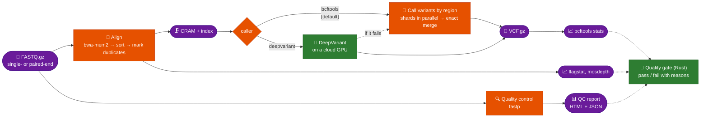
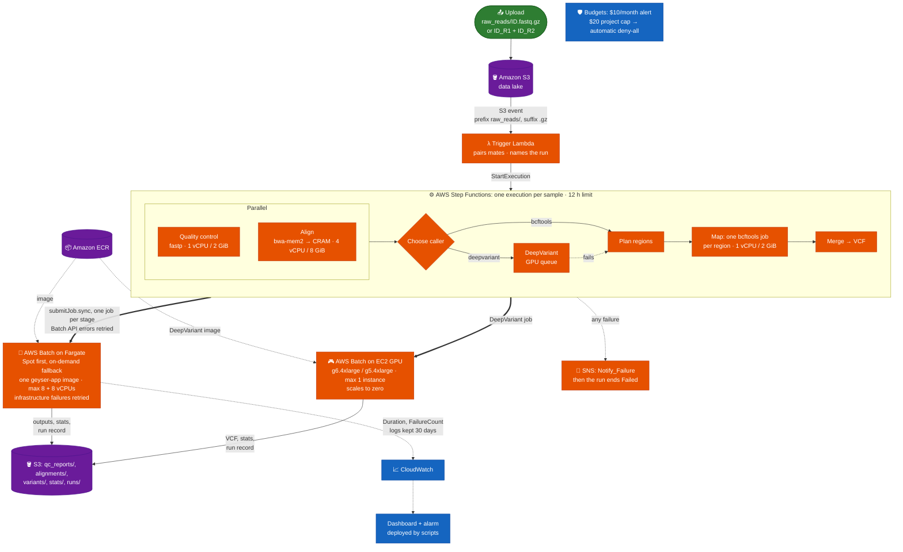
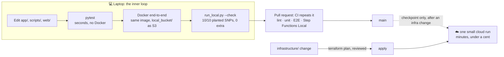

# Architecture and features

How Geyser Genomics works, what it does today and which technology does what. The [README](../README.md) has the short version; the [operations runbook](operations.md) covers running it.

## 💡 What is Geyser Genomics?

Geyser Genomics is an **event-driven bioinformatics pipeline**. It takes raw DNA data from a sequencing machine (a gzipped FASTQ file) and turns it into a list of genetic variants (a VCF file).

Uploading a file to S3 starts a run. AWS Step Functions runs quality control and alignment side by side as containers on AWS Batch, then variant calling, and writes every result back to the same bucket. The same containers also run on a laptop against a local folder: that is how the project is developed and tested, and the cloud is a checkpoint rather than the development loop.

**From raw reads to variants**

Every run also writes a **run record** (`runs/<id>.provenance.json`): the inputs, the reference's MD5, the tool versions, the image, and each stage's timing and outcome.

What it does today:

*   ⚙️ **Event-driven:** an upload to `raw_reads/` starts the run (both mates, for paired-end). No one launches the stages by hand.
*   ⚡ **Parallel where it can be:** QC and alignment both read the gzipped upload directly, so they run at the same time. Variant calling is then split by region into jobs that run side by side (a Step Functions `Map` state) and merged into one VCF, identical to an unsplit call.
*   🧠 **Two callers:** bcftools on Fargate by default, or **DeepVariant on a GPU** (`caller=deepvariant`), which falls back to bcftools automatically if it fails. Pangenome-aware DeepVariant is benchmarked locally.
*   🚦 **A run can succeed and still not be good enough:** a quality gate written in Rust checks the run's QC statistics (read quality, mapping, duplicates, depth, breadth, Ti/Tv) against calibrated thresholds and names every failed check.
*   📦 **Sized per stage, scales to zero:** QC gets 1 vCPU / 2 GiB, alignment 4 / 8 GiB, each variant-calling shard 1 / 2 GiB (the region planner and the merge 0.25 / 0.5 GiB), sized from the real-sample runs, on AWS Batch (Fargate), all from one Docker image. Nothing runs between samples.
*   🛟 **Resilient without hiding bugs:** infrastructure failures (a lost host, a task that failed to start) are retried; a failing tool or a corrupt upload fails at once and notifies through SNS. Each stage and each run has a time limit.
*   💰 **Cost-bounded:** no NAT gateway, Fargate capped at 8 vCPUs on Spot plus 8 on-demand, ECR images and logs pruned, a $10 monthly budget alert, and a $20 project cap with an automatic kill switch for the automation role. A real chr20 sample (HG003, 30-35x) costs about $0.07 per run, a small test run under a cent, a GPU DeepVariant run about $0.16; idle cost is storage.
*   🧪 **Tested offline:** every pull request and push to `main` runs the linters, the unit tests, a Docker end-to-end run on synthetic data with planted mutations (which must all be recovered, and nothing else), and the state machine itself in Step Functions Local. Changes to the web UI also run Lighthouse CI (`web-perf.yml`) on pages filled by a real synthetic run, both the live UI and the published static site (with its upload page, under the hosted site's strict CSP), on an emulated phone over slow 4G: a page over 30 KB of HTML, CSS and JS, or with LCP ≥ 1 s, any layout shift, TBT ≥ 50 ms or a console error fails the job.

> [!NOTE]
> **Where it stood at v2.0 (3 November 2026; later releases in [the release notes](releases/README.md)):**
> - **In the cloud, verified by real runs:** the whole bcftools pipeline (fastp, bwa-mem2, CRAM, region-split calling, QC statistics, run record) on six real GIAB chr20 runs (HG003 and HG005): about 22 minutes and $0.07 for a 30-35x paired sample. The 4 well-covered samples pass all 11 quality-gate checks, and the 2 under-covered ones fail on mean depth, as they should. DeepVariant on a GPU (g6.xlarge), 10/10 planted SNPs. See [Deployment](deployment.md).
> - **The quality gate is a step in the cloud state machine** ([#162](../../../pull/162)), in **fail mode** since 3 Nov 2026 ([#195](../../../pull/195), [#157](../../../issues/157)): a failed verdict fails the run, with its reasons. Thresholds are chosen per run ([#178](../../../pull/178)), including a `smoke` profile for the cloud smoke tests.
> - **Locally on a GPU:** pangenome-aware DeepVariant, benchmarked on HG003 and HG005, and graph alignment (vg giraffe), benchmarked on HG003 ([benchmark history](benchmarks/README.md)).

## ✨ Design Goals and Where They Stand

| Goal | Approach | Where it is today |
| :--- | :--- | :--- |
| **Reproducible results** | Tools and Python packages pinned exactly, base image pinned by digest; synthetic data with planted mutations as a truth check; a run record per sample | Done. The end-to-end truth check runs in CI on every pull request. |
| **No manual steps** | An S3 upload triggers a Lambda, which starts Step Functions | Verified in the cloud, single-end and paired-end. |
| **Pay only while running** | Batch on Fargate (Spot first) and a GPU environment, both scaling to zero; no NAT gateway; budgets | Applied. Measured per run at on-demand list prices for eu-west-2 (`query_pipeline_duration.py --stages`): **about $0.07** for a real chr20 sample (HG003, 30-35x, ~22 min), **$0.0066-0.0070** for the 10k-read test sample (almost all of it Fargate's 1-minute minimum per job), and **about $0.16** for a GPU DeepVariant run, two-thirds of which is starting the instance and pulling the 10 GB image. Storage is the remaining idle cost. |
| **Fail loudly, recover from flaky infrastructure** | Infrastructure-only retries, per-stage and per-run time limits, failures published to SNS | Applied and tested in the cloud: a truncated upload fails once, notifies and ends Failed. |
| **Scale out** | One execution per sample, QC and alignment in parallel, variant calling split by region, up to 8 Fargate Spot plus 8 on-demand vCPUs at once | Applied. The region split pays off on large samples: on a 10k-read sample it adds about 1.5 minutes of fixed job overhead (2 min 19 s → 3 min 45 s on the same image). |
| **Accessible to non-cloud users** | A web UI for uploading samples and browsing results | Live: a public read-only [results site](https://d1bp7nfasxklsf.cloudfront.net) on CloudFront since v2.1, with token-gated uploads. |

---

## 🗺️ Project Status & Features

Three levels of "done", kept separate: **☁️ verified in the cloud** (applied in AWS and proven by a real run), **✅ verified locally and in CI** (Docker end-to-end in CI on every pull request, not yet run in AWS), and **🔜 planned**.

| Feature | Status | Description |
| :--- | :---: | :--- |
| **Orchestration and trigger** | ☁️ Cloud | S3 upload → Lambda → Step Functions: QC and alignment in a `Parallel` state, then a caller choice: bcftools split by region (plan the regions, a `Map` over them, an exact merge) or DeepVariant on the GPU queue with a bcftools fallback, each a Batch job. Runs are named after the sample (`<id>-<UTC time>-<hash>`); a duplicate S3 event starts nothing. Tested offline in Step Functions Local. |
| **Resilience and sizing** | ☁️ Cloud | Infrastructure-only retries (3 attempts), Batch API retries with back-off, per-stage timeouts and a 12-hour run limit, per-stage vCPU/memory, 30-day log retention. A failed stage publishes to SNS and the run ends Failed; a run that hits the time limit ends TimedOut (no SNS message, but it counts in the Step Functions metrics). |
| **Bioinformatics tools** | ☁️ Cloud | fastp QC (one report per sample), bwa-mem2 alignment (with an automatic fallback to bwa for references that would trigger a bwa-mem2 bug), duplicates marked, CRAM + index, tabix-indexed VCF from bcftools. Verified in the cloud on 2 Nov 2026 (image `main-c6f490b`): single-end and paired-end chr20 runs, 10/10 planted SNPs each. The cloud reference stores both aligners' indexes, so no job builds one. |
| **QC statistics** | ☁️ Cloud | `samtools flagstat`, `mosdepth` coverage and `bcftools stats` per sample, under `stats/<id>/`. |
| **Run record (provenance)** | ☁️ Cloud | `runs/<id>.provenance.json` per sample, assembled from one part per stage so parallel stages never overwrite each other. Every job gets the Step Functions execution name as `RUN_NAME`, so each part records which run wrote it. |
| **Paired-end input** | ☁️ Cloud | `<id>_R1.fastq.gz` + `<id>_R2.fastq.gz`: the trigger waits for both mates and starts one run; the stages detect the layout themselves. Verified with a paired-end chr20 run on 2 Nov 2026. |
| **Offline development and testing** | ✅ Complete | The whole pipeline runs locally in Docker with no AWS account. CI: ruff lint and format, `terraform fmt`/`validate`, unit tests, Docker end-to-end truth check, Step Functions Local, and DeepVariant on the CPU image for pull requests. |
| **Infrastructure as code** | ✅ Complete | Every AWS resource is in Terraform, with state per environment (`dev` is live; `prod` is intentionally not deployed). Changes are planned, reviewed, then applied. |
| **CI authentication (OIDC)** | ✅ Complete | GitHub Actions gets short-lived AWS credentials through OIDC, with no stored keys. Separate dev and prod roles; the Terraform roles are read-only, and prod only trusts the `main` branch. |
| **Cost safety and guardrails** | ☁️ Applied | No NAT gateway, Fargate in a public subnet, capped Batch capacity, ECR and log retention, a $10 monthly budget alert. The role automation uses has a permissions boundary and a $20 project budget that attaches a deny-all policy by itself ([guardrails](design/claude-guardrails.md)). |
| **Automated deployment** | ⏸️ Manual by design | CI runs tests and checks only. The "Terraform Plan" workflow can only plan, is manual, and is disabled. Applies happen from a reviewed plan. |
| **Monitoring** | ☁️ Cloud | Each stage emits duration and failure metrics (CloudWatch, or a local file offline). A CloudWatch dashboard (runs, end-to-end time, failures and durations by stage, result quality per sample, data lake size, console links) and one alarm on trigger Lambda errors are deployed by scripts (see [Monitoring](deployment.md#3-monitoring)). Each job also records its CPU time and peak memory. |
| **DeepVariant in the cloud** | ☁️ Cloud | A GPU Batch environment (g6.4xlarge / g5.4xlarge since v1.5, public subnet, scales to zero, at most one instance) and a DeepVariant stage chosen per run (`caller=deepvariant`), falling back to bcftools if it fails. Verified 2 Nov 2026: 10/10 planted SNPs, 9 min 42 s, about $0.16. Normal runs stay on bcftools until a real-size chr20 DeepVariant run is checked. |
| **Pangenome-aware DeepVariant, graph alignment** | ✅ Local GPU | Pangenome-aware DeepVariant (HG003 and HG005 chr20) and vg giraffe alignment (HG003 chr20), benchmarked with hap.py (see below and the [benchmark history](benchmarks/README.md)). |
| **Quality gate** | ☁️ Cloud | [`gate/`](../gate/README.md), a Rust tool: reads a run's fastp report, QC statistics and run record, checks them against thresholds calibrated on HG003/HG005 and fails with named reasons. It runs as a pipeline stage, locally and as a step in the cloud state machine after either caller ([#162](../../../pull/162)). In the cloud it runs in fail mode ([#195](../../../pull/195)): a failed verdict fails the run. Locally `run_local.py` defaults to warn. The thresholds are chosen per run (`gate_profile`, [#178](../../../pull/178)). |
| **Variant consequences** | ✅ Local | `bcftools csq` when the reference has gene models (`reference/<name>.gff3.gz`), shown in the web UI. The cloud reference has none yet. |
| **Web UI and hosted site** | ☁️ Cloud | A Django app for uploading samples and browsing results (QC summary and report, variants, figures, downloads), also published as a static read-only site on CloudFront with token-gated uploads up to 256 GiB per file (v2.1, v3.1). Four themes (light, dark, retro, high contrast at WCAG AAA 7:1). See [Web UI](web-ui.md). |
| **Other S3-compatible storage** | ✅ Unit-tested | `S3_ENDPOINT_URL` points the storage layer at any S3-compatible service (OVHcloud Object Storage, MinIO, LocalStack). Not yet run against one. |

## 🛠️ How It Works: The Architecture

The design is event-driven and uses managed AWS services, so there are no servers to look after: the trigger is a Lambda, the orchestrator is Step Functions, and Batch on Fargate starts a container per stage and scales to zero. Everything below is Terraform in `infrastructure/`.

**Stages talk only through storage keys.** `app/tasks.py` holds the key conventions (`keys_for`), and every stage, the trigger, the web UI and the scripts use them. QC writes `qc_reports/`, alignment writes `alignments/` and `stats/`, variant calling reads the CRAM and writes `variants/` and `stats/`, and each stage adds its part of the run record under `runs/`. The same code runs against S3 in the cloud and against a folder offline (`STORAGE_BACKEND=s3|local`).

### The offline-first workflow

Developing directly in the cloud was slow and costly, so the project is built offline first. Changes are made and proven on a laptop, then repeated in CI; the cloud only sees checkpoints.

- **The fake has to behave like the real thing.** The local storage backend writes through a temp file and renames it, so a key only appears complete, as in S3. The first cloud run still found a bug no offline test could: the local backend only ever read streams forward, while boto3 seeks any stream that claims to be seekable, and a gzip stream over an S3 download claims it can (#71). The fix came with a test that runs boto3's real transfer code against a stubbed S3 client, so the offline suite now covers that access pattern too.
- **The state machine is tested too.** `infrastructure/state_machine.asl.json` is the file Terraform deploys, and `tests/test_state_machine_local.py` runs that same file in Step Functions Local with Batch and SNS mocked: parallel branches, every failure path, retries and the run time limit.
- **Infrastructure changes are reviewed as plans.** Every apply follows a reviewed `terraform plan`; replacing or destroying a compute environment, queue, bucket or VPC stops the change.

---

## 🤖 Technical Deep Dive

The platform's design is guided by modern cloud-native principles:

| Technology | Role & Rationale |
| :--- | :--- |
| **Terraform** | **The Cloud Architect.** Defines every AWS resource (VPC, S3, IAM, ECR, Batch, Step Functions, Lambda, budgets, log groups) as code, with state per environment, so every change is a plan that can be reviewed before it happens. |
| **AWS Step Functions** | **The Conductor.** Replaced a self-hosted Airflow setup from earlier in the project. Runs QC and alignment in a `Parallel` state, chooses the caller, splits bcftools calling by region with a `Map` state, retries Batch API errors, enforces a 12-hour limit and routes any failure to SNS. The definition is a JSON file that is tested in Step Functions Local. ([Why not Nextflow?](design/why-not-nextflow.md)) |
| **AWS Batch** | **The Compute Engine.** Runs each stage as a container job at its own size on Fargate, Spot first (QC 1 vCPU / 2 GiB, alignment 4 / 8, a variant shard 1 / 2, the region planner and merge 0.25 / 0.5), and DeepVariant on an EC2 GPU environment, retrying only infrastructure failures. Capped at 8 Fargate Spot plus 8 on-demand vCPUs and one GPU instance, which bounds the spend rate. |
| **Docker** | **The Reproducible Toolbox.** One image with every pipeline tool (fastp, bwa-mem2 and bwa, samtools, bcftools, mosdepth) at pinned versions, on a base image pinned by digest. DeepVariant has its own images (CPU and GPU, linear and pangenome-aware). |
| **GitHub Actions** | **The CI Engine.** Every pull request and every push to `main` runs ruff, `terraform fmt`/`validate`, the unit tests, the Docker end-to-end truth check (with cached image layers) and the state machine in Step Functions Local, all without AWS credentials. A manual workflow can run `terraform plan` with short-lived OIDC credentials and a read-only role. Dependabot proposes grouped dependency updates. **GitLab mirror:** GitHub is the source of truth; on every push to `main` and every `v*` tag, `gitlab-mirror.yml` pushes them to GitLab (its free tier can't pull-mirror), where `.gitlab-ci.yml` runs ruff and the unit tests on GitLab's runners. |
| **pytest + synthetic data** | **The Safety Net.** A generator creates a small reference genome and simulated reads (single- or paired-end, optionally with PCR-like duplicates) with known mutations. The end-to-end test runs every stage in Docker and requires the final VCF to contain exactly those mutations. |
| **Amazon S3** | **The Data Lake.** Holds the inputs, the outputs, the QC statistics and the run records under fixed key prefixes. An upload to `raw_reads/` is the event that starts the pipeline. |
| **Python** | The stage logic (`app/tasks.py`), the storage and metrics backends, the trigger Lambda, the ops scripts and the Django web UI. Cloud specifics stay in the backends, the Lambda and Terraform. |
| **Rust** | **The Quality Gate.** `gate/` builds to one static 1 MB binary that parses the tools' outputs (no tool re-run) and returns a verdict with named reasons; tested in CI with fixtures from real HG003/HG005 runs. |

**Why not Nextflow?** Most genomics pipelines are written for a workflow engine. [docs/design/why-not-nextflow.md](design/why-not-nextflow.md) maps Geyser's pieces to Nextflow concepts, lists what an engine would and wouldn't have replaced, and says when the choice should change.

**Operating it:** the [operations runbook](operations.md) covers starting, watching and stopping a run, the run record and gate verdict, image rollback and common failures.

**Design notes:** [why not Nextflow](design/why-not-nextflow.md) · [guardrails for the automation role](design/claude-guardrails.md) · [cloud DeepVariant](design/cloud-deepvariant.md) · [DeepVariant sizing on AWS](../app-deepvariant/README.md) · [a whole-genome vg giraffe align stage](design/giraffe-align.md)

---

## 🗂️ Repository Layout

| Path | What it holds |
| :--- | :--- |
| `app/` | The pipeline stages (`tasks.py`: QC, align, variants, regions, gate), the storage and metrics backends, the provenance run record |
| `app-deepvariant/` | The DeepVariant stage and its image (linear and pangenome-aware; GPU and CPU builds), with AWS sizing notes |
| `lambda/trigger/` | The S3 → Step Functions trigger: sample IDs, mate pairing, run names |
| `infrastructure/` | Terraform for everything in AWS, and the state machine definition (`state_machine.asl.json`) |
| `gate/` | The quality gate in Rust, with its thresholds and test fixtures |
| `web/` | The Django web UI (upload, demo data, results), running against the same storage layer |
| `scripts/` | Local runner (`run_local.py`), test data, benchmarks (hap.py, aligners, giraffe), monitoring and reconciliation |
| `tests/` | Unit tests, Docker end-to-end tests and the Step Functions Local tests |
| `docs/` | [Design notes](design/), [release notes](releases/README.md), the [benchmark history](benchmarks/README.md) |
| `Dockerfile` | The pipeline image: every tool at a pinned version, on a base pinned by digest |

---

[← Back to the README](../README.md)
