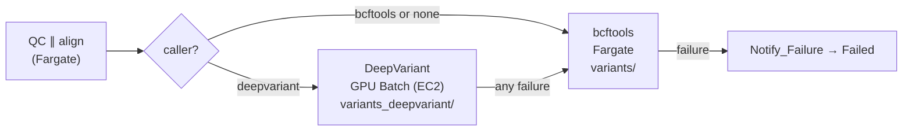

# Cloud DeepVariant (G2)

DeepVariant already runs locally on a GPU and is benchmarked with hap.py (HG003/HG005 chr20, see the
README). This page is the design for running it in AWS as the pipeline's variant caller, with bcftools
as the fallback. It covers the GPU environment fix (#43), the state-machine stage (#44), sizing and cost.
The infrastructure changes are drafted in the matching PR; **nothing here has been planned or applied**.

## What changes

| Piece | Today | After |
| :--- | :--- | :--- |
| GPU compute environment | private subnet: no route out with the NAT gateway off, so instances can't pull images or reach S3. Instance types `g4dn.xlarge`, `g5.xlarge`, `g5.2xlarge` | **public subnet** (public IPs, like the Fargate jobs; no NAT, no hourly cost). `gpu_instance_types` = `g6.xlarge`, `g5.xlarge`. ECS GPU AMI (`ECS_AL2_NVIDIA`), launch template with a 100 GB gp3 root volume |
| DeepVariant image | local only | ECR repository `geyser-deepvariant` (keeps 2 images), pushed by hand (~9.8 GB) |
| Job definition | none | `geyser-deepvariant-job`: EC2, 1 GPU, `deepvariant_resources` (4 vCPU / 14 GiB by default), `DEEPVARIANT_SHARDS` = vCPUs, the same infrastructure-only retry rule as the app job, logs in `/aws/batch/geyser-<env>` |
| State machine | QC ∥ align → bcftools | QC ∥ align → `Choose_Caller` → DeepVariant on the GPU queue, **falling back to bcftools** if it fails (the reason goes in `$.deepvariant_error`); bcftools only, as today, without a caller |
| Trigger | `{srr_id, reference_name}` | adds `"caller"` when its `CALLER` environment variable is set (Terraform `default_caller`, default `bcftools`). The default switches to `deepvariant` only after a cloud run passes |

DeepVariant writes `variants_deepvariant/{id}.vcf.gz`, beside bcftools' `variants/{id}.vcf.gz`. Before
the default switches, three readers must accept it as the sample's VCF: reconcile, the web status and
the run record (app follow-up; see the list at the end).

## Sizing (measured locally, then scaled)

From `app-deepvariant/README.md` (DeepVariant 1.10.0, HG003 chr20 35x, 16 vCPU + RTX 3080):

| Step | 16 vCPU | 4 vCPU | Basis |
| :--- | ---: | ---: | :--- |
| `make_examples` (CPU) | ~300 s | ~20 min | measured / extrapolated (80 vCPU-minutes) |
| `call_variants` (GPU) | 128 s | ~2 min | measured; A10G and L4 are both ~30 TFLOPS FP32, like the RTX 3080 [spec] |
| `postprocess_variants` | ~20 s | ~20 s | measured |
| Whole stage | **7.8 min** | **~23 min** | measured / extrapolated |
| Cold start (instance + 9.8 GB image pull) | ~6 min | ~6 min | estimate, not measured: every run pays it with `min_vcpus = 0` |
| Memory | 0.6 GB per shard + 2 GB | → 4.4 GB on 4 vCPU | measured rule |
| GPU memory | `call_variants` at batch 1024 needs >10 GB | | measured: OOM on 10 GB; **24 GB-class (A10G, L4) is the floor** |

The GPU idles during `make_examples`, so a bigger instance mostly buys `make_examples` speed. The
default (4 vCPU) fits today's spend cap. The measured shape (16 vCPU) needs a guardrail change (below).

## Cost per run (chr20, eu-west-2 prices on 2 Nov 2026)

On-demand from the AWS Price List API; Spot from the current Spot price history, cheapest AZ. Billed
time = stage + ~6 min cold start: **~29 min on 4 vCPU, ~14 min on 16 vCPU** (estimates).

| Instance | GPU | vCPU / RAM | On-demand $/h | Spot $/h | Per run, on-demand | Per run, Spot |
| :--- | :--- | :--- | ---: | ---: | ---: | ---: |
| **g6.xlarge** (default) | L4 24 GB | 4 / 16 GiB | 1.022 | 0.382 | **$0.49** | $0.18 |
| g5.xlarge | A10G 24 GB | 4 / 16 GiB | 1.277 | 0.468 | $0.62 | $0.23 |
| g6.4xlarge | L4 24 GB | 16 / 64 GiB | 1.680 | 0.573 | $0.39 | $0.13 |
| g5.4xlarge | A10G 24 GB | 16 / 64 GiB | 2.061 | 0.670 | $0.48 | $0.16 |
| g4dn.xlarge (not offered) | T4 16 GB | 4 / 16 GiB | 0.615 | 0.184 | — | — |

- The 100 GB gp3 root volume adds under a cent per run.
- **The 16-vCPU types are cheaper per run** than the 4-vCPU ones: they finish `make_examples` four times faster.
- **Spot** is a third of the price. Workstream C (Spot) applies here too: a Spot compute environment for the GPU queue, with the job definition's retry rule already covering `Your Spot Task was interrupted`.
- For comparison, bcftools on Fargate costs about **$0.01** for chr20 (409 s at 2 vCPU / 4 GB). DeepVariant's case is accuracy (README: SNP F1 0.9978 vs 0.9915, indel F1 0.9971 vs 0.9507), not cost.
- g4dn.xlarge is cheaper, but its T4 is 2-3× slower at `call_variants` and has only 16 GB. It's left out to keep the 24 GB floor.

## Spend caps and guardrails

| Guard | Today | Effect on G2 |
| :--- | :--- | :--- |
| `gpu_max_vcpus` (compute environment `max_vcpus`) | **4** | One 4-vCPU GPU instance at a time. The default `deepvariant_resources` fits; a precondition refuses a job size that can't fit. |
| Boundary `NoComputeEnvChangesOrStatefulDeletes` | `geyser-claude` cannot create, update or delete compute environments | **The GPU environment change (subnet, instance types, launch template) is yours to apply.** The rest (ECR, job definition, state machine, Lambda) `geyser-claude` can apply; the apply that includes `gpu_env` must be run by you. |
| Boundary `NoDirectInstances` | no direct `RunInstances`/Spot/Fleet | Unchanged: instances only come from Batch, inside `max_vcpus`. (The boundary does **not** list instance types. The instance types are limited by the compute environment, which only you can change.) |
| Hook `guard_aws.py` | refuses any Batch job on a GPU queue until #43 | After #43 is applied and checked, the hook needs updating. Claude can't edit its own hooks: it drafts the change, you copy it in. |
| One run at a time, new runs only below $6 | hook | Unchanged |
| Kill switch at $8 actual | attaches deny-all to `geyser-claude` | **It does not stop running instances**, and budget data lags by hours. The real stoppers are the next three rows. |
| Batch scales to zero (`min_vcpus = 0`) | | No idle cost between runs |
| Job attempt limit | 3600 s on the DeepVariant task | Bounds a hung job (the pangenome variant has hung on GPU OOM) |
| Retries | infrastructure failures only, up to 3 attempts | An application failure is not retried |

**Worst case under the caps:**
- **Today's cap (4 vCPU):** one `g5.xlarge` at $1.28/h. A single run is bounded by the 1 h attempt limit: $1.28, or $3.83 if all three infrastructure retries happen. A queue kept busy around the clock would cost $30.6/day, which only the one-run-at-a-time hook and an empty queue prevent.
- **Cap raised to 16** for the measured shape: limit `gpu_instance_types` to `g6.4xlarge`/`g5.4xlarge` at the same time. Otherwise 16 vCPU allows four `xlarge` instances at once, $5.11/h. With the 4xlarge types only, it's one at a time, at most $2.06/h.

## Rollout

Infra lane order (one infrastructure branch at a time, shared state): the trigger-Lambda slot, then the
scatter-gather Map state (D), then this branch. Until its turn it stays a draft and is not planned.

1. **Merge main and plan, as `geyser-claude`** (`terraform init -backend-config=backend-dev.hcl`, current
   tfvars from `~/geyser-secrets`, `-var="image_version=dev-local"`). Expected:
   - in place: `gpu_env` (subnets, instance types, launch template, image type), the state machine, the
     Lambda environment, the Step Functions policy;
   - created: ECR repository and lifecycle, launch template, DeepVariant job definition.

   **Any replace of `gpu_env` or `gpu_queue` stops the plan.** Managed EC2 environments with
   `BEST_FIT_PROGRESSIVE` can be updated in place, but the plan has to show it. The plan goes to you for
   review.
2. **You apply, as yourself.** The permissions boundary denies compute-environment changes to
   `geyser-claude` by design, so this apply can't be Claude's. From your own terminal (a `!` command has no
   stdin for the yes prompt): `AWS_PROFILE=default terraform apply -var-file=terraform.tfvars
   -var="image_version=dev-local"`, checking that the plan it prints matches the reviewed one before
   answering yes. No saved plan file.
3. **Push the DeepVariant image** to the new repository: build `app-deepvariant/Dockerfile` (GPU tag) and
   push it as `geyser-deepvariant:dev-local`. That's ~9.8 GB of upload and about $1/month of ECR storage
   per kept image. The repository only exists after step 2.
4. **You lift the hook's GPU-queue block** (`guard_aws.py` refuses GPU jobs until #43 is applied). Claude
   drafts the change and its tests in the scratchpad; you copy it in, since Claude may not edit its own
   guards.
5. **One GPU checkpoint run** with `caller = deepvariant`, started by hand: `aws stepfunctions
   start-execution` with `{"srr_id", "reference_name", "caller": "deepvariant"}` after uploading a sample.
   Check:
   - the job ran on the GPU queue, on a g6/g5 in the public subnet;
   - `variants_deepvariant/{id}.vcf.gz` exists, and the truth check passes;
   - the cold start and stage times;
   - the cost, from `query_pipeline_duration.py --stages`;
   - the instance scaled back to zero afterwards.
6. The fallback is tested offline (Step Functions Local: `DeepVariantFallsBack`, `BothCallersFail`). A cloud check needs a failure that hits DeepVariant only. The simplest is a one-off job-definition revision whose image tag doesn't exist (`deepvariant_image_version = "missing"`; plan, apply, run, revert). The job fails, possibly after Batch's infrastructure retries (whether a failed pull counts as one depends on the status reason Batch reports). Then bcftools takes over and the run ends SUCCEEDED, with `deepvariant_error` in the output. It still costs a few minutes of GPU instance time, because the instance starts before the pull fails. It's optional.
7. App follow-up (offline PR), then `default_caller = "deepvariant"`.

## Follow-ups (not in the draft)

- **App:** reconcile, the web status and the run record accept `variants_deepvariant/{id}.vcf.gz` as the sample's VCF when `caller = deepvariant`. `run_local.py --caller deepvariant` already mirrors the cloud path.
- **Spot for the GPU queue** (Workstream C): a second compute environment `SPOT_CAPACITY_OPTIMIZED` with the same types, ahead of on-demand in the queue.
- **Whole genome:** split `make_examples` (large CPU Spot) from `call_variants` (GPU), with a 250+ GB volume. Only when whole genomes are needed.
- **Pangenome-aware DeepVariant** in the cloud: same environment; needs `--shm-size` (`linuxParameters.sharedMemorySize`), the chr20 graph in `pangenome/`, and `batch_size` 1024 fits 24 GB.
- **GitHub OIDC provider import (#46 follow-up):** the provider is currently recorded only in the old teraflow state, and geyser reads it as a `data` source. After teraflow's `state rm`, import it on a geyser infra branch (`import { to = aws_iam_openid_connect_provider.github, id = "<arn>" }`) and switch `iam_cicd.tf` from the data source to the resource. It's a small infra item of its own, planned and applied by you.
