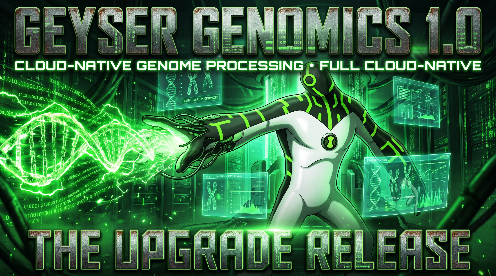

# v1.0: Public Release (draft, not tagged)

The rebuilt pipeline, proven in the cloud on real data, and the repository made public. It's developed
offline first (the whole pipeline runs in Docker against a local folder), then deployed to AWS from reviewed
Terraform plans, under spend guardrails.

From one S3 upload to a VCF:
1. QC (fastp) and alignment (bwa-mem2 → CRAM) run in parallel from the raw reads.
2. Variant calling is either bcftools, split by region and merged exactly, or DeepVariant on a GPU with a
   bcftools fallback.
3. A Rust quality gate judges the run's statistics, and every run leaves a provenance record.

A real GIAB HG003 chr20 sample (30-35x) runs in about 22 minutes for about **$0.07**, and passes all 11
gate checks.

## Highlights

**Pipeline**
- **Offline-first development:** local storage and metrics backends, synthetic data with planted SNPs, and a Docker end-to-end truth check in CI. ([#32](../../../../pull/32), *(no milestone)*)
- **Three stages,** with QC and alignment in a `Parallel` state. Small-sample cloud run: 3 min 45 s → 1 min 52 s. ([#86](../../../../pull/86), [#89](../../../../pull/89))
- **bwa-mem2 by default:** 1.56× faster align on HG003 chr20 ([#110](../../../../pull/110)), with an automatic bwa fallback for references hit by bwa-mem2#262 ([#88](../../../../pull/88)). The cloud reference stores its index, so the align job went from 45.7 s to 29.3 s ([#115](../../../../pull/115)).
- **CRAM + indexes and tabix-indexed VCFs** ([#99](../../../../pull/99)), **QC statistics per sample** ([#102](../../../../pull/102)), and **fastp** instead of FastQC ([#103](../../../../pull/103)).
- **Provenance run record** per sample, assembled from one part per stage ([#105](../../../../pull/105)):
  - it carries the Step Functions execution name ([#114](../../../../pull/114)) and per-stage CPU time and peak memory ([#143](../../../../pull/143));
  - it says which caller's VCF holds the sample's calls ([#166](../../../../pull/166), [#170](../../../../pull/170));
  - a failed run's record can be closed by `tasks.py finalize` ([#156](../../../../pull/156)).
- **Scatter-gather variant calling:** regions called in parallel and merged exactly ([#113](../../../../pull/113)), run by a `Map` state in the cloud ([#140](../../../../pull/140)).
- **Quality gate** in Rust: fails a run with named reasons ([#116](../../../../pull/116), [#123](../../../../pull/123)); a pipeline stage with its verdict in the run record ([#148](../../../../pull/148)); warn mode by default. Thresholds are calibrated on HG003 and HG005.
- **Variant consequences** with `bcftools csq` when the reference has gene models ([#128](../../../../pull/128)).
- **Web UI** for uploads, demo data and results, including the gate verdict and run record ([#37](../../../../pull/37), [#159](../../../../pull/159)). Offline, not deployed.

**DeepVariant** (details in [v0.4](v0.4.md))
- On a local GPU, and pangenome-aware ([#33](../../../../pull/33), [#70](../../../../pull/70)). Graph alignment halves the errors on Google's published HG003 chr20 alignments ([#145](../../../../pull/145)).
- **In the cloud on a GPU** ([#125](../../../../pull/125)): a g6.xlarge GPU environment that scales to zero, `caller=deepvariant` with an automatic bcftools fallback, and PASS-call stats as the sample's ([#147](../../../../pull/147)). Hang and retry safeguards ([#153](../../../../pull/153), [#165](../../../../pull/165)).

**Infrastructure (applied and cloud-verified)**
- **Resilience and sizing:** infrastructure-only retries, Batch API retries, a 12-hour run limit, per-stage vCPU/memory, 30-day log retention. ([#106](../../../../pull/106))
- **Fargate Spot first**, with on-demand as the fallback ([#126](../../../../pull/126)), and a **slim image**: 186 → 87 MB compressed, pulled by every job ([#142](../../../../pull/142)).
- **Storage lifecycle:** intermediates (region parts) expire after 7 days ([#131](../../../../pull/131), [#132](../../../../pull/132)).
- **Terraform state per environment;** prod intentionally not deployed. ([#75](../../../../pull/75))
- **Least-privilege CI:** OIDC with no stored keys, read-only Terraform roles, prod trusting only `main` ([#34](../../../../pull/34), [#35](../../../../pull/35), *(no milestone)*).
- **Cost safety:** no NAT gateway, Fargate in a public subnet, ECR and log retention, a budget alert ([#36](../../../../pull/36), *(no milestone)*).
- **Guardrails for automation:** a bounded role, capped Batch capacity, and a project budget that attaches a deny-all policy by itself ([#74](../../../../pull/74), [#77](../../../../pull/77)).
- **Failure notifications by email** (SNS subscription). ([#122](../../../../pull/122))

**Observability** (details in [v0.3](v0.3.md))
- A deployed CloudWatch dashboard (runs, failures, stage durations, result quality per sample, data lake size), the trigger alarm, and per-stage queue wait, run time, cost and resource use. The benchmark history is a tracked series. ([#54](../../../../pull/54), [#117](../../../../pull/117), [#137](../../../../pull/137), [#143](../../../../pull/143), [#151](../../../../pull/151))

**Fixed**
- **The first cloud run since the rebuild failed in decompress:** a gzip stream over an S3 download claimed to be seekable. ([#72](../../../../pull/72))

**Repository**
- **Public** since 2 Nov 2026, with an [accurate README](../../README.md) ([#172](../../../../pull/172)).
- **Quality gates in CI:** ruff, `terraform fmt`/`validate`, Rust fmt/clippy/tests ([#107](../../../../pull/107)), a Docker layer cache ([#91](../../../../pull/91)), and halved Actions minutes ([#161](../../../../pull/161)).
- **Dependency handling:** exact pins and Dependabot ([#92](../../../../pull/92), [#98](../../../../pull/98)).
- **Contributor docs:** PR template ([#83](../../../../pull/83)), CONTRIBUTING/SECURITY/CITATION ([#93](../../../../pull/93)), test coverage ([#55](../../../../pull/55)).
- **Docs:** documentation that matches what is deployed ([#50](../../../../pull/50), [#111](../../../../pull/111), [#120](../../../../pull/120)), assets without third-party logos ([#90](../../../../pull/90)), design notes for cloud DeepVariant and a whole-genome giraffe stage ([#164](../../../../pull/164)).

## Verified on real data
GIAB HG003 chr20, paired-end, run in the cloud on 2-3 Nov 2026 (image `main-660ec8f`). The quality gate ran on each run's outputs (warn mode). Costs are at Fargate on-demand list prices.

| Run | Reads | Wall time | Cost | Quality gate | Notes |
| :--- | ---: | ---: | ---: | :--- | :--- |
| HG003 35x | 19.0 M | 22 min 31 s | $0.067 | PASS 11/11 | depth 36.8x, Ti/Tv 1.81: the same as the offline calibration |
| HG003 30x | 16.2 M | 21 min 25 s | $0.068 | PASS 11/11 | depth 32.0x, Ti/Tv 1.82 |
| *Runs 3-6* | | | | | *Pending: the remaining real samples and the negative control ([#157](../../../../issues/157))* |

Also verified in the cloud: the GPU DeepVariant checkpoint (g6.xlarge, 10/10 planted SNPs, about $0.16, [#125](../../../../pull/125)), and a deliberately truncated upload failing fast through SNS.

## Pull requests
Milestone v1.0: [#50](../../../../pull/50), [#55](../../../../pull/55), [#72](../../../../pull/72), [#74](../../../../pull/74), [#75](../../../../pull/75), [#77](../../../../pull/77), [#83](../../../../pull/83), [#86](../../../../pull/86), [#88](../../../../pull/88), [#89](../../../../pull/89), [#90](../../../../pull/90), [#91](../../../../pull/91), [#92](../../../../pull/92), [#93](../../../../pull/93), [#98](../../../../pull/98), [#99](../../../../pull/99), [#102](../../../../pull/102), [#105](../../../../pull/105), [#106](../../../../pull/106), [#107](../../../../pull/107), [#110](../../../../pull/110), [#111](../../../../pull/111), [#113](../../../../pull/113), [#114](../../../../pull/114), [#120](../../../../pull/120), [#122](../../../../pull/122), [#140](../../../../pull/140), [#161](../../../../pull/161), [#172](../../../../pull/172).

Listed above from other milestones (or none) where their content belongs: #32-#37, #54, #103, #115-#117, #123, #125-#128, #131, #132, #137, #142, #143, #147, #148, #151, #153, #156, #159, #164-#166, #170.

The faster-and-cheaper work (#86, #88, #89, #99, #110, #113) also forms the [v2.0 "XLR8"](v2.0.md) story. The plan: once v1.0 is tagged, those PRs move to the v2.0 milestone, and this page is trimmed to match.

## Before tagging
- **Done:** the repository is public, the README is current, and v0.3, v0.35 and v0.4 are tagged.
- **The maintainer's:** the `main` ruleset (branch protection) and protection for the `prod` environment; then the v1.0 tag and Release.
- **Open in #47:** the rest of the public-release checklist.
- **Real-sample runs 3-6** (#157): fill in the table above when they finish.
