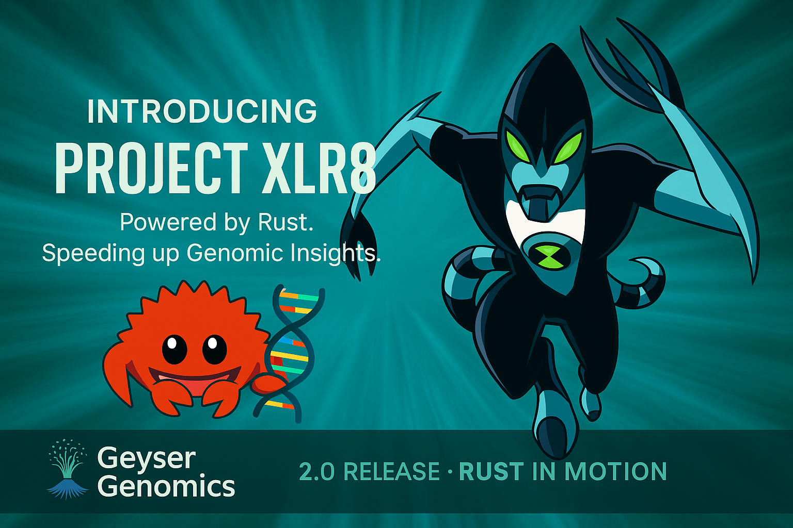
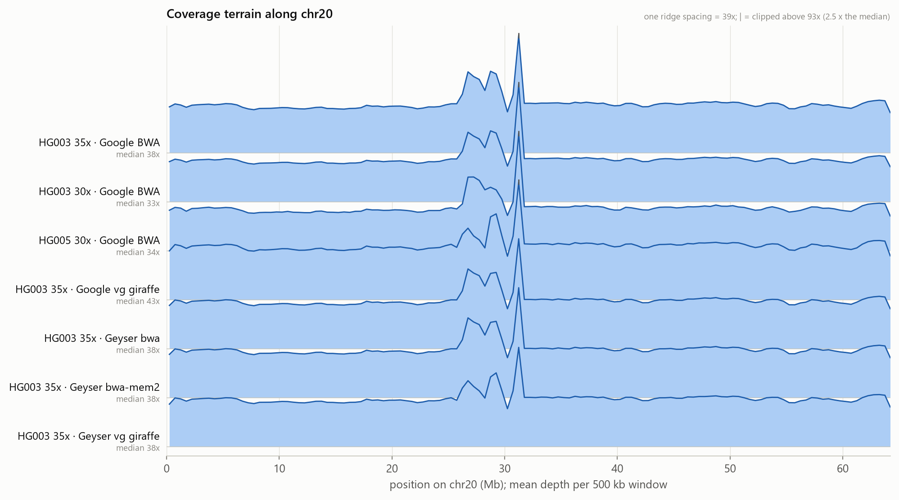

# v2.0 "XLR8": the speed release (draft, not tagged)

2.0 is the speed release. The pipeline does less work, starts each job faster, runs on cheaper capacity and
splits variant calling across jobs. A real 30-35x chromosome 20 sample now goes from upload to checked VCF in
**about 22 minutes for about $0.07**. The run also checks itself: a quality gate reads every run's statistics
and says, with reasons, whether the result is good enough. That's the banner's "speeding up genomic insights"
in measured form.

**Every number below was measured on this pipeline:** cloud runs in `eu-west-2` (named by execution) or the
local HG003 chr20 benchmark. None of it comes from upstream claims. Each number names its source: a pull
request, an issue or a run name.

Some of this work was merged under the **v1.0** milestone (marked *v1.0 milestone*) and also appears in the
[v1.0 draft](v1.0.md). Which tag ships it depends on the order the tags are made. That's the maintainer's
decision, like the tags themselves.

## Highlights

**Less work, in parallel**
- **Three stages instead of four:** QC and alignment read the gzipped upload directly and run side by side,
  so the decompress stage and its `decompressed/` copy are gone. **Cloud run 3 min 45 s → 1 min 52 s** on the
  same 10,000-read sample (`CLOUD001-20261102T101408Z-a31c7977` → `CLOUD002-20261102T132058Z-43888afd`).
  ([#86](../../../../pull/86), [#89](../../../../pull/89), *v1.0 milestone*)
- **fastp instead of FastQC:** one JSON + HTML report that machines can read (the quality gate uses it). Speed
  didn't matter here, because QC is now off the critical path. ([#103](../../../../pull/103))

**Faster tools, less storage**
- **bwa-mem2 by default:** the align stage is **1.56× faster** on HG003 chr20 (812 s → 521 s; 1.65× for the
  aligner alone), for 2.3 GiB more peak memory, with equivalent calls by hap.py. A guard falls back to bwa for
  references hit by upstream bwa-mem2#262. ([#88](../../../../pull/88), [#110](../../../../pull/110),
  *v1.0 milestone*)
- **Index stored, not rebuilt:** the cloud reference keeps bwa-mem2's index, so the align job went from
  **45.7 s → 29.3 s** (`CLOUD005-20261102T151205Z-548b7a1b` → `CLOUD007-20261102T152740Z-c8af04a5`).
  ([#115](../../../../pull/115))
- **CRAM instead of BAM**, with `.crai` and tabix indexes ([#99](../../../../pull/99), *v1.0 milestone*):
  - **real data, about a third of the BAM:** HG003 chr20 35x (9.48M read pairs, bwa-mem2) is a **393 MB CRAM**
    in the cloud (`REAL-HG003-35x-chr20-20261102T210050Z-5bd4cf33`), against 1.08 GB for the BAM the #110
    benchmark wrote from the same reads with the same aligner. That's 36%, and 27% of the 1.48 GB gzipped
    FASTQ upload. The two files were measured, but they come from two different runs, not one controlled
    comparison.
  - on the synthetic sample: 36 KB against 198 KB (5.5×).

**Faster starts, cheaper capacity**
- **Slim image:** **821 MB → 328 MB on disk, 186 MB → 87 MB compressed.** That's what every Fargate task pulls
  before its stage starts, so image size is per-stage latency. Same tool versions, same truth checks.
  Measured in the cloud (`CLOUD012-20261102T185742Z-2f9926cc` old image vs `CLOUD013-20261102T193240Z-93148e9e`
  slim, same state machine and reads): the wait from submission to container start fell from
  **28.1 s to 20.7 s** on average over all six jobs, faster for every one, with run times unchanged. The whole
  run went from **3:45 to 3:13**. One run each, so indicative. ([#142](../../../../pull/142),
  [#141](../../../../issues/141))
- **Fargate Spot first, on-demand fallback** (applied: the job queue tries `geyser-fargate-spot-env`
  first). Spot is roughly 70% cheaper; interrupted tasks are retried by the job definition.
  ([#126](../../../../pull/126))
- **Cost per sample:** **$0.0066-0.0070** for the 10,000-read sample (CLOUD005-010), almost all of it the
  1-minute minimum per job ([#143](../../../../pull/143)). **$0.071-0.079** for a real 30-35x chr20 sample (the
  runs below; corrected in [#184](../../../../pull/184), which found the per-stage report had counted only
  one of the two variant shards). Both are at Fargate *on-demand* list prices; runs placed on Spot cost less, and a measured
  Spot figure is still to come.

**Scale out**
- **Scatter-gather variant calling:** the reference is cut into regions, each called as its own job, and a
  merge concatenates them into the usual VCF. The merge is exact: merged calls equal unsharded calls,
  including SNPs on window boundaries. ([#113](../../../../pull/113), *v1.0 milestone*)
- **The `Map` state in Step Functions** plans the regions, calls them in parallel and merges them
  ([#140](../../../../pull/140), applied and merged, *v1.0 milestone*). First checkpoint:
  `CLOUD012-20261102T185742Z-2f9926cc`, 2 parallel shards of 28 s each.
  - **On a 10,000-read sample the run takes *longer*** (3 min 45 s vs about 2 min), because planning and
    merging each add a job with about a minute of fixed overhead.
  - **On real chr20** the two shards are the work: each ran 299-366 s in parallel, with a 25 s merge
    (`REAL-HG003-35x-chr20-…`, `REAL-HG003-30x-chr20-…`). A cloud run of the same sample without sharding,
    to give the speed-up, hasn't been measured.

**Real samples, end to end in the cloud**

Six runs on GIAB chr20 data, one at a time, on image `main-660ec8f` (2-3 Nov 2026, [#157](../../../../issues/157)):

| Run | Input | Wall time | $ on-demand | Quality gate |
| :--- | :--- | ---: | ---: | :--- |
| `REAL-HG003-35x-chr20-20261102T210050Z-5bd4cf33` | HG003 35x paired | 22 min 31 s | 0.071 | PASS 11/11 |
| `REAL-HG003-30x-chr20-20261102T235811Z-3da626bc` | HG003 30x paired | 21 min 25 s | 0.072 | PASS 11/11 |
| `REAL-HG005-30x-chr20-20261103T002940Z-859d7397` | HG005 30x paired | 22 min 54 s | 0.079 | PASS 11/11 |
| `REAL-HG005-30x-SE-chr20-20261103T011842Z-98517fa7` | HG005, R1+R2 as single-end (31.7x) | 18 min 36 s | 0.063 | PASS 11/11 |
| `REAL-HG003-35x-SE-chr20-20261103T005831Z-7723a9fc` | HG003, R1 only (19.1x) | 12 min 36 s | 0.039 | FAIL: mean depth 19.07 < 20 |
| `REAL-HG003-15x-NEG-chr20-20261103T014007Z-1a09ce99` | HG003 downsampled (16.1x), negative control | 15 min 10 s | 0.045 | FAIL: mean depth 16.14 < 20 |

- **4 good samples pass and 2 under-covered samples fail, both on exactly the check that should catch them.**
  Both failures are true negatives; there were 0 false fails and 0 errors.
- The 35x run reproduces the offline calibration: mean depth 36.78x, Ti/Tv 1.81. So the cloud pipeline and
  the local benchmark agree on real data.
- **Where the time goes:** alignment is about two-thirds of a run (814-955 s of 21-23 min for the paired
  samples). That's where the next speed-up has to come from.
- These six were gated with the same `geyser-gate` binary and `default.toml`, run on each run's downloaded
  statistics. The gate's state-machine step (below) was applied straight after them (3 Nov, 02:29 UTC).

**Know when a run isn't good enough**
- **Quality gate in Rust:** one static 1 MB binary that reads a run's QC statistics and run record. It checks
  base quality, GC, reads lost in alignment, mapped %, duplicates, properly paired, mean depth, breadth at 10×,
  SNP count and Ti/Tv against thresholds, and fails with named reasons. Thresholds calibrated on HG003 and
  HG005 chr20. ([#116](../../../../pull/116), [#123](../../../../pull/123))
- **The gate in the pipeline:**
  - a gate stage with the binary in the image and the verdict in the run record ([#148](../../../../pull/148));
  - the gate as a state-machine step after either caller, **warn mode** by default: the verdict is recorded
    and the run still succeeds ([#162](../../../../pull/162), applied).
  - First run through it: `CLOUD015-20261103T022401Z-6e8ba766`. The gate job costs about $0.0009 and 45 s of
    a 4-minute run.
  - **Thresholds per run** (`gate_profile`: `default` for real samples, `synthetic` for the local test data),
    set with S3 metadata `gate-profile` on the upload or in a manual start's input. An unknown value (a typo,
    mates that disagree) fails the run at the first state, `Check_Gate_Profile`, before any job starts, in
    either gate mode: never a silent default ([#178](../../../../pull/178), applied). Checkpoint
    `CLOUD016-20261103T194442Z-341e1f51` ran with `gate_profile: synthetic`; `CLOUD017-20261103T224702Z-40d619f3`
    without one took `Default_Gate_Profile`. Both runs succeeded, but in both the gate's verdict was FAIL, recorded as a warning (`Gate_Warned`): the cloud smoke sample
    (about 0.02x over chr20) fits neither profile. That's what the `smoke` profile below is for.
- **DeepVariant stats over PASS calls only**, so the gate reads them correctly: RefCall candidates would take
  Ti/Tv from 1.96 to 0.86. ([#147](../../../../pull/147))
- **A failed run closes its own record** before the failure is notified, so its provenance says what failed
  ([#156](../../../../pull/156), [#160](../../../../pull/160)).
- **Resource use per stage:** CPU seconds and peak memory, measured by each job against what it was given;
  the input for right-sizing. ([#143](../../../../pull/143))

**Right-sized from the real runs** ([#174](../../../../pull/174), applied 3 Nov 2026)
- Across all six real runs a variant-calling shard peaked at **130 MiB of the 4 GiB** it was given, the merge at
  81 MiB, and the region planner runs for about 24 s. So the state machine now asks for:

  | Stage | Before | Now |
  | :--- | :--- | :--- |
  | Variant shard (bcftools, single-threaded) | 2 vCPU / 4 GiB | **1 vCPU / 2 GiB** |
  | Merge (`CallVariants`) | 2 vCPU / 4 GiB | **0.25 vCPU / 0.5 GiB** |
  | Region planner | 1 vCPU / 2 GiB | **0.25 vCPU / 0.5 GiB** |
  | QC, align | 1 / 2 GiB, 4 / 8 GiB | unchanged (already the minimum; align is CPU-bound at 3.9 of 4 vCPU) |

- **Estimated saving: about 12% of a real sample's Fargate compute** (~$0.008 of ~$0.07 at on-demand prices),
  worked out from the stage usage of the HG003 35x and 30x runs. The sizes are submit-time overrides, so the
  apply changed only the state machine (0 add / 1 change / 0 destroy) and no job definition. Checkpoint
  `CLOUD016-20261103T194442Z-341e1f51` succeeded at the new sizes (4 min 12 s, small sample).
- The bigger effect is capacity: at 1 vCPU per shard, twice as many shards fit in the 8-vCPU Fargate cap.
  `variants_max_concurrency` stays 4 for now.
- *Slot: the saving measured on a real sample at the new sizes. Number: TBD.*

**DeepVariant on a cloud GPU** (released in [v0.4](v0.4.md), and part of what 2.0 runs)
- `caller=deepvariant` runs DeepVariant on a g6.xlarge (NVIDIA L4), with an automatic bcftools fallback
  ([#125](../../../../pull/125)). Checkpoint `CLOUD014-20261102T203644Z-dv`: **9 min 42 s, 10/10 planted SNPs,
  about $0.16**, most of it instance launch and the 9.87 GB image pull. GPU calling pays off on real
  coverage, where make_examples and call_variants run for tens of minutes.
- When DeepVariant was the caller, its VCF is the sample's calls for the run record, reconcile and the web UI
  ([#170](../../../../pull/170)).

**More from each run**
- **Variant consequences** with `bcftools csq` when the reference has gene models (e.g. missense in DEFB125
  on chr20), shown in the web UI. ([#128](../../../../pull/128))
- **Any S3-compatible storage** via `S3_ENDPOINT_URL`. ([#85](../../../../pull/85))

## Figures

**Read depth along chr20** for seven alignments of the real samples behind the numbers above (Google's BWA
and vg giraffe BAMs, Geyser's bwa, bwa-mem2 and vg giraffe). Flat along the arms, piled up around the
centromere in every one. Geyser's bwa and bwa-mem2 ridges are identical: bwa-mem2 is faster, with the same
depth in every window. Source and commands: [docs/figures](../figures/README.md).

**Cost × turnaround (the hero figure): TBD.** Cost per run and turnaround over align vCPUs × calling shards,
with the Pareto front. The script is ready (`scripts/figures/cost_surface.py`). It needs a grid of cloud runs
and per-run overrides ([#192](../../../../pull/192)), both the maintainer's decision: see the
[grid design note](../figures/cost-surface-grid.md).

## In flight (slots: fill in or drop before tagging)
Each slot names its PR and what's still missing. None of these is applied yet; until a slot is filled, 2.0
doesn't claim it.

- **SLOT: quality gate in fail mode** ([#195](../../../../pull/195), draft infra, not planned). A `smoke` threshold
  profile for the cloud smoke sample, then `gate_mode` `warn` → `fail`, so a failing gate stops a real run.
  Builds on #178 above. *Result: TBD (the apply, and a smoke run passing plus a real run failing as it should).*
- **SLOT: a reference per upload** ([#183](../../../../pull/183), infra, not planned). S3 metadata `reference` on the
  upload chooses the reference genome, checked before any job starts, instead of always `chr20.fa`.
  *Status: TBD.*
- **SLOT: per-run overrides** ([#192](../../../../pull/192), draft infra, planned 0/1/0, not applied). A manual start
  can set align's Fargate size and the variant-calling window, so one state machine serves the whole cost
  grid. Triggered uploads are unchanged. *Status: TBD (the maintainer decides, with the grid).*
- **SLOT: the cost × turnaround grid and figure** (see [Figures](#figures);
  [grid design note](../figures/cost-surface-grid.md)). A grid of real-sample cloud runs over align vCPUs ×
  calling shards, estimated at ~$1.1-2.0, needing #192. *Figure: TBD.*
- **SLOT: lifecycle by break-even** ([#190](../../../../pull/190), draft infra, not planned). `alignments/` expire after
  180 days, when the storage paid equals one recompute. This reverses "outputs never expire", so the
  maintainer decides. *Status: TBD.*
- **SLOT: a real-size GPU DeepVariant run** (chr20 at 30x, `caller=deepvariant`), with GPU utilisation and
  memory ([#139](../../../../issues/139)). It's needed before `default_caller` could switch from bcftools.
  *Wall time, cost and GPU use: TBD.*
- **Giraffe alignment:** `ALIGNER=giraffe` (vg giraffe, reads aligned to the pangenome graph) is merged as an
  offline align option ([#191](../../../../pull/191)). A cloud stage waits for whole-genome sizing ([#146](../../../../issues/146)), so
  it's not a 2.0 item unless that lands.

## Pull requests
| PR | Title |
| :--- | :--- |
| [#81](../../../../pull/81) | Docs: why Step Functions and Batch, not Nextflow |
| [#85](../../../../pull/85) | Storage: S3 backend works with any S3-compatible endpoint |
| [#86](../../../../pull/86) | Three stages: QC and align from the raw reads *(v1.0 milestone)* |
| [#88](../../../../pull/88) | bwa-mem2 as the default aligner *(v1.0 milestone)* |
| [#89](../../../../pull/89) | State machine: QC and align in a Parallel state *(v1.0 milestone)* |
| [#99](../../../../pull/99) | CRAM + indexes *(v1.0 milestone)* |
| [#103](../../../../pull/103) | QC with fastp |
| [#110](../../../../pull/110) | bwa vs bwa-mem2 benchmark on HG003 chr20 *(v1.0 milestone)* |
| [#113](../../../../pull/113) | Scatter-gather variant calling, app half *(v1.0 milestone)* |
| [#115](../../../../pull/115) | Cloud reference: bwa-mem2 index stored |
| [#116](../../../../pull/116) | Quality gate in Rust |
| [#123](../../../../pull/123) | Quality gate: read quality, reads lost, breadth of coverage |
| [#126](../../../../pull/126) | Fargate Spot first, on-demand fallback |
| [#128](../../../../pull/128) | Variant consequences with bcftools csq |
| [#140](../../../../pull/140) | State machine: scatter variant calling with a Map state *(v1.0 milestone)* |
| [#142](../../../../pull/142) | Slim image |
| [#143](../../../../pull/143) | Per-stage CPU time and peak memory *(v0.3 milestone)* |
| [#147](../../../../pull/147) | DeepVariant VCF stats over PASS calls *(v0.3 milestone)* |
| [#148](../../../../pull/148) | Quality gate in the pipeline (app half) |
| [#156](../../../../pull/156) | Close a failed run's record: tasks.py finalize (app half) *(no milestone)* |
| [#160](../../../../pull/160) | State machine: close a failed run's record before notifying *(no milestone)* |
| [#162](../../../../pull/162) | Quality gate in the state machine, warn by default |
| [#166](../../../../pull/166) | Run record: a DeepVariant-only run is complete when its caller succeeds |
| [#174](../../../../pull/174) | Sizing: right-size shards, merge and planner from the real runs |
| [#178](../../../../pull/178) | Quality gate: threshold profile per run (`gate_profile`) |

Cloud DeepVariant ([#125](../../../../pull/125), [#170](../../../../pull/170)) is listed under [v0.4](v0.4.md).

## Before tagging
- **Decide the tag order and the milestone overlap above.** The suggestion: tag v1.0 (public release) first,
  then 2.0 when the placeholders above are filled, and move the *v1.0 milestone* speed PRs to v2.0, so that
  each page lists its own work.
- Fill in or drop each slot under "In flight".
- Measure the open numbers: Spot cost per sample, and a controlled CRAM vs BAM comparison on one run.
- **Banner:** fan art of a third-party cartoon character. The maintainer chose to use it as is (2 Nov 2026), on
  the release page and the README only, never in the dissertation.
