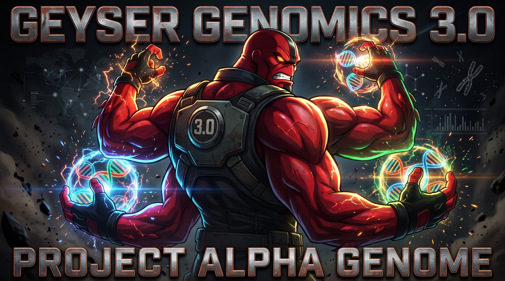

# v3.0 "Alpha Genome": regulatory-effect scores for the variants of interest

3.0 adds an optional step after variant calling. It asks Google DeepMind's **AlphaGenome** what each of a sample's
most confident non-coding variants near a gene does to gene regulation. It records the strongest predicted
effect: which track (assay and tissue or cell type) changes most, and how much the expression of the nearest gene
changes. The sample's page shows these variants, ranked, in a "variants of interest" panel.

The step is **opt-in per run** (`annotate=alphagenome`) and **research use only**. A failed annotation is noted
in the run record and never fails the run.

**Every number below was measured on this pipeline** in `eu-west-2`, and names its source: a pull request or a run
name. **Tagged** 9 Nov 2026. **No AlphaGenome output is in this repository**: this page gives counts only, never scores, tracks or genes.

> By using this information, you agree to AlphaGenome Output Terms of Use found at
> https://deepmind.google.com/science/alphagenome/output-terms

Every AlphaGenome output the pipeline writes carries this notice:
- the annotated VCF, as a header line;
- the variants-of-interest table, as its first line;
- the run record (`alphagenome.terms`);
- the panel on every page, local and hosted.

## Highlights

**The Annotate step** ([#207](../../../../pull/207) app, [#209](../../../../pull/209) infrastructure)
- **`tasks.py annotate <id> <reference>`** reads the run's VCF and selects the variants worth scoring. It scores
  them and writes:
  - `variants/{id}.alphagenome.vcf.gz` (+ `.tbi`): sites only, with `AG_TOP_TRACK`, `AG_GENE`, `AG_RNA_LFC` and
    `AG_SOURCE`;
  - `stats/{id}/alphagenome.tsv`: the ranked variants of interest.
- **Selection:**
  - PASS calls only.
  - With bcftools csq consequences, only non-coding variants near a gene (UTR, splice region, intron, non-coding).
  - Ranked by QUAL, with ties spread by a stable hash, so a capped list isn't simply the first calls along the
    chromosome.
  - Capped at 500 by default (1-20,000).
- **The cloud uses the AlphaGenome Atlas only:** precomputed per-track and per-gene scores, one request per SNV.
  - No AVI (AlphaGenome's variant-impact table) is kept in S3.
  - The offline `avi-file` and `fake` sources are refused on S3 storage.
- **Genome scale:** the VCF is streamed, and the selection keeps only the best N variants in memory. A whole genome
  selects as a chromosome does, with the same result as ranking every call (tested).
- **Sized by the VCF:** `annotate --plan` gives the job's vCPUs, memory and time from the VCF's size and the cap.
  - The state machine runs `Plan_Annotate` first and then sizes the `Annotate` job from the plan.
  - With nothing to annotate, the run skips the step.
- **Its own image:** `geyser-annotate` is `geyser-app` plus the AlphaGenome client 0.10.0, about 301 MB
  compressed. The client is kept out of every other stage's pull.
- **The key:**
  - It is an SSM SecureString (`/geyser/alphagenome/api-key`), mapped into the job by the job definition.
  - The code reads it only from the environment, never logs it, and redacts it from client errors.
- **Both routes:** chromosome-scale and whole-genome runs end in the same VCF and run record, so Annotate is the
  same step on both.

**The variants-of-interest panel** ([#263](../../../../pull/263))
- The sample page shows the table with the research-only note and the terms notice, on the local UI and on the
  hosted site.
- **No AlphaGenome downloads on the hosted site:** visitors see only the panel, with its notice. The web API's
  allowlist leaves those files out (pinned by a test).

**On the dashboard** ([#264](../../../../pull/264), O8, counts only)
- An Annotate stage group: duration and failures, like every stage.
- AlphaGenome API calls per day (`AnnotateApiCalls`), as a cost and quota signal.
- No widget shows a score, track or gene. Deployed 9 Nov 2026 from `61effcc`.

## Verified in the cloud
Images:
- `geyser-app` at `dev-local` = `main-5e27bca` (rollback `main-2d6b020`);
- `geyser-annotate` at `dev-local` = `main-5e27bca`.

| Run | Outcome | What it showed |
| :--- | :--- | :--- |
| `CLOUD023-20261109T202550Z-cb71db21` | **FAILED**, before any job started | The Step Functions role lacked `batch:TagResource` on job definitions. The cost tags that #149 added to every job need it, so **every run since #149's apply would have failed the same way**. Hotfix 1 to #209 (0/1/0). |
| `CLOUD024-20261109T203056Z-86054608` | **FAILED** the same way, one level on | `batch:TagResource` on the job queue. Hotfix 2 (0/1/0). |
| `CLOUD025-20261109T203513Z-10b2d37d` | **SUCCEEDED**, annotation refused | The core pipeline ran and published, but `Plan_Annotate` was denied `batch:SubmitJob` (a stray `}` in the annotate job definition's ARN). The never-fatal design held: the step was noted as failed and the run still succeeded. Hotfix 3 (0/1/0). |
| `CLOUD026-20261109T204333Z-f7ddf042` | **SUCCEEDED in 7 min 7 s** | `annotate=alphagenome`, `smoke` gate profile. The Atlas scored **10 of 10 SNVs in 10 API calls**. The Annotate job ran in 2.9 s with a peak of 231 MiB. The panel is on the hosted page with the terms notice. **0 occurrences of the key** in the logs. |

All three hotfixes were small in-place policy changes, each planned against counts written down beforehand, with a
"No changes" re-plan after. A new consistency test now checks that every job definition and queue a `SubmitJob`
names is covered by the role's policy, so neither mistake can recur unnoticed.

## In flight (slots: fill in or drop before tagging)
- **[#208](../../../../pull/208), the evaluation harness and design note**: how AlphaGenome's selected variants
  compare with known regulatory variants. *(slot: the result, as counts and rates only)*

## Pull requests
| PR | Title |
| :--- | :--- |
| [#207](../../../../pull/207) | AlphaGenome annotation: `tasks.py annotate`, selection, backends, outputs; Atlas only in the cloud, streamed selection, job size plan |
| [#209](../../../../pull/209) | AlphaGenome Annotate step: per-run setting, own image and job definition, SSM key by reference (merged 9 Nov 2026 at `51aac5a`, with the three hotfixes and the guard test) |
| [#263](../../../../pull/263) | AlphaGenome variants-of-interest panel on the sample page, local and published |
| [#264](../../../../pull/264) | O8: AlphaGenome annotation signals on the dashboard (counts only) |

The research plan behind the evaluation is preregistered in [docs/prereg/rp1-alphagenome.md](../prereg/rp1-alphagenome.md).

## Open at the tag (9 Nov 2026)
- [#208](../../../../pull/208), the evaluation harness: SLOT, the maintainer's call (in v3.0, or Future).
