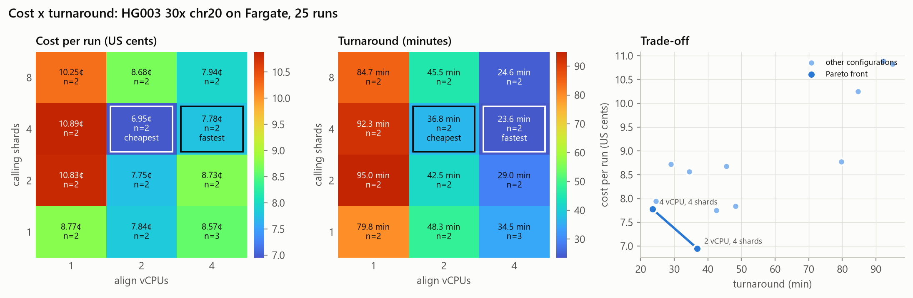
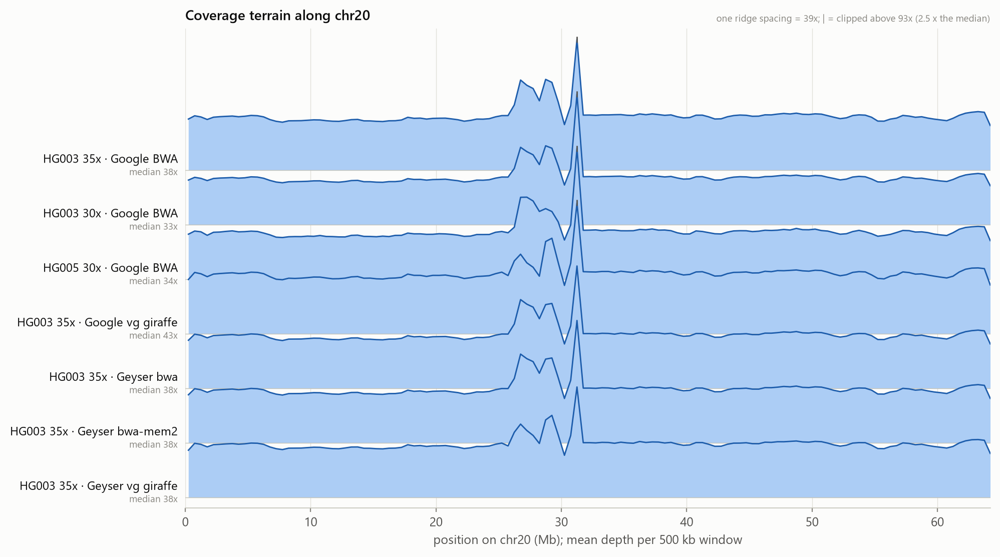
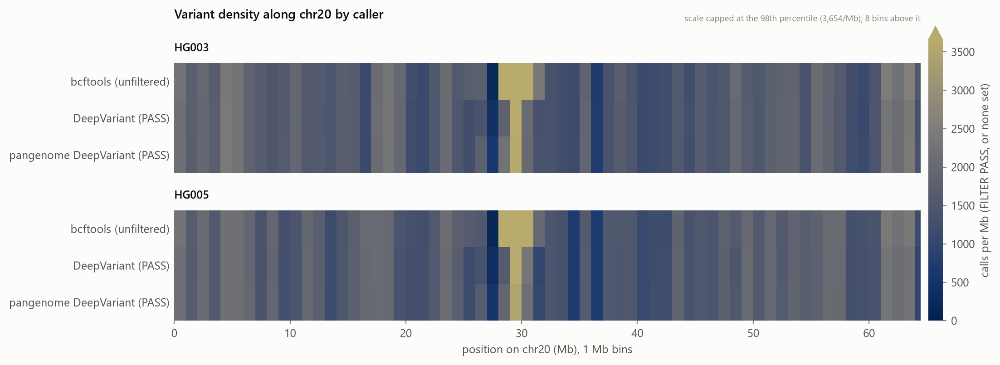
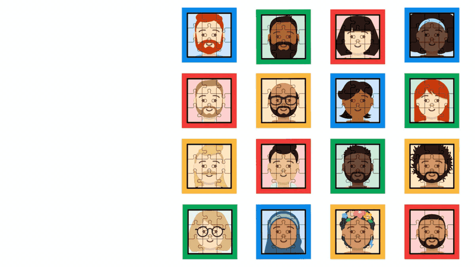
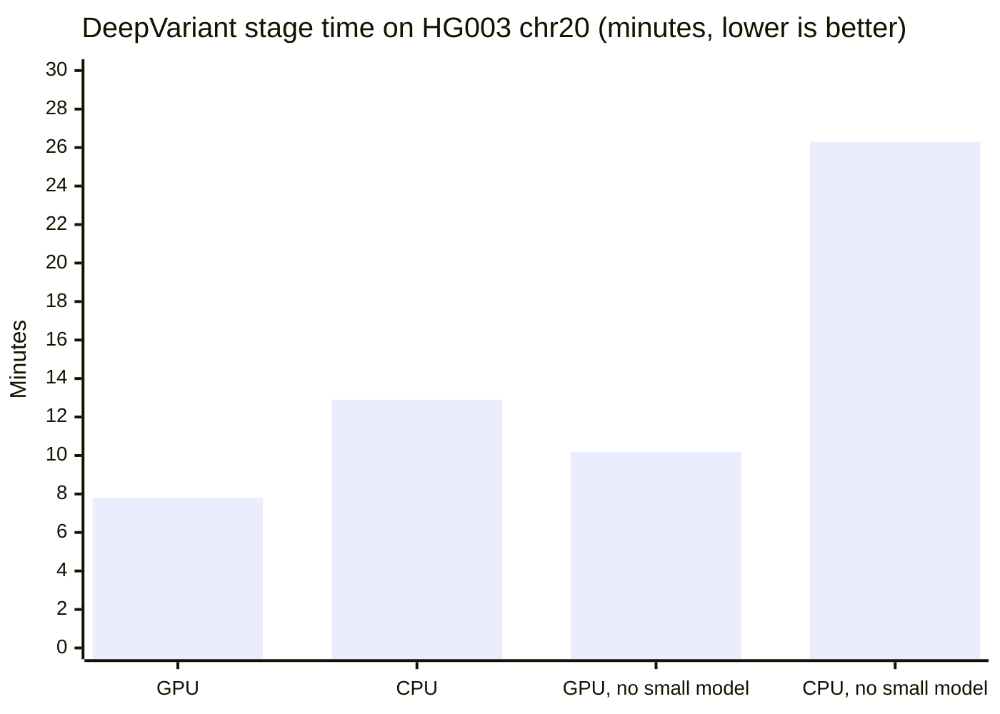

# Results and benchmarks

Every number here was measured on this pipeline or on the local GPU, and is scored against the GIAB truth sets. The [release notes](releases/README.md) have every cloud run.

## 📊 Results

Real chromosome 20 data (GIAB HG003 and HG005), drawn by scripts from small derived CSVs, never by hand. Sources, commands and the numbers behind each figure are in [docs/figures](figures/README.md). Click a figure for the SVG.

**Graph alignment:** vg giraffe cut DeepVariant's errors by about half against BWA (−51%, 186 SNP + indel errors against 378).
<sub>HG003 chr20, linear DeepVariant on Google's published case-study alignments: vg giraffe (graph) against BWA, 186 SNP + indel errors against 378, scored with hap.py (vcfeval, PASS only) against GIAB v4.2.1 confident regions, the method of Google's case studies (<a href="https://github.com/Harry5haw/Geyser-Genomics/pull/145">#145</a>). The giraffe BAM is not duplicate-marked and the BWA one is. Aligning only the reads BWA had placed on chr20 with this project's own giraffe step gave a smaller gain (368 errors, <a href="https://github.com/Harry5haw/Geyser-Genomics/pull/129">#129</a>). Cloud cost at Fargate on-demand list prices.</sub>

<a href="figures/cost-surface.svg"></a>

**Cost and turnaround of a real 30x chromosome-20 run, over the two sizing knobs** (25 Fargate runs, 2-3 per setting). Align vCPUs set the turnaround: about 85, 45 and 25 minutes at 1, 2 and 4. Calling shards matter far less: at 2 and 4 vCPUs, 4 shards is both the cheapest and the fastest. The cheapest setting (2 vCPU, 4 shards) costs 6.95¢ a run; the fastest (4 vCPU, 4 shards) costs 7.78¢ and takes 24 minutes. 1 vCPU is both the slowest and the most expensive. Costs are at on-demand list prices, an upper bound, since jobs try Fargate Spot first.

<a href="figures/coverage-terrain.svg"></a>

**Read depth along chr20, seven alignments.** Coverage is flat along the chromosome arms, but around the centromere (26-31 Mb) reads pile up in every alignment, to about 1.7× the usual depth, and 2-3× in one window at 31 Mb, most likely reads from repeated sequence piling up on the reference's single copy.

<a href="figures/variant-density.svg"></a>

**Calls per megabase along chr20, by caller.** In that same pile-up, bcftools makes about 4× as many calls per Mb as DeepVariant's PASS calls (HG003, 29-30 Mb: 16,421 against 3,763), and about 25% more over the whole chromosome. bcftools applies no filter here, so its row is every call, as hap.py scored it. Linear and pangenome-aware DeepVariant look the same at this scale.

Also: [per-base quality by sequencing cycle](figures/quality-surface.png) for the six real-sample cloud runs (R2 a little lower than R1 towards the end of the read, as expected for Illumina).

---
### DeepVariant on a local NVIDIA GPU

[Google DeepVariant](https://github.com/google/deepvariant) `1.10.0` is available as an alternative variant caller, in its own image (`app-deepvariant/`). It reads the same `alignments/<id>.cram` (or a BAM, for imported data) and writes `variants_deepvariant/<id>.vcf.gz`, so its calls can be compared with the bcftools calls.

#### Why the reference genome matters: pangenomes

<div align="center">
  
  <br/>
  <sub>Animation: Google Research, from <a href="https://research.google/blog/building-better-pangenomes-to-improve-the-equity-of-genomics/"><i>Building better pangenomes to improve the equity of genomics</i></a> (Andrew Carroll and Kishwar Shafin, May 2023).</sub>
</div>

<br/>

Variant callers like DeepVariant find variants by comparing reads with a **reference genome**. The standard reference is a single linear sequence, so variation it doesn't contain is easy to miss or to call wrongly. A study of 910 African individuals found about 300 million base pairs, roughly 10% of the reference, that were present in at least one person but absent from the linear reference.

A **pangenome** reference is a graph that combines many people's genomes. The Human Pangenome Reference Consortium's first draft (*Nature*, 2023) combines 47 genomes chosen to better reflect global diversity. Google and UC Santa Cruz built a graph-based variant-calling workflow around DeepVariant and reported improved accuracy across several thousand samples.

> [!NOTE]
> **Where this project is:**
> - **Done:** pangenome-aware variant calling (Google's pangenome-aware DeepVariant with the HPRC graph) runs **locally on the GPU** and is benchmarked on chr20 of HG003 (Ashkenazi) and HG005 (Han Chinese), overall and by GIAB region type (results below).
> - **Graph alignment, benchmarked offline:** reads aligned to the pangenome graph with vg giraffe (haplotype sampling, surjected to GRCh38) give the most accurate calls on HG003 chr20 (results below). The align stage runs it locally with `ALIGNER=giraffe` (#146). It isn't in the cloud yet, and bwa-mem2 stays the default.
> - **Not yet:** whole-genome graphs and runs in the cloud. These are next on the [Roadmap](roadmap.md) (#51).

#### Running it

```bash
docker run --rm --gpus all nvidia/cuda:12.3.2-base-ubuntu22.04 nvidia-smi   # GPU visible to Docker?
docker build -f app-deepvariant/Dockerfile -t geyser-deepvariant .
python scripts/run_local.py --sample SYNTH001 --reference synthetic_ref.fa --caller both --check

# Real data: NA12878, chr20:10.0-10.1 Mb, with the GIAB truth set (~5 MB download)
python scripts/fetch_dv_testdata.py
python scripts/run_local.py --sample NA12878_S1 --reference ucsc.hg19.chr20.unittest.fasta \
    --caller both --skip-to-variants --check

# Whole chromosome: HG003, NovaSeq 35x, all of chr20 on GRCh38, with GIAB v4.2.1 truth (~1.34 GB download)
python scripts/fetch_dv_testdata.py --dataset hg003-chr20
python scripts/run_local.py --sample HG003_chr20 --reference GRCh38_chr20.fa \
    --caller deepvariant --skip-to-variants --check --dv-memory 12g

# Pangenome-aware DeepVariant (GPU image) with the HPRC v1.1 graph cut down to chr20 (built locally with vg)
docker build -f app-deepvariant/Dockerfile --build-arg DV_TAG=pangenome_aware_deepvariant-1.10.0-gpu \
    -t geyser-deepvariant-pangenome .
python scripts/fetch_dv_testdata.py --dataset hg003-chr20 --pangenome
DEEPVARIANT_SHARDS=6 DEEPVARIANT_EXTRA_ARGS="--call_variants_extra_args=batch_size=256" \
python scripts/run_local.py --sample HG003_chr20 --reference GRCh38_chr20.fa \
    --caller pangenome --skip-to-variants --dv-memory 14g

# Score every caller's VCF with hap.py (vcfeval engine, PASS only, GIAB confident regions)
python scripts/benchmark_happy.py --sample HG003_chr20 --reference GRCh38_chr20.fa --region chr20

# HG005 (Han Chinese) and an HG003 control from the same 30x BAM set; only chr20 is fetched (~1 GB each).
# --stratifications adds GIAB region BEDs (difficult regions, segdups, low mappability) for a per-region table.
python scripts/fetch_dv_testdata.py --dataset hg005-chr20 --stratifications
python scripts/fetch_dv_testdata.py --dataset hg003-30x-chr20
python scripts/benchmark_happy.py --sample HG005_chr20 --reference GRCh38_chr20.fa --region chr20 \
    --stratification stratifications/GRCh38_chr20.tsv

# Every scored caller is appended to the benchmark history with the commit (--aligner / --caller-settings say
# what produced the calls). Regenerate the report and commit both:
python scripts/benchmark_history.py report
```

**Benchmark history:** every hap.py result so far, 22 configurations across HG003 and HG005, is in one tracked series, [`docs/benchmarks/history.csv`](benchmarks/history.csv), with the [report](benchmarks/README.md) and a figure-ready CSV. The tables below are excerpts.

**Accuracy: HG003 chr20, hap.py.** HG003 is NovaSeq PCR-free 35x, scored against GIAB v4.2.1 confident regions. These are the same settings Google's case studies use (`--engine=vcfeval --pass-only`):

| Caller | Type | Missed (FN) | False (FP) | Recall | Precision | F1 |
| :--- | :--- | ---: | ---: | ---: | ---: | ---: |
| bcftools | SNP | 361 | 835 | 0.9949 | 0.9882 | 0.9915 |
| bcftools | Indel | 582 | 487 | 0.9452 | 0.9562 | 0.9507 |
| DeepVariant 1.10 (linear) | SNP | 263 | 52 | 0.9963 | 0.9993 | **0.99775** |
| DeepVariant 1.10 (linear) | Indel | 48 | 15 | 0.9955 | 0.9986 | 0.99706 |
| Pangenome-aware DeepVariant 1.10 | SNP | **242** | 78 | **0.9966** | 0.9989 | 0.99772 |
| Pangenome-aware DeepVariant 1.10 | Indel | **42** | 18 | **0.9960** | 0.9984 | **0.99721** |

- **The setup reproduces Google's published result.** Their pangenome-aware BWA case study on the same BAM reports SNP F1 0.997746 and indel F1 0.996788 (version 1.9, whole-genome graph). Here: 0.997718 and 0.997206, with a chr20-only graph and version 1.10.
- **The pangenome finds variants the linear reference misses.** Missed SNPs fall by 8% (263 → 242) and missed indels by 13% (48 → 42).
- **It also makes slightly more false calls** (SNPs 52 → 78). On this one sample the total error count is level: 378 for linear against 380 for pangenome-aware.
- **HG003 is a hard case for showing a benefit.** It is Ashkenazi Jewish, an ancestry the standard reference already represents well. The preprint reports the largest gains with more diverse samples, whole genomes (most segmental duplications are on other chromosomes) and reads aligned to the graph. The HG005 benchmark below tests the first of these.
- **bcftools is much better than earlier exact-match counts suggested** (SNP F1 0.99, not 0.87). Exact (position, ref, alt) matching without normalisation heavily penalised its indel representation.

**Does ancestry matter? HG005 against HG003, chr20, hap.py.** HG005 is Han Chinese. To isolate ancestry, both samples come from the same Google data set: NovaSeq PCR-free 30x, BWA-MEM to hs38DH, Picard MarkDuplicates. Only chr20 is fetched (`fetch_dv_testdata.py --dataset hg005-chr20` / `hg003-30x-chr20`). Errors are missed + false calls:

| Sample | Caller | SNP FN / FP | SNP F1 | Indel FN / FP | Indel F1 |
| :--- | :--- | ---: | ---: | ---: | ---: |
| HG003 30x | DeepVariant (linear) | 273 / 81 | 0.99747 | 63 / 28 | 0.99577 |
| HG003 30x | Pangenome-aware DeepVariant | **250** / 90 | **0.99757** | **53** / 28 | **0.99623** |
| HG005 30x | DeepVariant (linear) | **233 / 58** | **0.99788** | 49 / 11 | 0.99646 |
| HG005 30x | Pangenome-aware DeepVariant | 244 / 95 | 0.99753 | **39 / 10** | **0.99711** |

By GIAB region type (`--stratification`, GIAB v3.3 stratifications), SNP errors as FN / FP, linear → pangenome-aware:

| Region (chr20) | HG003 30x | HG005 30x |
| :--- | :--- | :--- |
| Segmental duplications | 30 / 36 → **13 / 25** | 47 / 30 → **30 / 25** |
| Low mappability (all) | 238 / 48 → **222** / 55 | 205 / 42 → 230 / 73 |
| Outside all difficult regions | 17 / 23 → **16 / 17** | 10 / 6 → **6 / 2** |

- **The ancestry prediction did not hold here.** On HG005, pangenome-aware DeepVariant made *more* SNP errors than linear (291 → 339), though fewer indel errors (60 → 49). On HG003 from the same data set it improved both (SNPs 354 → 340, indels 91 → 81).
- **Segmental duplications are where the pangenome helps on both samples.** SNP errors there fall by 42% for HG003 (66 → 38) and 29% for HG005 (77 → 55). chr20 has only 149 segmental-duplication intervals, so a whole-genome run should show more of this gain.
- **HG005's extra SNP errors are in low-mappability regions outside segmental duplications** (FN 205 → 230, FP 42 → 73). They are not explained yet. Looking at those sites is the next step.
- **No leakage:** HG005 is not one of the 46 samples in the HPRC v1.1 graph (checked with `vg gbwt -L`; HPRC held out HG002, HG005 and NA19240). The graph does contain several Han Chinese samples (e.g. HG00438, HG00621, HG00673), so HG005's ancestry is represented. HG003 is not in it either.
- **Caveats:**
  - One chromosome and one run per caller, so differences of a few dozen variants are small.
  - The truth regions differ in kind. GIAB v4.2.1 ships only a "noinconsistent" BED for HG003 and only a plain BED for HG005. The plain BED keeps some harder sites the other drops, which could account for part of HG005's extra errors.
  - The 30x BAMs are aligned to hs38DH (with ALT and decoy contigs), the 35x HG003 BAM to no_alt. Only 0.03% of chr20 reads sit on chr20's ALT contigs (6,011 for HG005, 4,305 for HG003, from the BAM indexes), so dropping them by fetching `chr20` only has a negligible effect. The two 30x samples are aligned identically.
- **Time:** pangenome-aware DeepVariant took 21.4 min on HG005 and 20.3 min on HG003 30x, with the settings below.

**Aligning to the graph: vg giraffe vs bwa-mem2, HG003 chr20, hap.py** (`scripts/benchmark_giraffe.py`). Both aligners get the same 19.0 M reads (recovered from the 35x case-study BAM). bwa-mem2 aligns them to the chr20 reference with the pipeline's align stage; vg giraffe 1.55.0 aligns them to the HPRC v1.1 chr20 graph. Giraffe uses haplotype sampling, a personal 2-haplotype graph chosen from the sample's own k-mers, then surjects the reads to GRCh38 (Google's VG case-study flags). Both BAMs get the same fixmate, sort and markdup. Errors are missed + false calls:

| Alignment + caller | SNP FN / FP | Indel FN / FP | SNP + indel errors | SNP errors in segdups | SNP errors, low mappability |
| :--- | ---: | ---: | ---: | ---: | ---: |
| bwa-mem2 + DeepVariant (linear) | 266 / 120 | 50 / 18 | 454 | 79 | 323 |
| bwa-mem2 + pangenome-aware DeepVariant | 251 / 108 | 41 / 17 | 417 | 45 | 304 |
| **giraffe + DeepVariant (linear)** | 216 / **91** | 40 / 21 | **368** | **25** | **230** |
| giraffe + pangenome-aware DeepVariant | **190** / 146 | **31** / 21 | 388 | 76 | 237 |

- **Aligning to the graph helps more than a graph-aware caller.** Giraffe with plain linear DeepVariant has the fewest errors: 19% fewer than bwa-mem2 + linear, and 12% fewer than bwa-mem2 + pangenome-aware DeepVariant. In segmental duplications, its SNP errors fall from 79 to 25.
- **Pangenome-aware DeepVariant on giraffe reads finds the most variants** (fewest misses: SNP 190, indel 31) **but adds false SNPs**: 146 against 91 with linear DeepVariant on the same reads. 53 of those 55 extra false SNPs are in segmental duplications (74 there against 21). The two pangenome inputs, reads already placed with the graph plus graph haplotypes at every site, seem to overcount evidence there. Google's two case studies (pangenome-aware DeepVariant, whole genome, HG003 35x) show the same direction: SNP FN/FP 240/76 with BWA and 72/106 with giraffe.
- **Cost per sample:**
  - giraffe: 546 s, of which 462 s mapping, peak 1.5 GiB; plus 158 s for fixmate, sort and markdup.
  - bwa-mem2 align stage: 521 s, peak 7.4 GiB.
  - Giraffe also needs a 37 s k-mer count (kmc, capped at 8 GB) per sample.
  - One-off graph indexes (distance index, r-index, haplotype information) take 345 s and under 1.5 GiB for chr20.
- **Caveats:**
  - **Biased towards the linear aligner.** The reads are only those BWA had placed on chr20 in Google's BAM, and the graph and reference are chr20 only. With whole-genome alignments the gain is much larger (next table).
  - **Flags differ for linear DeepVariant.** On giraffe BAMs it runs with Google's VG flags (`min_mapping_quality=0`, `keep_legacy_allele_counter_behavior`, `normalize_reads`); on the bwa-mem2 BAM it runs with defaults.
  - **One run each.** Pangenome-aware DeepVariant ran with 12 `make_examples` workers here (16.5 and 16.0 min); shard count changes speed only, not the calls.

```bash
python scripts/benchmark_aligners.py --root <root> --from-bam alignments/HG003_chr20.bam --base HG003_chr20 \
    --reference GRCh38_chr20.fa --region chr20          # reads + bwa-mem2 BAM first
python scripts/fetch_dv_testdata.py --dataset hg003-chr20 --pangenome --stratifications
python scripts/benchmark_giraffe.py --root <root> --base HG003_chr20 --reference GRCh38_chr20.fa \
    --region chr20 --stratification stratifications/GRCh38_chr20.tsv --pg-shards 12 --pg-memory 18g
```

**Without the bias: Google's whole-genome alignments, HG003 chr20, hap.py** (`scripts/benchmark_calls.py`). Google's two pangenome-aware case studies publish BAMs of the same HG003 35x reads aligned to the **whole genome**: one with BWA-MEM to GRCh38, one with vg giraffe to the whole-genome HPRC v1.1 graph. Both are cut to chr20 afterwards (`fetch_dv_testdata.py --dataset hg003-chr20` / `hg003-chr20-vg`). Every read could go anywhere in the genome, so neither aligner is favoured. Calls use the chr20 graph:

| Alignment + caller | SNP FN / FP | Indel FN / FP | SNP + indel errors | SNP errors in segdups | SNP errors, low mappability |
| :--- | ---: | ---: | ---: | ---: | ---: |
| BWA + DeepVariant (linear) | 263 / 52 | 48 / 15 | 378 | 52 | 257 |
| BWA + pangenome-aware DeepVariant | 242 / 78 | 42 / 18 | 380 | 41 | 266 |
| BWA + pangenome-aware DeepVariant, MAPQ ≥ 5 | 235 / 62 | 43 / 19 | 359 | 46 | 240 |
| **giraffe + DeepVariant (linear)** | 75 / **44** | 40 / 27 | **186** | **7** | **46** |
| giraffe + pangenome-aware DeepVariant | **72** / 104 | **30** / 22 | 228 | 69 | 70 |
| giraffe + pangenome-aware DeepVariant, MAPQ ≥ 5 | 96 / 87 | 36 / 30 | 249 | 55 | 79 |

- **The setup reproduces Google's VG case study:** giraffe + pangenome-aware DeepVariant gives SNP FN/FP 72/104, against Google's published 72/106.
- **Aligning to the graph halves the errors.** giraffe + plain linear DeepVariant has 186 errors against 378 for BWA + linear (51% fewer). In low-mappability regions SNP errors fall from 257 to 46, and in segmental duplications from 52 to 7. The chr20-only experiment above understated this, because its reads were the ones BWA had already put on chr20.
- **On graph-aligned reads, linear DeepVariant beats the pangenome-aware model for SNPs** (119 against 176 SNP errors). The pangenome model still has the fewest misses and the fewest indel errors (52 against 67), but over-calls in segmental duplications (69 SNP errors there against 7).
- **The MAPQ ≥ 5 filter helps only with BWA** (380 → 359). On giraffe reads it makes things worse (228 → 249), mostly through more missed SNPs (72 → 96). A likely reason, not verified: giraffe gives low mapping quality to reads the graph can still place usefully, so filtering them loses real evidence.
- **Caveats:**
  - The giraffe BAM is published without duplicate marking and the BWA BAM with it. This is Google's own comparison, kept as published.
  - Linear DeepVariant on giraffe uses Google's VG flags.
  - One chromosome and one run each.

```bash
python scripts/fetch_dv_testdata.py --dataset hg003-chr20 --pangenome --stratifications
python scripts/fetch_dv_testdata.py --dataset hg003-chr20-vg                     # 947 MB
python scripts/benchmark_calls.py --root <root> --preset google-case-studies --reference GRCh38_chr20.fa \
    --region chr20 --stratification stratifications/GRCh38_chr20.tsv --pg-shards 12 --pg-memory 18g
```

Small datasets (exact-match counts): synthetic data, 10/10 planted SNPs and 0 extra calls for both callers; NA12878 slice, bcftools 45 TP / 4 FN / 4 FP and DeepVariant 49 TP / 0 FN / 0 FP. DeepVariant's accuracy is identical on GPU and CPU.

**Pangenome-aware DeepVariant: time and memory** (HG003 chr20, RTX 3080 10 GB, 16 CPUs, 6 `make_examples` workers):

| Step | Time | Notes |
| :--- | ---: | :--- |
| `make_examples` (CPU) | 936 s | Pileups from the reads and from the pangenome haplotypes at every candidate site |
| `call_variants` (GPU) | 257 s | 231,085 examples, about 3× linear DeepVariant's 79,759. Pangenome mode has no small model, so every candidate reaches the network. |
| `postprocess_variants` | 21 s | |
| **Stage total** | **1,241 s (20.7 min)** | |

- **Graph size drives memory.** HPRC's whole-genome graph (3.29 GB file) takes about 10.7 GB of shared memory once loaded, plus about 2 GB per `make_examples` worker. That ran out of memory in a 22 GB container. The chr20 graph built by `fetch_dv_testdata.py` (72 MB, same 46 samples / 90 haplotypes) loads in under a second, and the container peaked at about 8.4 GB.
- **GPU memory.** At the default batch size (1,024), `call_variants` ran out of memory on the 10 GB card (it tried to allocate 2.7 GB blocks). At batch 256 it fits. A 24 GB cloud GPU (A10G, L4) should run the default.
- **Known issue.** After the out-of-memory error, Google's wrapper hung instead of exiting. In the cloud, the stage needs a job timeout.

**Timing: whole chromosome.** HG003 chr20, 35x, measured on an RTX 3080 (10 GB) under Docker Desktop/WSL2 with 16 CPUs, one run per configuration. These are times for the DeepVariant stage only:

| Device | Small model | Examples sent to the neural network | make_examples (CPU) | call_variants (GPU step) | postprocess (CPU) | Stage total |
| :--- | :--- | ---: | ---: | ---: | ---: | ---: |
| GPU | on (default) | 79,759 | 298.6 s | **128.1 s** | 17.5 s | **466.7 s** (7.8 min) |
| CPU | on (default) | 79,759 | 306.8 s | **426.5 s** | 21.6 s | **776.4 s** (12.9 min) |
| GPU | off | 222,978 | 303.5 s | 266.5 s | 20.5 s | 609.9 s (10.2 min) |
| CPU | off | 222,978 | 336.4 s | 1,200.5 s | 16.9 s | 1,575.4 s (26.3 min) |



**At whole-chromosome scale the GPU pays off.**
- With default settings, `call_variants` is **3.3× faster** on the GPU and the whole stage is **1.7× faster**. With the small model off, `call_variants` is 4.5× faster: about 840 examples/s on the GPU against about 190 on the CPU.
- The stage gains less than `call_variants` does, because `make_examples` (about 300 s) runs on the CPU on either image. It is the largest step on the GPU.
- The small model is itself a CPU speed-up: it makes 64% of the calls before the neural network is involved.
- bcftools took 409 s for the same chromosome.

The CPU runs used a 12 GB container cap (`--dv-memory 12g`) and `--call_variants_extra_args=batch_size=256`. Without a cap, CPU `call_variants` took most of the 16 GB Docker VM and starved Windows. An 8 GB cap was too small for 16 `make_examples` shards.

<details>
<summary><b>Timing on small inputs (where the GPU is slower)</b></summary>

<br/>

Same machine, median of 3 runs:

| Data | Device | Small model | Examples sent to the neural network | make_examples (CPU) | call_variants (GPU step) | postprocess (CPU) | Stage total |
| :--- | :--- | :--- | ---: | ---: | ---: | ---: | ---: |
| Synthetic 50 kb | GPU | on | 0 | 13.8 s | 4.7 s | 6.1 s | 27.7 s |
| Synthetic 50 kb | CPU | on | 0 | 15.0 s | 4.0 s | 6.0 s | 27.6 s |
| Synthetic 50 kb | GPU | off | 10 | 13.2 s | 18.7 s | 5.9 s | 41.1 s |
| Synthetic 50 kb | CPU | off | 10 | 12.2 s | 12.3 s | 5.7 s | 32.9 s |
| NA12878 100 kb | GPU | on | 90 | 33.6 s | 18.5 s | 5.7 s | 61.2 s |
| NA12878 100 kb | CPU | on | 90 | 34.2 s | 13.4 s | 5.6 s | 56.5 s |
| NA12878 100 kb | GPU | off | 305 | 33.3 s | 20.0 s | 6.6 s | 63.3 s |
| NA12878 100 kb | CPU | off | 305 | 32.9 s | 14.3 s | 5.7 s | 56.2 s |

**On small inputs the GPU is 5–6 s slower than the CPU.** With at most a few hundred examples, `call_variants` time is almost entirely fixed start-up: loading the model and initialising CUDA and cuDNN. The GPU's start-up costs more than TensorFlow's on the CPU. On the synthetic data, the small model makes every call, so the neural network sees nothing. `nvidia-smi` sampling confirmed the GPU was used: utilisation peaked at 98%, and TensorFlow reserved nearly all free VRAM.

</details>

**Tests.** `GEYSER_GPU_E2E=1 pytest tests/test_e2e_deepvariant.py` runs the GPU image. `GEYSER_DV_E2E=1` runs the CPU image; CI runs that one on pull requests, because GitHub runners have no GPU. Setting `GEYSER_DV_TESTDATA=<bucket>` also runs the real slice. `GEYSER_PG_E2E=1 pytest tests/test_e2e_pangenome.py` runs the real pangenome-aware image on synthetic data with a synthetic graph (`make_test_data.py --pangenome`): the 10 planted SNPs are called, and none of the 5 SNPs only the graph's panel carries. In the cloud, linear DeepVariant runs on a GPU Batch environment (g6.4xlarge / g5.4xlarge) when a run is started with `caller=deepvariant`, with bcftools as the fallback ([design](design/cloud-deepvariant.md)). Pangenome-aware DeepVariant is local only for now. Sizing notes: [`app-deepvariant/README.md`](../app-deepvariant/README.md).

---

---

[← Back to the README](../README.md)
