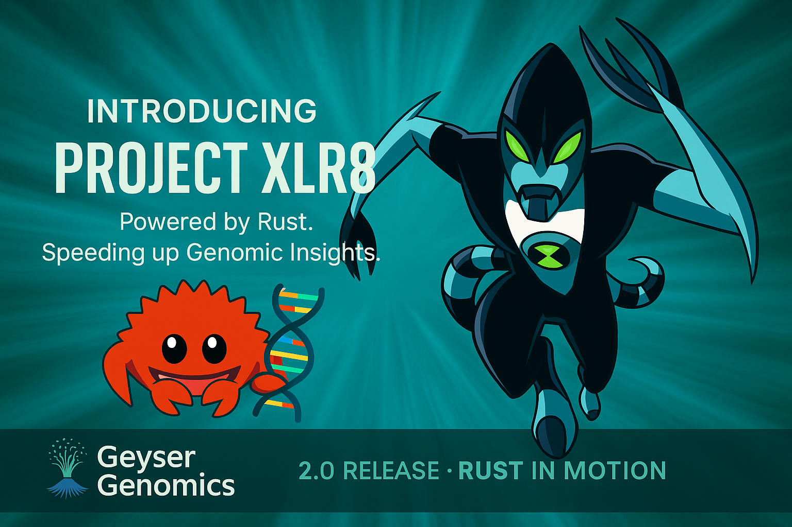
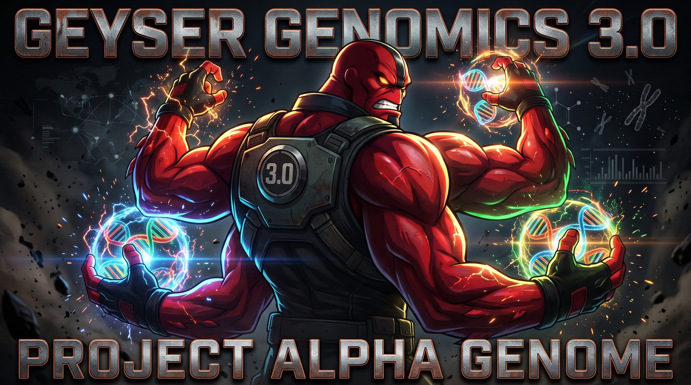

# 🛣️ Roadmap

✅ done · ☁️ done and verified in the cloud · 🚧 in progress · 🎯 top priority · 🔜 next

**Releases:** v0.3, v0.35, v0.4, v1.0, v1.1, v1.2, v1.3, v1.5, v2.0, v2.1 and v3.0 are tagged ([GitHub Releases](../../../releases), [release notes](releases/README.md)). v3.1 "Redesign" (the web UI: four themes, the erupting logo, helix progress, motion, 256 GiB uploads) is merged and not yet tagged.

### 1.0: the platform, made public

| | | |
| :---: | :--- | :--- |
| ✅ | **Offline pipeline** | Storage and metrics backends, Docker end-to-end truth check in CI |
| ☁️ | **Cost-safe networking and CI hardening** | NAT gateway off, budgets, OIDC with read-only Terraform roles, prod restricted to `main` |
| ☁️ | **Paired-end input, duplicate marking, run names** | R1/R2 pairing in the trigger, layout-aware stages, `samtools markdup`, runs named after the sample |
| ✅ | **DeepVariant and pangenome-aware DeepVariant (local GPU)** | hap.py on HG003 chr20 reproduces Google's published result; HG005 vs an HG003 control by GIAB region type |
| ✅ | **Web UI** | Works offline |
| ☁️ | **Resilience and sizing** | Infrastructure-only retries, time limits, per-stage sizes, 30-day log retention |
| ☁️ | **Terraform state per environment, guardrails for automation** | Bounded role with a permissions boundary and an automatic $20 kill switch |
| ☁️ | **Provenance and monitoring** | Run record per sample with the execution name; dashboard with result quality, data lake storage and stage durations; trigger alarm; per-stage CPU and memory use |
| ✅ | **Repository quality** | ruff, Terraform and Rust checks in CI, exact pins and Dependabot, CONTRIBUTING / SECURITY / CITATION |
| ✅ | **Public release** | Tagged [v1.0](../../../releases/tag/v1.0) on 4 Nov 2026, after the `main` ruleset (PRs and 7 checks required, no force-push or deletion), `prod` environment protection and private vulnerability reporting ([#47](../../../issues/47)) |

### 2.0 "XLR8": faster and cheaper

  

| | | |
| :---: | :--- | :--- |
| ☁️ | **Three stages, QC and alignment in parallel** | No decompressed intermediate; small-sample cloud run 1 min 52 s, down from 3 min 45 s |
| ☁️ | **Faster tools, less storage** | bwa-mem2 (align stage 1.56× faster on HG003 chr20) with its index stored (align job 45.7 s → 29.3 s); fastp; CRAM + indexes (real HG003 chr20 35x: 393 MB, about a third of the BAM) |
| ☁️ | **Faster starts, cheaper capacity** | Slim image (186 → 87 MB compressed, pulled by every job); Fargate Spot first with on-demand fallback; about $0.07 per real chr20 sample (30-35x) at on-demand prices |
| ☁️ | **Sharded variant calling** | Regions called in parallel by a `Map` state and merged exactly; for large samples, not small ones (it adds ~1.5 min of fixed overhead there) |
| ✅ | **Quality gate (Rust)** | Fails a run with named reasons; thresholds calibrated on HG003/HG005; DeepVariant stats over PASS calls |
| ✅ | **Variant consequences** | `bcftools csq` when the reference has gene models; shown in the web UI |
| ☁️ | **Quality gate in the pipeline** | Gate stage and verdict in the run record ([#148](../../../pull/148)), a state-machine step after either caller ([#162](../../../pull/162)), in fail mode since 3 Nov 2026 ([#195](../../../pull/195)). Six real chr20 runs, about 22 min and $0.07 each: 4 good samples pass, 2 under-covered ones fail on mean depth, as they should ([#157](../../../issues/157)). All 25 runs of the cost grid passed in fail mode ([#221](../../../pull/221)) |
| ☁️ | **Quality gate in fail mode** | Threshold profiles per run ([#178](../../../pull/178)), a `smoke` profile, `warn` → `fail` on 3 Nov 2026 ([#157](../../../issues/157), [#195](../../../pull/195)) |
| ☁️ | **DeepVariant in the cloud** | GPU environment in the public subnet, DeepVariant stage with bcftools fallback; 10/10 on a g6.xlarge for about $0.16 ([#125](../../../pull/125)) |
| 🔜 | **DeepVariant as the default caller** | The app treats DeepVariant's VCF as the sample's calls when it was the caller ([#170](../../../pull/170)); next, a real-size chr20 DeepVariant run before switching `default_caller` |

### After 2.0

| | | |
| :---: | :--- | :--- |
| 🎯 | **Pangenome: where it should help most** | Done offline on chr20: HG005's extra errors explained (MAPQ-0 reads), reads aligned to the graph (`vg giraffe`, fewest errors). Next: newer HPRC graph, whole genome, giraffe in the pipeline ([#51](../../../issues/51), [#146](../../../issues/146)). **Top priority** |
| 🔜 | **Pangenome-aware DeepVariant in the cloud** | Same GPU environment as cloud DeepVariant, plus shared memory for the graph |
| ☁️ | **Whole genomes in the cloud** | v1.3: HG003 30x in 2 h 59 min; v2.0: DeepVariant split on the GPU, SNP / indel errors −57% / −90% against bcftools |
| 🔜 | **Spot for the GPU queue** | A Spot environment ahead of on-demand, as for Fargate |

### 3.0 "Project Alpha Genome": done

  

Tagged 9 Nov 2026. An optional, never-fatal Annotate step scores a run's variants of interest with
[AlphaGenome](https://deepmind.google/science/alphagenome/) (Google DeepMind's model of how DNA sequence controls
gene regulation) and shows them on the run's page, for research use only. With a pre-registered evaluation
([the pre-registration](prereg/rp1-alphagenome.md)). See the [v3.0 notes](releases/v3.0.md).

### 3.1 "Redesign": merged, not yet tagged

The web UI and hosted site rebuilt in a Google-style look: four themes (light, dark, retro, high contrast at
WCAG AAA), the erupting Geyser logo, one progress helix across the stages, decorative DeepVariant and AlphaGenome
motion, rainbow (Turbo) figures with a 2D/3D toggle, and uploads up to 256 GiB per file, all inside the Lighthouse
budgets ([#269](../../../pull/269), [#271](../../../pull/271), [#274](../../../pull/274), [#276](../../../pull/276), [#281](../../../pull/281)).

---

[← Back to the README](../README.md)

<!-- probe for #286, not to merge -->
