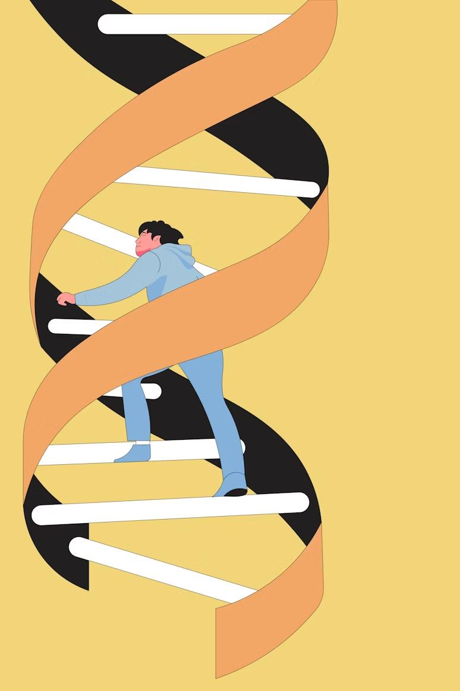

# The Odyssey: why this project exists

This project was born from a profound, life-changing journey through the world of genomic medicine. It is a tribute to the pioneering work of NHS England and its **100,000 Genomes Project**.

> The NHS 100,000 Genomes Project is a landmark UK initiative aimed at sequencing the complete genetic codes of patients with rare diseases and their families. By creating this massive dataset, it seeks to uncover new diagnoses and pave the way for personalized medicine.

For eighteen years, my life was an odyssey through a fog of medical uncertainty with no linking diagnosis. As part of the project, my mother, my father, and I all donated our blood. Our entire genomes would be sequenced and explored, becoming three more data points in a vast ocean of information. We were told it was unlikely we would hear anything back.

A year later, against all odds, I received a result. The project had delivered a link. In the three billion letters of my genetic code, they had found a single, ultra-rare mutation in the **COA3 gene**, causing a mitochondrial defect.

The statistical probability of this discovery is staggering: for both parents to carry the same rare recessive fault *and* pass it on to their child is roughly **1 in 256 million**.

### The 1 in 256 million chance

This isn't a random number; it's grounded in a core concept of population genetics known as the **Hardy-Weinberg principle**, the standard way to estimate how common a genetic variant is in a population:

$$ p^2 + 2pq + q^2 = 1 $$

Here `q` is the frequency of the faulty version of the gene, `p` the frequency of the working one, and `2pq` the chance that a person is a carrier: one faulty copy, no symptoms (like my parents). The estimate then takes two steps:

1. **🧑‍🤝‍🧑 Both parents are carriers.** The estimated chance of one person being a carrier (`2pq`) is **1 in 8,000**, so the chance that two people are both carriers is

   
<code>(1 / 8,000) × (1 / 8,000) = 1 / 64,000,000</code>

2. **👶 Both pass it on.** Each carrier parent passes the faulty copy to a child half the time, so a child of two carriers inherits two faulty copies, and is affected, **1 time in 4**:

   
<code>1 / 64,000,000 × 1 / 4 = 1 / 256,000,000</code>

So about **1 in 64 million** for two people to both carry it, and about **1 in 256 million** for both to carry it and pass it on. (A simplification: it treats the parents as unrelated and the carrier frequency as one population-wide figure.)

My donated genome will now serve as a data point to help others, ensuring that a single-letter fault doesn't define another patient's life. My odyssey of discovery took two decades, but it doesn't need to be that way for others. With technologies like Geyser Genomics, we can accelerate these discoveries and build solutions that may one day repair the very code of life itself.

  
   <em>We can help each other, by looking within ourselves, to build a better future</em>

---

## 🤔 The Challenge: From a DNA Sample to an Answer

Analyzing genomes is incredibly difficult. Scientists face three major hurdles:

*    **The Data Deluge:** A single human genome can be over 100 gigabytes. Analyzing hundreds requires a staggering amount of storage and power.
*    **The Complex Recipe:** The analysis involves dozens of specialized scientific tools, each needing to be run in a specific order with precise parameters. One mistake can invalidate the results.
*    **The Hardware Hurdle:** This work traditionally requires buying and maintaining powerful, expensive server clusters that are difficult to manage and often sit idle.

---

[← Back to the README](../README.md)
